# Calculation Problems — Exam Questions (GCSE Maths · Edexcel · Grade 2)

Topic code `2.1` · slug `grade-2-2-1-calculation-problems` · source sheet sha256 `8d05a793257a1729…`

## Q1 (marks not printed · parts a, b)

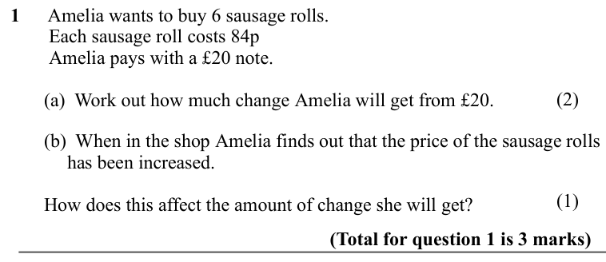

Text (lossy): 1      Amelia wants to buy 6 sausage rolls.  /         Each sausage roll costs 84p /         Amelia pays with a £20 note.   / (2) /        (a)  Work out how much change Amelia will get from £20.  /                     /        (b)  When in the shop Amelia finds out that the price of the sausage rolls / has been increased.  / (1) /        How does this affect the amount of change she will get? /   

## Q2 (marks not printed)

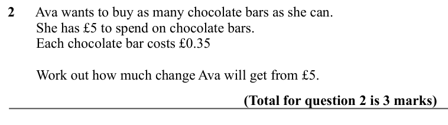

Text (lossy): 2      Ava wants to buy as many chocolate bars as she can. /         She has £5 to spend on chocolate bars.  /         Each chocolate bar costs £0.35  /         Work out how much change Ava will get from £5.  /                     / (Total for question 2 is 3 marks)

## Q3 (marks not printed · parts a, b)

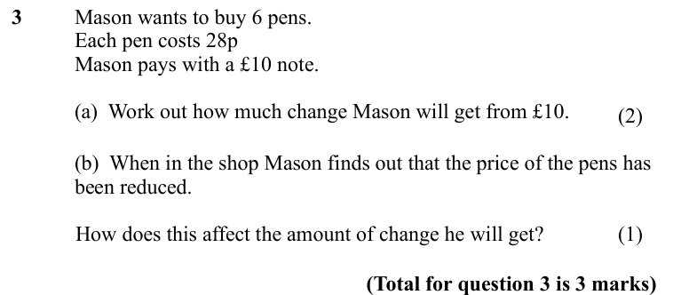

Text (lossy): 3       / Mason wants to buy 6 pens.  /          / Each pen costs 28p /          / Mason pays with a £10 note.   /          / (a)  Work out how much change Mason will get from £10.                   / (2) /         / (b)  When in the shop Mason finds out that the price of the pens has  / been reduced.  / (1) /             How does this affect the amount of change he will get? /                    

## Q4 (marks not printed)

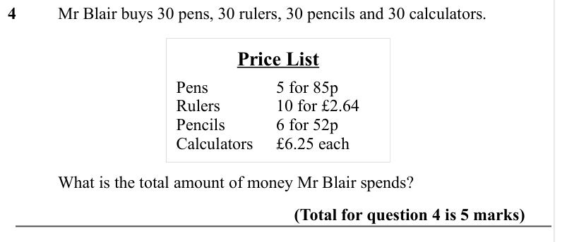

Text (lossy): 4       / Mr Blair buys 30 pens, 30 rulers, 30 pencils and 30 calculators. / Price List / Pens / 5 for 85p  / Rulers  / 10 for £2.64 / Pencils  / 6 for 52p / Calculators  / £6.25 each /        / What is the total amount of money Mr Blair spends? /                     / (Total for question 4 is 5 marks)

## Q5 (marks not printed)

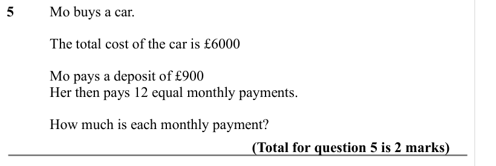

Text (lossy): 5    / Mo buys a car.  / The total cost of the car is £6000 / Mo pays a deposit of £900 / Her then pays 12 equal monthly payments. / How much is each monthly payment? /                     / (Total for question 5 is 2 marks)

## Q6 (marks not printed)

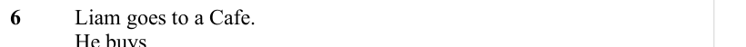

Text (lossy): 6      / Liam goes to a Cafe.  /          / He buys

## Q7 (marks not printed)

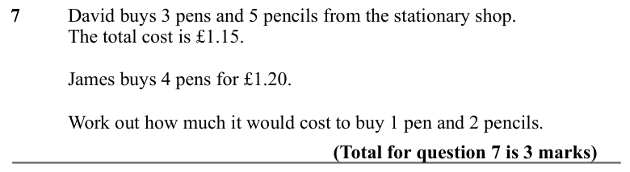

Text (lossy): 7      / David buys 3 pens and 5 pencils from the stationary shop.  /         / The total cost is £1.15. /        / James buys 4 pens for £1.20. /   / Work out how much it would cost to buy 1 pen and 2 pencils. /        / (Total for question 7 is 3 marks)

## Q8 (marks not printed)

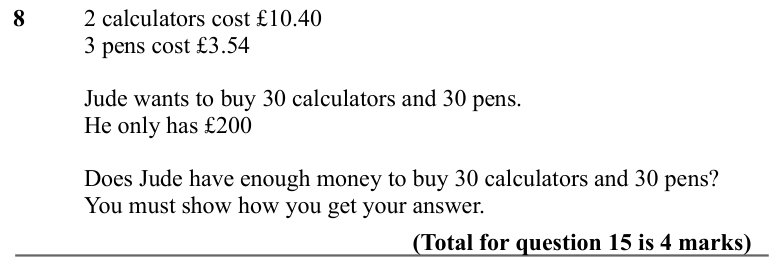

Text (lossy): 8   / 2 calculators cost £10.40 /      / 3 pens cost £3.54 /   / Jude wants to buy 30 calculators and 30 pens. /   / He only has £200 /   / Does Jude have enough money to buy 30 calculators and 30 pens? / You must show how you get your answer. /        / (Total for question 15 is 4 marks)

## Q9 (marks not printed)

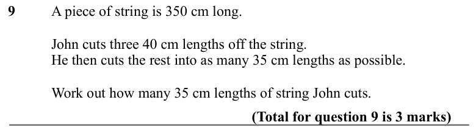

Text (lossy): 9       / A piece of string is 350 cm long.  /         / John cuts three 40 cm lengths off the string. /         / He then cuts the rest into as many 35 cm lengths as possible. /         / Work out how many 35 cm lengths of string John cuts.                  / (Total for question 9 is 3 marks)

## Q10 (marks not printed)

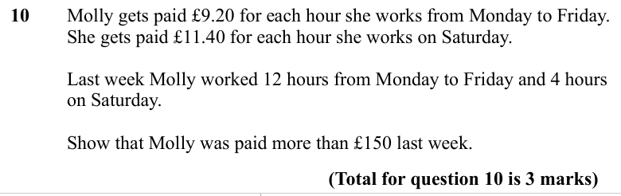

Text (lossy): 10     / Molly gets paid £9.20 for each hour she works from Monday to Friday.  /          / She gets paid £11.40 for each hour she works on Saturday.  /   /          / Last week Molly worked 12 hours from Monday to Friday and 4 hours  / on Saturday. /          / Show that Molly was paid more than £150 last week.   /      /                     / (Total for question 10 is 3 marks)

## Q11 (marks not printed)

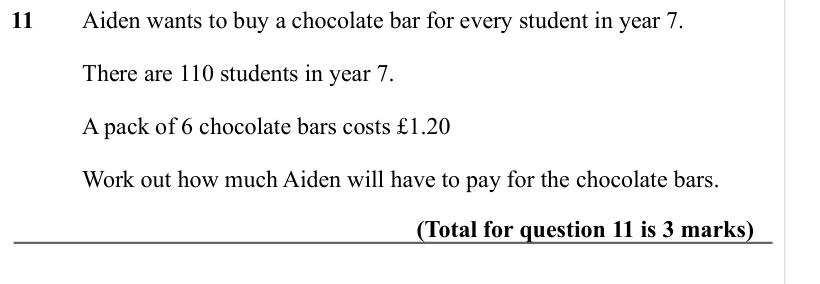

Text (lossy): 11     Aiden wants to buy a chocolate bar for every student in year 7.  /          / There are 110 students in year 7.  /          / A pack of 6 chocolate bars costs £1.20  /          / Work out how much Aiden will have to pay for the chocolate bars.  /                     / (Total for question 11 is 3 marks)

## Q12 (marks not printed)

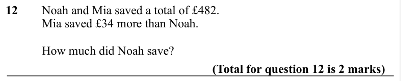

Text (lossy): 12     Noah and Mia saved a total of £482.  /          / Mia saved £34 more than Noah.  /          / How much did Noah save? /             (Total for question 12 is 2 marks)

## Q13 (marks not printed)

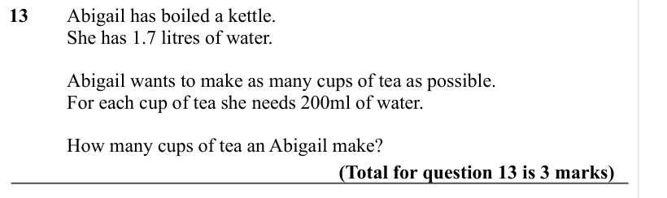

Text (lossy): 13      Abigail has boiled a kettle.  /          / She has 1.7 litres of water.  /          / Abigail wants to make as many cups of tea as possible.  /     / For each cup of tea she needs 200ml of water.  /          / How many cups of tea an Abigail make? /                     / (Total for question 13 is 3 marks)

## Q14 (marks not printed)

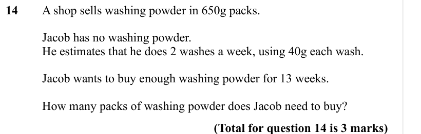

Text (lossy): 14      A shop sells washing powder in 650g packs.  /          /          / Jacob has no washing powder.  /          / He estimates that he does 2 washes a week, using 40g each wash.   /          / Jacob wants to buy enough washing powder for 13 weeks.  /         / How many packs of washing powder does Jacob need to buy? /                     / (Total for question 14 is 3 marks)

