# Angles — Exam Questions (GCSE Maths · Edexcel · Grade 2)

Topic code `2.10` · slug `grade-2-2-10-angles` · source sheet sha256 `a403cf93c2ceded0…`

## Q1 (marks not printed · parts a, b)

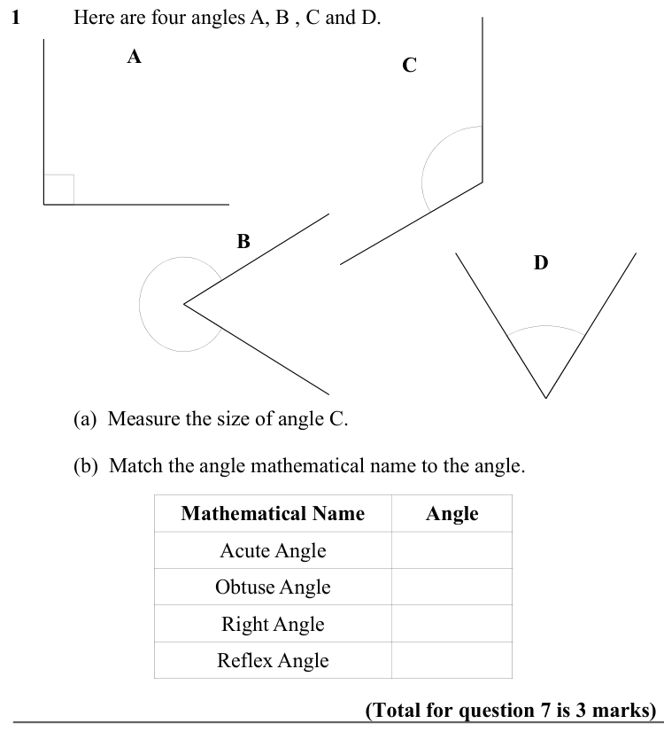

Text (lossy): 1  / Here are four angles A, B , C and D. / A / C / B / D / (a)  Measure the size of angle C.  / (b)  Match the angle mathematical name to the angle.  / Mathematical Name / Angle / Acute Angle / Obtuse Angle / Right Angle / Reflex Angle / (Total for question 7 is 3 marks)

## Q2 (marks not printed)

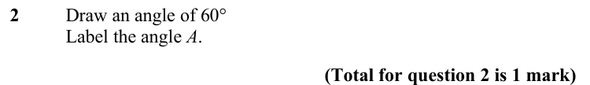

Text (lossy): 2  / Draw an angle of 60° / Label the angle A.  / (Total for question 2 is 1 mark)

## Q3 (marks not printed)

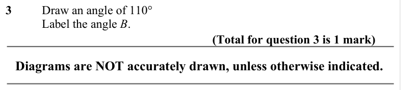

Text (lossy): 3  / Draw an angle of 110° / Label the angle B.  / (Total for question 3 is 1 mark) / Diagrams are NOT accurately drawn, unless otherwise indicated.

## Q4 (marks not printed)

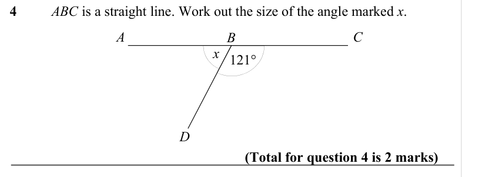

Text (lossy): 4  / ABC is a straight line. Work out the size of the angle marked x.  / A / C / B / x 121° / D / (Total for question 4 is 2 marks)

## Q5 (marks not printed)

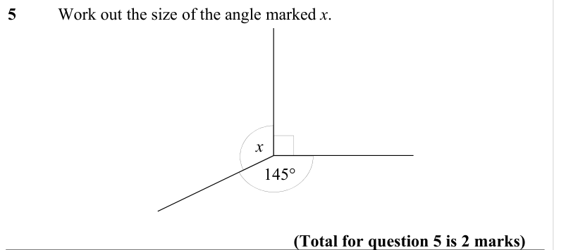

Text (lossy): 5  / Work out the size of the angle marked x.  / x / 145° / (Total for question 5 is 2 marks)

## Q6 (marks not printed)

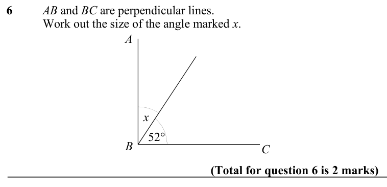

Text (lossy): 6  / AB and BC are perpendicular lines.  / Work out the size of the angle marked x.  / A / x / 52° / C / B / (Total for question 6 is 2 marks)

## Q7 (marks not printed)

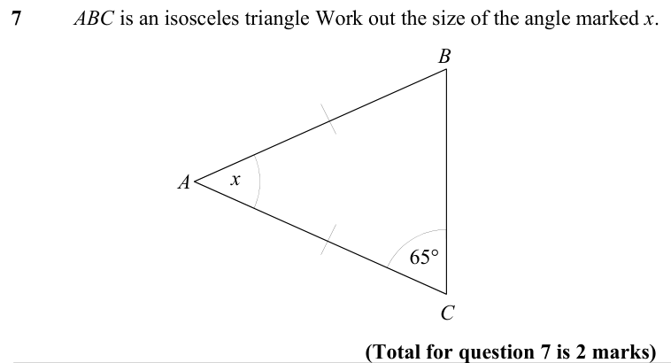

Text (lossy): 7  / ABC is an isosceles triangle Work out the size of the angle marked x.  / B / x / A / 65° / C / (Total for question 7 is 2 marks)

## Q8 (marks not printed · parts a, b)

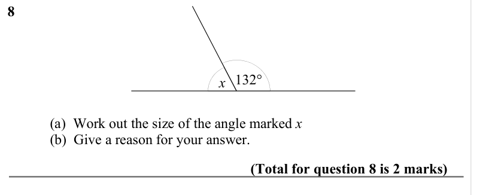

Text (lossy): 8 / x 132° / (a)  Work out the size of the angle marked x / (b)  Give a reason for your answer.  / (Total for question 8 is 2 marks)

## Q9 (marks not printed · parts a, b, c)

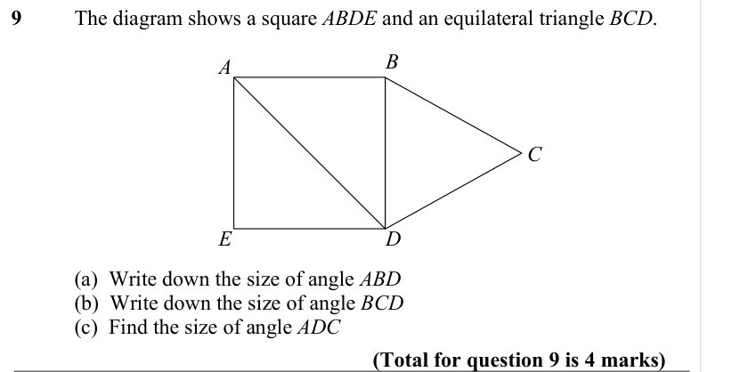

Text (lossy): 9  / The diagram shows a square ABDE and an equilateral triangle BCD.  / B / A / C / D / E / (a)  Write down the size of angle ABD / (b)  Write down the size of angle BCD / (c)  Find the size of angle ADC / (Total for question 9 is 4 marks)

## Q10 (marks not printed · parts a, b)

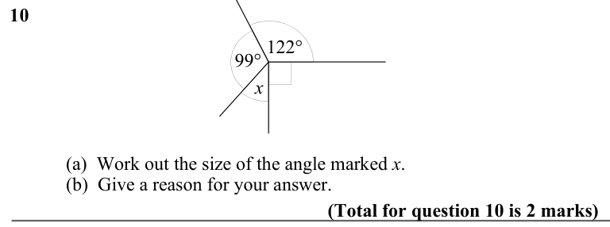

Text (lossy): 10  / 122° / 99° / x / (a)  Work out the size of the angle marked x.  / (b)  Give a reason for your answer.  / (Total for question 10 is 2 marks)

## Q11 (marks not printed · parts a, b)

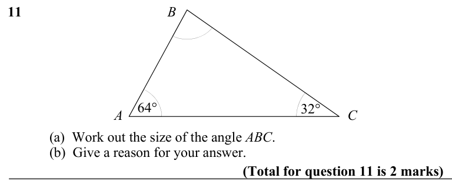

Text (lossy): 11 / B / 32° / 64° / A / C / (a)  Work out the size of the angle ABC. / (b)  Give a reason for your answer.  / (Total for question 11 is 2 marks)

## Q12 (marks not printed)

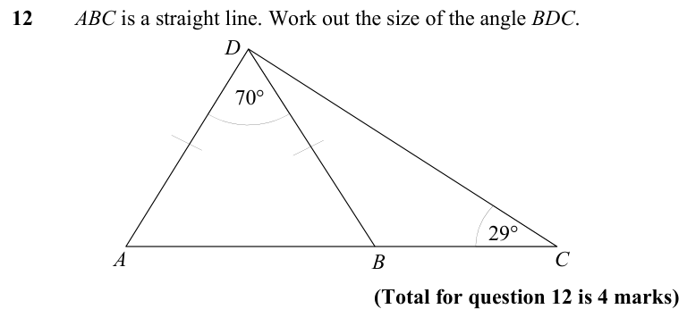

Text (lossy): 12  / ABC is a straight line. Work out the size of the angle BDC.  / D / 70° / 29° / A / C / B / (Total for question 12 is 4 marks)

## Q13 (marks not printed · parts a, b, c)

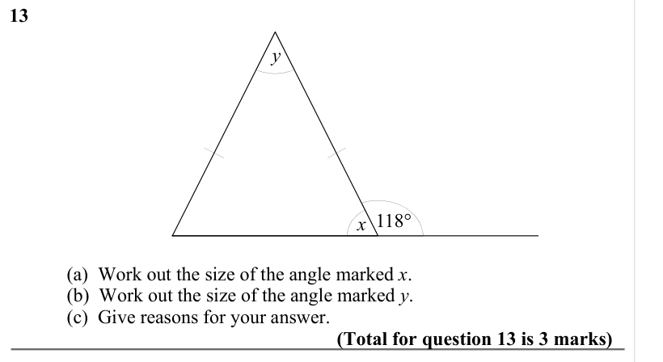

Text (lossy): 13 / y / 118° / x / (a)  Work out the size of the angle marked x.  / (b)  Work out the size of the angle marked y. / (c)  Give reasons for your answer.  / (Total for question 13 is 3 marks)

## Q14 (marks not printed)

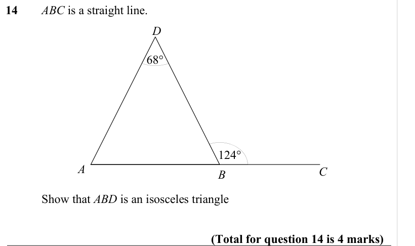

Text (lossy): 14  / ABC is a straight line.  / D / 68° / 124° / A / C / B / Show that ABD is an isosceles triangle  / (Total for question 14 is 4 marks)

