# Area and Perimeter — Exam Questions (GCSE Maths · Edexcel · Grade 2)

Topic code `2.11` · slug `grade-2-2-11-area-and-perimeter` · source sheet sha256 `00a5abafa044a0c8…`

## Q1 (3 marks · parts a, b, c)

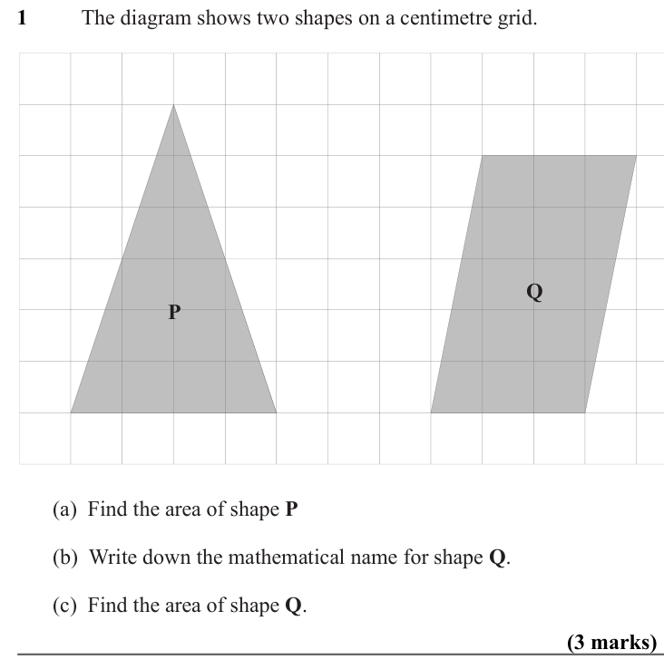

Text (lossy): 1      / The diagram shows two shapes on a centimetre grid.  / Q / P / (a)  Find the area of shape P / (b)  Write down the mathematical name for shape Q. /   / (c)  Find the area of shape Q.  / (3 marks)

## Q2 (2 marks)

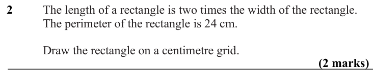

Text (lossy): 2      / The length of a rectangle is two times the width of the rectangle.  / The perimeter of the rectangle is 24 cm. / Draw the rectangle on a centimetre grid.  / (2 marks)

## Q3 (2 marks)

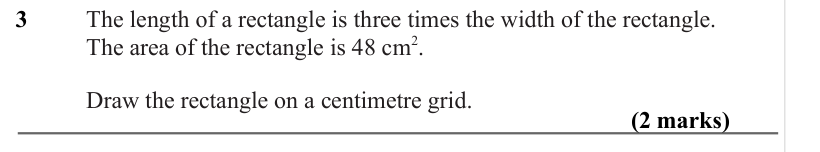

Text (lossy): 3      / The length of a rectangle is three times the width of the rectangle.  / The area of the rectangle is 48 cm 2.  / Draw the rectangle on a centimetre grid.  / (2 marks)

## Q4 (2 marks)

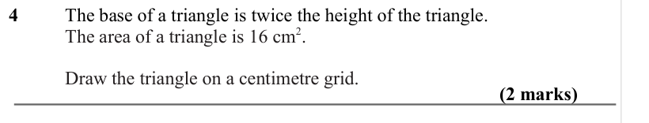

Text (lossy): 4      / The base of a triangle is twice the height of the triangle.  / The area of a triangle is 16 cm 2. / Draw the triangle on a centimetre grid.  / (2 marks)

## Q5 (2 marks)

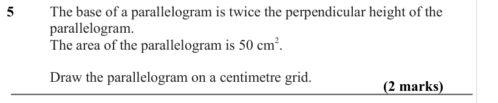

Text (lossy): 5      / The base of a parallelogram is twice the perpendicular height of the  / parallelogram.  / The area of the parallelogram is 50 cm 2.  / Draw the parallelogram on a centimetre grid.  / (2 marks)

## Q6 (marks not printed)

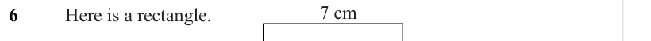

Text (lossy): 7 cm / 6      / Here is a rectangle.

## Q7 (marks not printed)

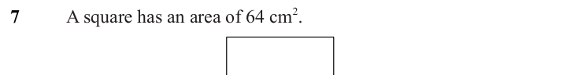

Text (lossy): 7      / A square has an area of 64 cm 2.

## Q8 (2 marks)

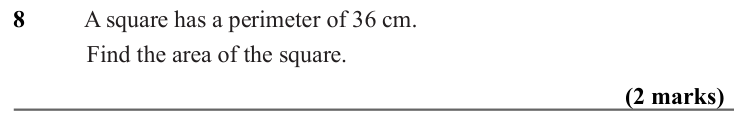

Text (lossy): 8      / A square has a perimeter of 36 cm.  / Find the area of the square.  / (2 marks)

## Q9 (marks not printed)

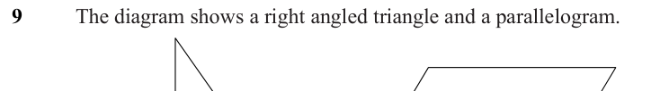

Text (lossy): 9      / The diagram shows a right angled triangle and a parallelogram.

## Q10 (marks not printed)

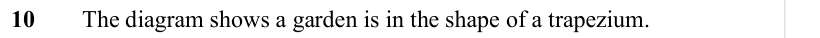

Text (lossy): 10     The diagram shows a garden is in the shape of a trapezium.

## Q11 (2 marks)

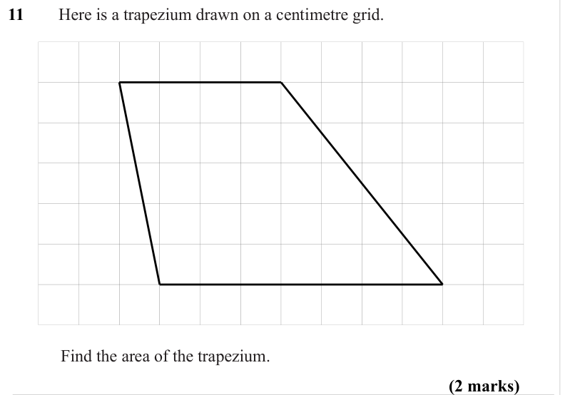

Text (lossy): 11     Here is a trapezium drawn on a centimetre grid. / Find the area of the trapezium. / (2 marks)

## Q12 (marks not printed)

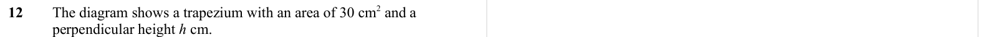

Text (lossy): 12     The diagram shows a trapezium with an area of 30 cm 2 and a  / perpendicular height h cm.

## Q13 (marks not printed)

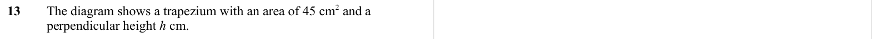

Text (lossy): 13     The diagram shows a trapezium with an area of 45 cm 2 and a  / perpendicular height h cm.

