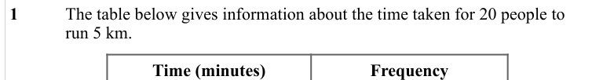
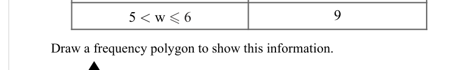
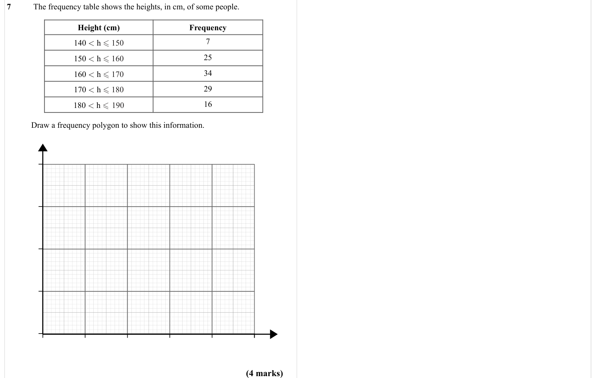

# Frequency Polygons — Exam Questions (GCSE Maths · Edexcel · Grade 2)

Topic code `2.13` · slug `grade-2-2-13-frequency-polygons` · source sheet sha256 `ba61f6604c86272d…`

## Q1 (marks not printed)

Text (lossy): 1 / The table below gives information about the time taken for 20 people to  / run 5 km.   / Time (minutes) / Frequency

## Q2 (marks not printed)

Text (lossy): 2

## Q3 (marks not printed)

Text (lossy): 3 / The frequency table shows the weight, in kg, of some cats. / Weight (kg) / Frequency

## Q4 (marks not printed)

Text (lossy): 4 < w  5 / 13

## Q5 (marks not printed)

Text (lossy): 5 < w  6 / 9 /       / Draw a frequency polygon to show this information.

## Q6 (marks not printed)

Text (lossy): 6 / The frequency table shows the temperature, in degrees, of 30 days.   / Temperature (°C) / Frequency

## Q7 (4 marks)

Text (lossy): 7 / The frequency table shows the heights, in cm, of some people.  / Height (cm) / Frequency / 140 < h  150 / 7 / 150 < h  160 / 25 / 160 < h  170 / 34 / 170 < h  180 / 29 / 180 < h  190 / 16 /       / Draw a frequency polygon to show this information. / (4 marks)

