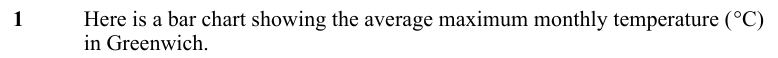
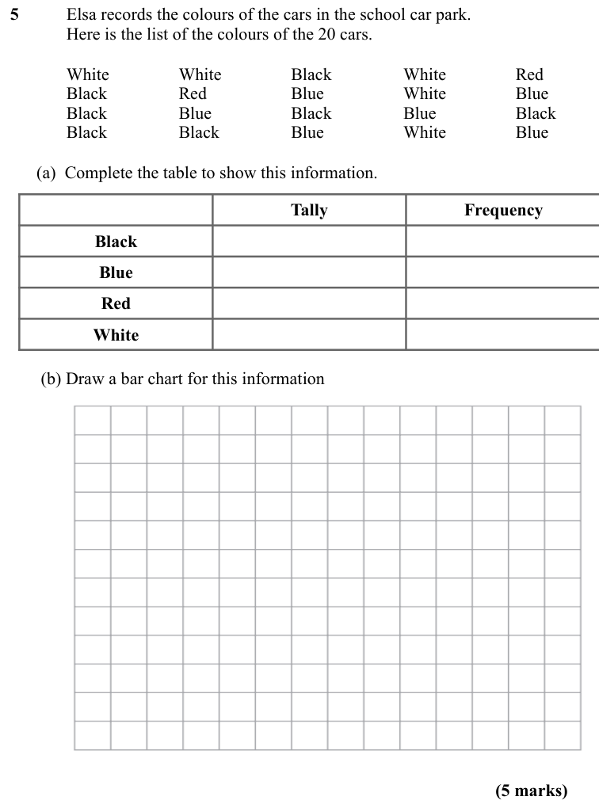
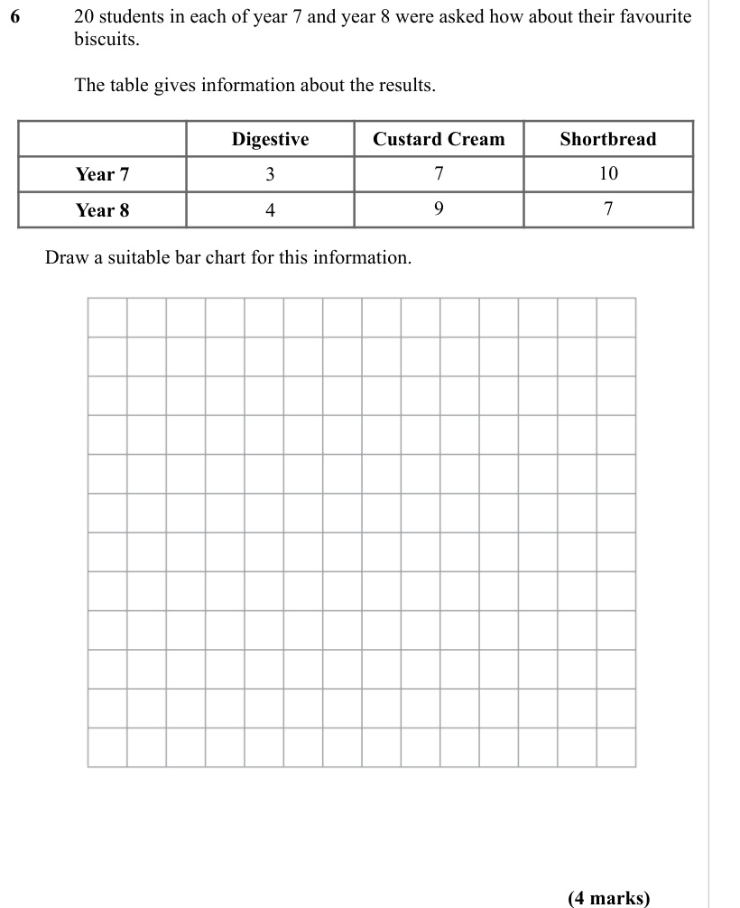
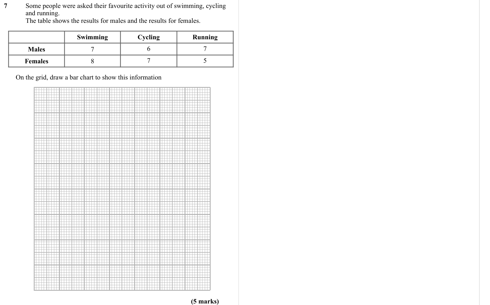

# Bar Charts — Exam Questions (GCSE Maths · Edexcel · Grade 2)

Topic code `2.15` · slug `grade-2-2-15-bar-charts` · source sheet sha256 `8d63bcc1a2f5e996…`

## Q1 (marks not printed)

Text (lossy): 1     / Here is a bar chart showing the average maximum monthly temperature (°C)  / in Greenwich.

## Q2 (marks not printed)

Text (lossy): 2

## Q3 (marks not printed)

Text (lossy): 3 / Rose

## Q4 (marks not printed)

Text (lossy): 4

## Q5 (5 marks · parts a, b)

Text (lossy): 5      / Elsa records the colours of the cars in the school car park.  / Here is the list of the colours of the 20 cars.  / White / White / Black / White / Red / Black / Red / Blue / White / Blue / Black / Blue / Black / Blue / Black / Black / Black / Blue / White / Blue /       (a)  Complete the table to show this information.  /         / Tally / Frequency / Black / Blue / Red / White /        (

## Q6 (4 marks)

Text (lossy): 6      / 20 students in each of year 7 and year 8 were asked how about their favourite  / biscuits.  /         / The table gives information about the results.  / Digestive / Custard Cream / Shortbread / Year 7 / 3 / 7 / 10 / Year 8 / 4 / 9 / 7 /        Draw a suitable bar chart for this information. / (4 marks)

## Q7 (5 marks)

Text (lossy): 7     / Some people were asked their favourite activity out of swimming, cycling  / and running. / The table shows the results for males and the results for females.  / Swimming / Cycling / Running / Males / 7 / 6 / 7 / Females / 8 / 7 / 5 /        On the grid, draw a bar chart to show this information / (5 marks)

