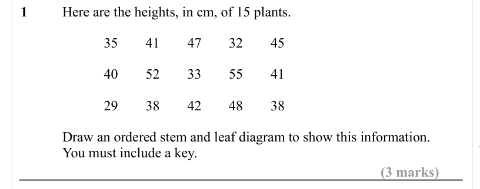
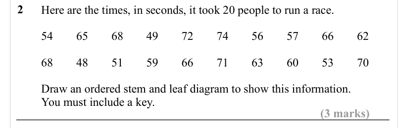
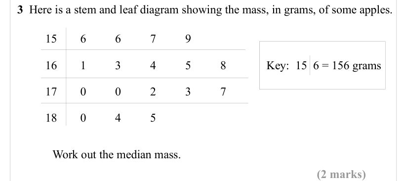
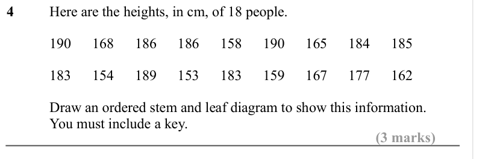
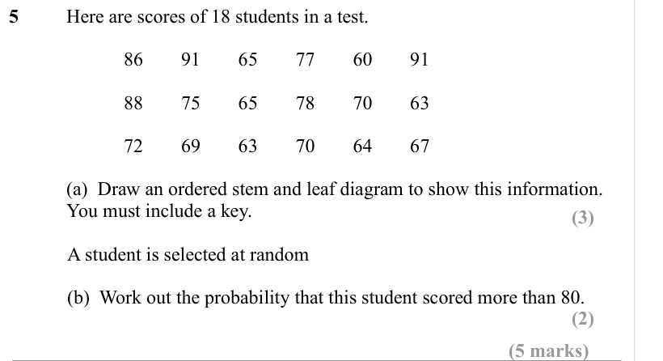
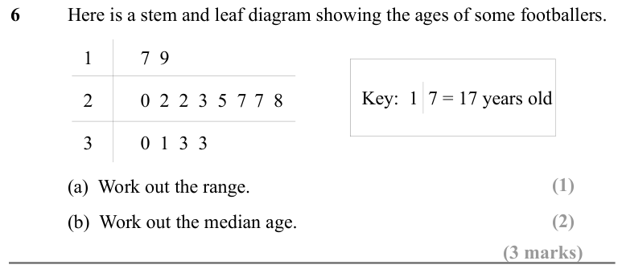
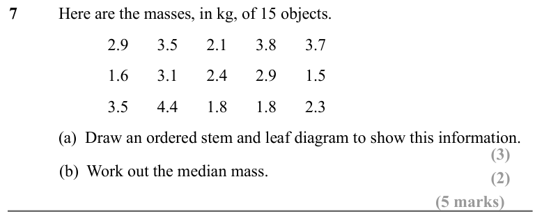
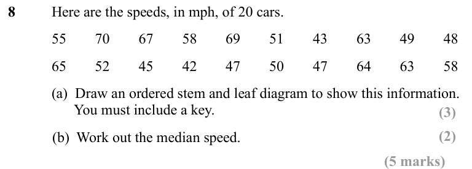
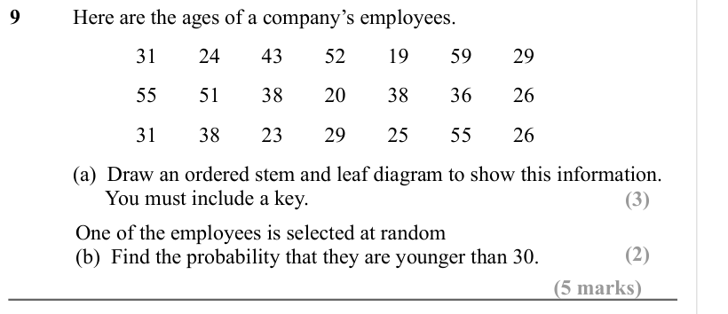
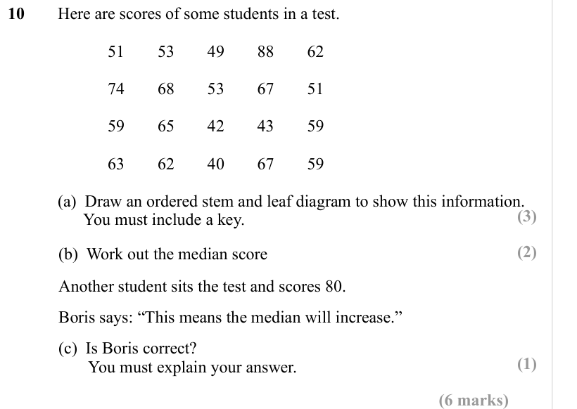

# Stem and Leaf — Exam Questions (GCSE Maths · Edexcel · Grade 2)

Topic code `2.16` · slug `grade-2-2-16-stem-and-leaf` · source sheet sha256 `6cf8436adcab3fd8…`

## Q1 (3 marks)

Text (lossy): 1      / Here are the heights, in cm, of 15 plants. / 35 / 41 / 47 / 32 / 45 / 40 / 52 / 33 / 55 / 41 / 29 / 38 / 42 / 48 / 38 / Draw an ordered stem and leaf diagram to show this information. / You must include a key.   / (3 marks)

## Q2 (3 marks)

Text (lossy): 2 /       / Here are the times, in seconds, it took 20 people to run a race. / 54 / 65 / 68 / 49 / 72 / 74 / 56 / 57 / 66 / 62 / 68 / 48 / 51 / 59  / 66 / 71 / 63 / 60 / 53 / 70 / Draw an ordered stem and leaf diagram to show this information.  / You must include a key.   / (3 marks)

## Q3 (2 marks)

Text (lossy): 3  Here is a stem and leaf diagram showing the mass, in grams, of some apples.   / 15 / 6 / 6 / 7 / 9 / 16 / 1 / 3 / 4 / 5 / 8 / Key:  15  6 = 156 grams / 17 / 0 / 0 / 2 / 3 / 7 / 18 / 0 / 4 / 5 / Work out the median mass.  / (2 marks)

## Q4 (3 marks)

Text (lossy): 4      / Here are the heights, in cm, of 18 people.  / 190 / 168 / 186 / 186 / 158 / 190 / 165 / 184 / 185 / 183 / 154 / 189 / 153  / 183 / 159 / 167 / 177 / 162 / Draw an ordered stem and leaf diagram to show this information.  / You must include a key.   / (3 marks)

## Q5 (5 marks · parts a, b)

Text (lossy): 5      / Here are scores of 18 students in a test.  / 86 / 91 / 65 / 77 / 60 / 91 / 88 / 75 / 65 / 78 / 70 / 63 / 72 / 69 / 63 / 70 / 64 / 67 / (a)  Draw an ordered stem and leaf diagram to show this information.  / You must include a key.   / (3) / A student is selected at random / (b)  Work out the probability that this student scored more than 80.   / (2) / (5 marks)

## Q6 (3 marks · parts a, b)

Text (lossy): 6      / Here is a stem and leaf diagram showing the ages of some footballers.  / 1 / 7  9 / Key:  1  7 = 17 years old / 2 / 0  2  2  3  5  7 7  8 / 3 / 0  1  3  3 / (1) / (a)  Work out the range.  / (2) / (b)  Work out the median age.  / (3 marks)

## Q7 (5 marks · parts a, b)

Text (lossy): 7      / Here are the masses, in kg, of 15 objects. / 2.9 / 3.5 / 2.1 / 3.8 / 3.7 / 1.6 / 3.1 / 2.4 / 2.9 / 1.5 / 3.5 / 4.4 / 1.8 / 1.8 / 2.3 / (a)  Draw an ordered stem and leaf diagram to show this information.  / (b)  Work out the median mass.  / (2) / (3) / (5 marks)

## Q8 (5 marks · parts a, b)

Text (lossy): 8      / Here are the speeds, in mph, of 20 cars. / 55 / 70 / 67 / 58 / 69 / 51 / 43 / 63 / 49 / 48 / 65 / 52 / 45 / 42 / 47 / 50  / 47 / 64 / 63 / 58 / (a)  Draw an ordered stem and leaf diagram to show this information. /       You must include a key.   / (3) / (b)  Work out the median speed.  / (2) / (5 marks)

## Q9 (5 marks · parts a, b)

Text (lossy): 9      / Here are the ages of a company’s employees.  / 31 / 24 / 43 / 52 / 19 / 59 / 29 / 55 / 51 / 38 / 20 / 38 / 36  / 26 / 31 / 38 / 23 / 29 / 25 / 55  / 26 / (a)  Draw an ordered stem and leaf diagram to show this information. /       You must include a key.   / (3) / One of the employees is selected at random / (b)  Find the probability that they are younger than 30. / (2) / (5 marks)

## Q10 (6 marks · parts a, b, c)

Text (lossy): 10     Here are scores of some students in a test. / 51 / 53 / 49 / 88 / 62 / 74 / 68 / 53 / 67 / 51 / 59 / 65  / 42 / 43 / 59 / 63 / 62 / 40 / 67 / 59 / (a)  Draw an ordered stem and leaf diagram to show this information. /       You must include a key.   / (3) / (2) / (b)  Work out the median score / Another student sits the test and scores 80. / Boris says: “This means the median will increase.

