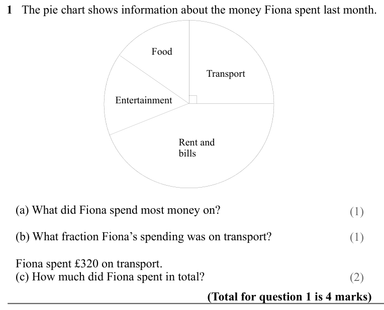
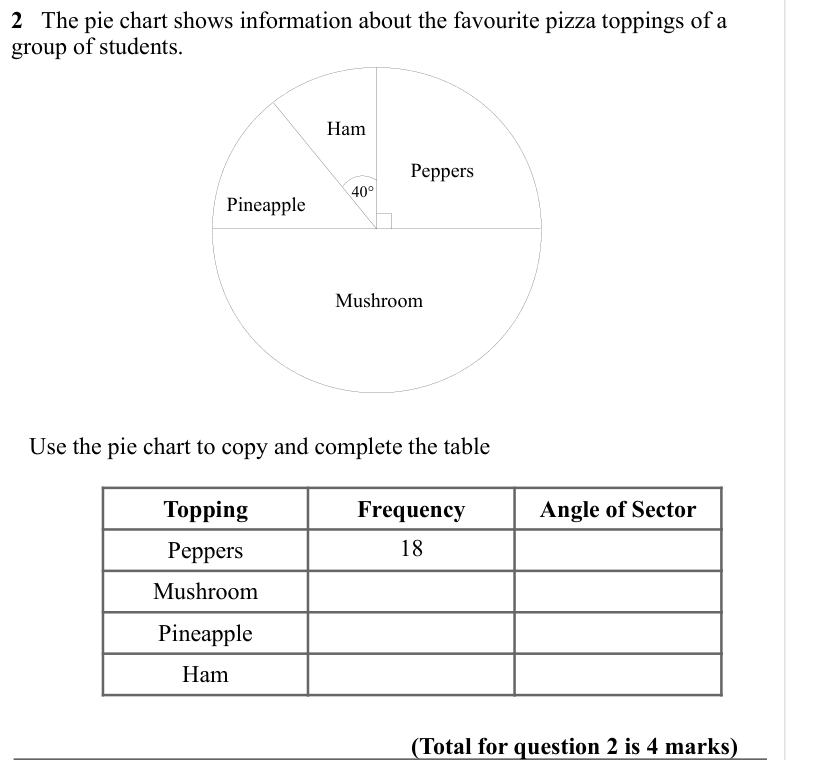
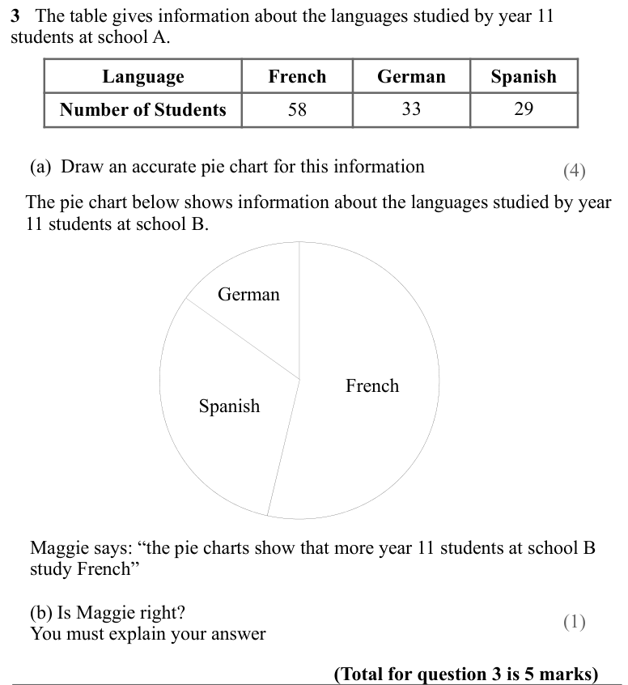
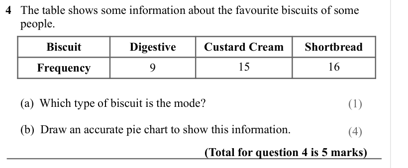
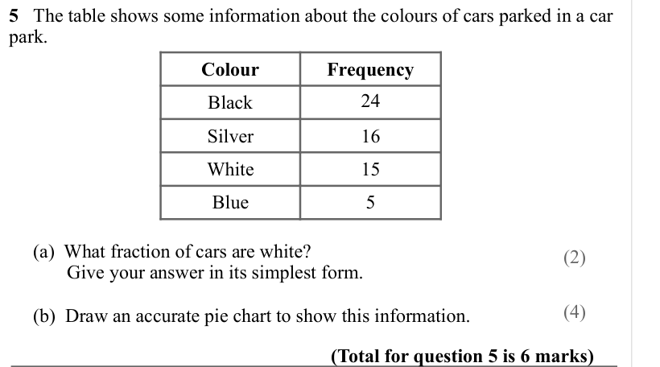
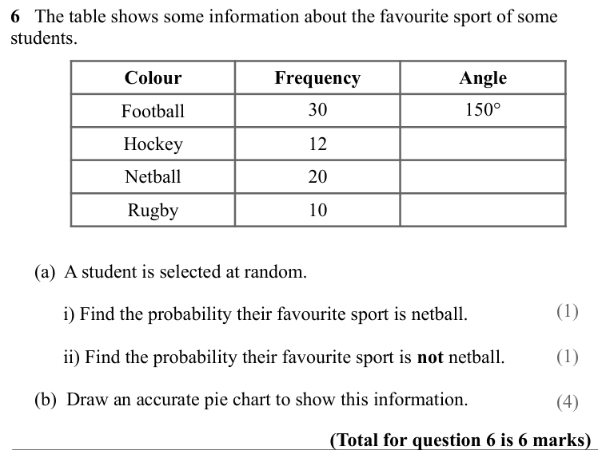
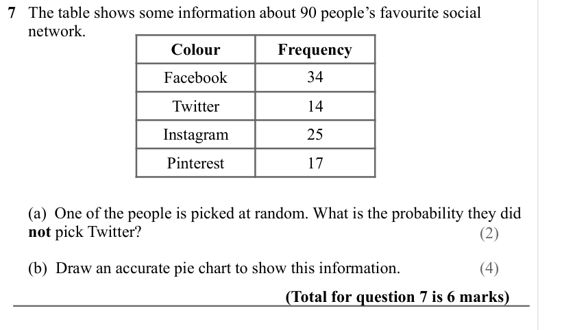
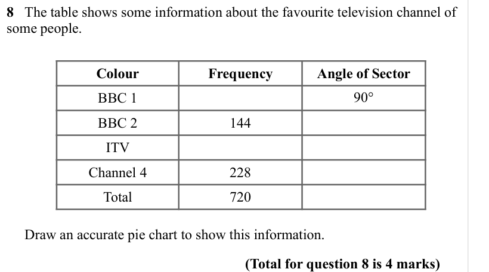

# Pie Charts — Exam Questions (GCSE Maths · Edexcel · Grade 2)

Topic code `2.17` · slug `grade-2-2-17-pie-charts` · source sheet sha256 `bbdef4bf9f217c82…`

## Q1 (marks not printed · parts a, b, c)

Text (lossy): 1   The pie chart shows information about the money Fiona spent last month.  / Food / Transport / Entertainment / Rent and  / bills /    (a) What did Fiona spend most money on? / (1) /    (b) What fraction Fiona’s spending was on transport? / (1) /    Fiona spent £320 on transport.  /    (c) How much did Fiona spent in total?  /       /   / (2) / (Total for question 1 is 4 marks)

## Q2 (marks not printed)

Text (lossy): 2   The pie chart shows information about the favourite pizza toppings of a  / group of students.  / Ham / Peppers / 40° / Pineapple / Mushroom /    Use the pie chart to copy and complete the table  /       /   / Topping / Frequency / Angle of Sector / Peppers / 18 / Mushroom / Pineapple / Ham / (Total for question 2 is 4 marks)

## Q3 (marks not printed · parts a, b)

Text (lossy): 3   The table gives information about the languages studied by year 11  / students at school A. / Language / French / German / Spanish / Number of Students / 58 / 33 / 29 /     (a)  Draw an accurate pie chart for this information / (4) /    The pie chart below shows information about the languages studied by year   /    11 students at school B.  / German / French / Spanish /     Maggie says: “the 

## Q4 (marks not printed · parts a, b)

Text (lossy): 4   The table shows some information about the favourite biscuits of some          /      people. / Biscuit / Digestive / Custard Cream / Shortbread /   /       /       /        /      (a)  Which type of biscuit is the mode? / Frequency / 9 / 15 / 16 / (1) /      (b)  Draw an accurate pie chart to show this information.  / (4) / (Total for question 4 is 5 marks)

## Q5 (marks not printed · parts a, b)

Text (lossy): 5   The table shows some information about the colours of cars parked in a car  / park.  /       /       /        / Colour / Frequency / Black / 24 / Silver / 16 / White / 15 / Blue / 5 /      (a)  What fraction of cars are white? /             Give your answer in its simplest form.  / (2) / (4) /      (b)  Draw an accurate pie chart to show this information.  / (Total for question 5 is 6 marks)

## Q6 (marks not printed · parts a, b)

Text (lossy): 6   The table shows some information about the favourite sport of some  / students.  /       /       /        / Colour / Frequency / Angle / Football / 30 / 150° / Hockey / 12 / Netball / 20 / Rugby / 10 /      (a)  A student is selected at random.  / (1) /            i) Find the probability their favourite sport is netball. / (1) /            ii) Find the probability their favourite sport is not 

## Q7 (marks not printed · parts a, b)

Text (lossy): 7   The table shows some information about 90 people’s favourite social             /      network. /       /       /        / Colour / Frequency / Facebook / 34 / Twitter / 14 / Instagram / 25 / Pinterest / 17 /      (a)  One of the people is picked at random. What is the probability they did   /      not pick Twitter? / (2) / (4) /      (b)  Draw an accurate pie chart to show this information.  

## Q8 (marks not printed)

Text (lossy): 8   The table shows some information about the favourite television channel of  / some people.  / Colour / Frequency / Angle of Sector /       /       /        / BBC 1 / 90° / BBC 2 / 144 / ITV / Channel 4 / 228 / Total / 720 /      Draw an accurate pie chart to show this information.  / (Total for question 8 is 4 marks)

