# Fractions of an Amount — Exam Questions (GCSE Maths · Edexcel · Grade 2)

Topic code `2.4` · slug `grade-2-2-4-fractions-of-an-amount` · source sheet sha256 `60f855c4b786eb58…`

## Q1 (1 marks)

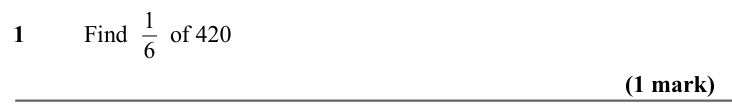

Text (lossy): 1       / Find       of 420 / 1 / 6 / (1 mark)

## Q2 (1 marks)

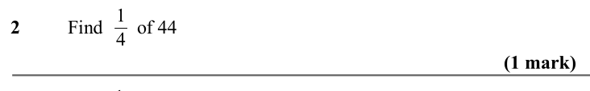

Text (lossy): 2       / Find       of 44 / 1 / 4 / (1 mark) /        / Find       of 72 / 1 / 8

## Q3 (1 marks)

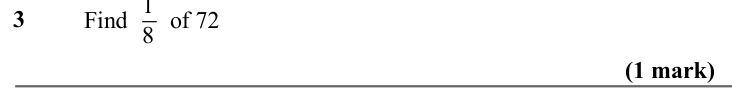

Text (lossy): 3     / (1 mark)

## Q4 (marks not printed)

Text (lossy): 4       / Find       of 60 / 1

## Q5 (1 marks)

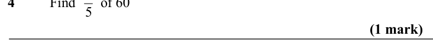

Text (lossy): 5 / (1 mark)

## Q6 (2 marks)

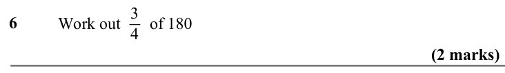

Text (lossy): 6     /        / Work out       of 180 / 3 / 4 / (2 marks)

## Q7 (2 marks)

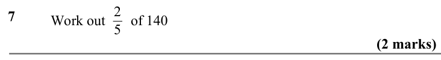

Text (lossy): 7     /        / Work out       of 140 / 2 / 5 / (2 marks)

## Q8 (2 marks)

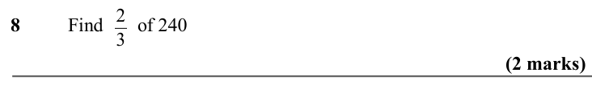

Text (lossy): 8       / Find       of 240 / 2 / 3 / (2 marks)

## Q9 (2 marks)

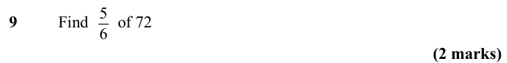

Text (lossy): 9       / Find       of 72 / 5 / 6 / (2 marks)

## Q10 (2 marks)

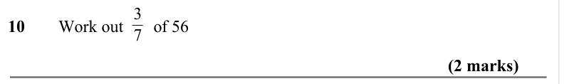

Text (lossy): 10      Work out       of 56 / 3 / 7 / (2 marks)

## Q11 (2 marks)

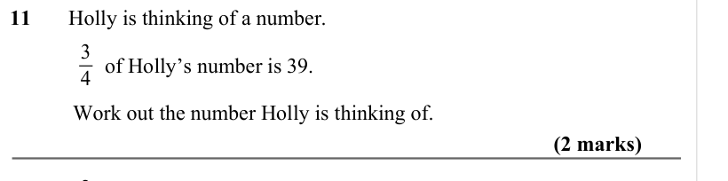

Text (lossy): 11       Holly is thinking of a number.  / 3 / 4 /       of Holly’s number is 39.  / Work out the number Holly is thinking of.   / (2 marks) / 2 / 5

## Q12 (2 marks)

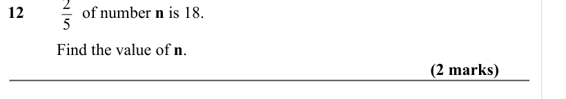

Text (lossy): 12              of number n is 18.  / Find the value of n.    / (2 marks) / 5 / 6

## Q13 (2 marks)

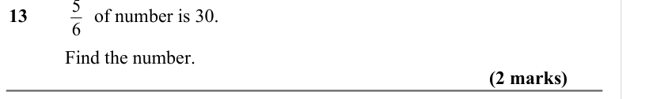

Text (lossy): 13              of number is 30.  / Find the number.    / (2 marks)

## Q14 (3 marks)

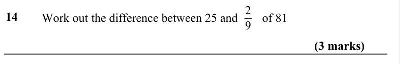

Text (lossy): 14     /        / Work out the difference between 25 and        of 81 / 2 / 9 / (3 marks)

## Q15 (3 marks)

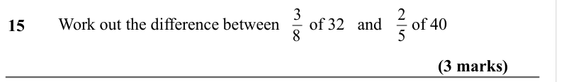

Text (lossy): 15     /        / Work out the difference between       of 32   and       of 40           / 3 / 8 / 2 / 5 / (3 marks)

## Q16 (3 marks)

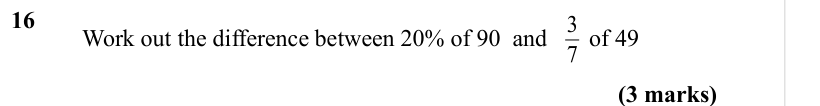

Text (lossy): 16     /        / Work out the difference between 20% of 90  and       of 49           / 3 / 7 / (3 marks)

## Q17 (3 marks)

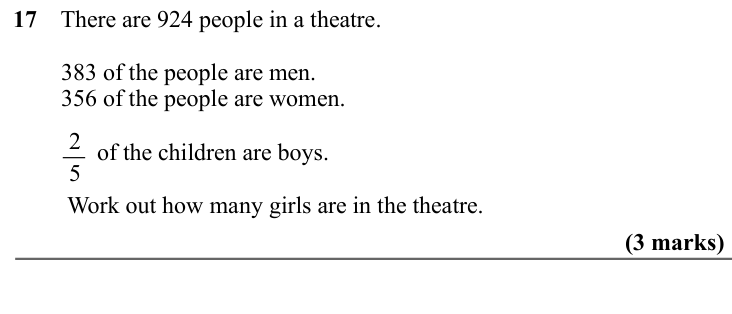

Text (lossy): 17    There are 924 people in a theatre.  /         383 of the people are men.  /         356 of the people are women.  / 2 / 5 /               of the children are boys.  /          Work out how many girls are in the theatre.  /                     / (3 marks)

## Q18 (3 marks)

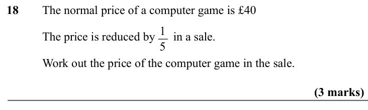

Text (lossy): 18     / The normal price of a computer game is £40  / 1 / 5 / The price is reduced by      in a sale.  / Work out the price of the computer game in the sale.  / (3 marks)

## Q19 (3 marks)

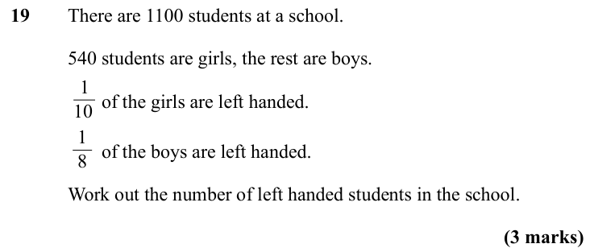

Text (lossy): 19     / There are 1100 students at a school.  / 540 students are girls, the rest are boys.  / 1 / 10 /        of the girls are left handed.  / 1 / 8 /        of the boys are left handed.  / Work out the number of left handed students in the school.  /                     / (3 marks)

## Q20 (3 marks)

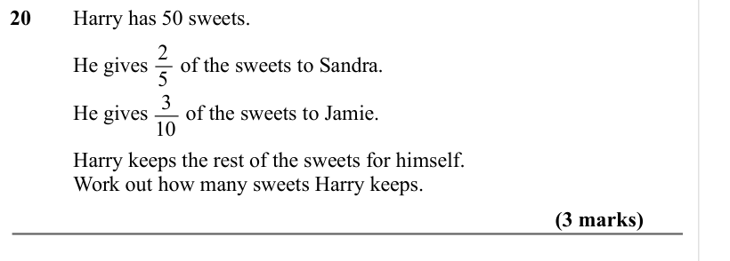

Text (lossy): 20     / Harry has 50 sweets.  / 2 / 5 / He gives      of the sweets to Sandra. / 3 / 10 / He gives       of the sweets to Jamie.   / Harry keeps the rest of the sweets for himself.  / Work out how many sweets Harry keeps.  / (3 marks)

## Q21 (marks not printed)

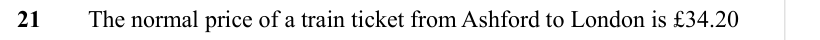

Text (lossy): 21     / The normal price of a train ticket from Ashford to London is £34.20

## Q22 (3 marks)

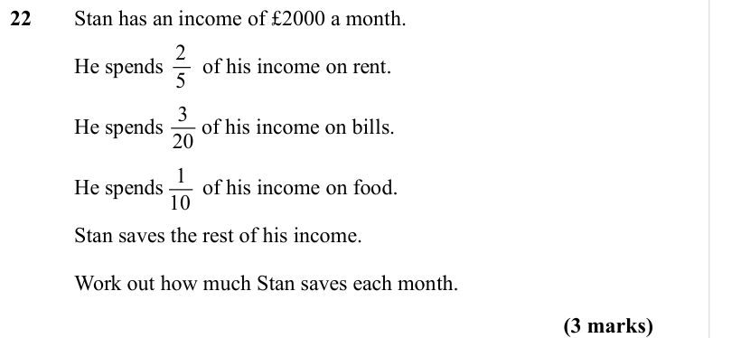

Text (lossy): 22     / Stan has an income of £2000 a month.  / 2 / 5 / He spends / of his income on rent.  / 3 / 20 / He spends       of his income on bills.  / 1 / 10 / He spends / of his income on food.  /   / Stan saves the rest of his income.  / Work out how much Stan saves each month.   / (3 marks)

