# Simplifying Algebra — Exam Questions (GCSE Maths · Edexcel · Grade 2)

Topic code `2.6` · slug `grade-2-2-6-simplifying-algebra` · source sheet sha256 `acec31a9c9a60263…`

## Q1 (1 marks)

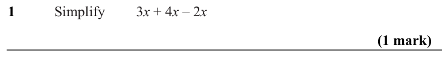

Text (lossy): 1     /  Simplify / 3 x + 4 x – 2 x  / (1 mark)

## Q2 (1 marks)

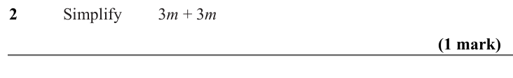

Text (lossy): 2     /  Simplify / 3 m + 3 m / (1 mark)

## Q3 (1 marks)

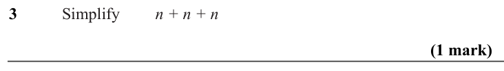

Text (lossy): 3     /  Simplify / n + n + n / (1 mark)

## Q4 (marks not printed · parts a, b)

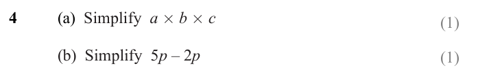

Text (lossy): 4 / (a)  Simplify  a ´ b ´ c / (1) / (b)  Simplify  5 p – 2 p  / (1)

## Q5 (1 marks)

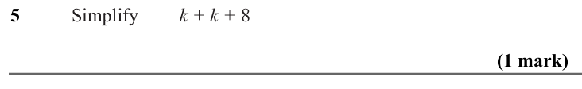

Text (lossy): 5     /  Simplify / k + k + 8  / (1 mark)

## Q6 (2 marks · parts a, b)

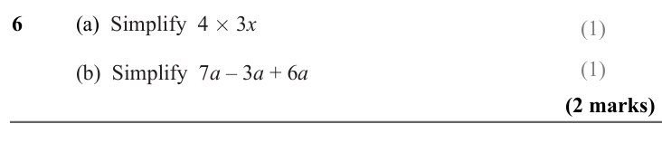

Text (lossy): 6 / (a)  Simplify  4 ´ 3 x / (1) / (1) / (b)  Simplify  7 a – 3 a + 6 a  / (2 marks)

## Q7 (2 marks)

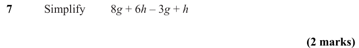

Text (lossy): 7     /  Simplify / 8 g + 6 h – 3 g + h  / (2 marks)

## Q8 (3 marks · parts a, b)

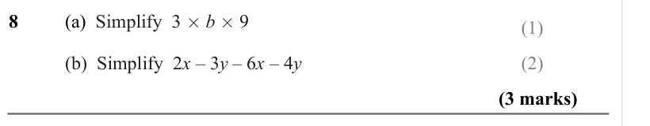

Text (lossy): 8 / (a)  Simplify  3 ´ b ´ 9 / (1) / (b)  Simplify  2 x – 3 y – 6 x – 4 y  / (2) / (3 marks)

## Q9 (2 marks)

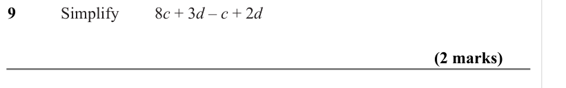

Text (lossy): 9     /  Simplify / 8 c + 3 d – c + 2 d / (2 marks)

## Q10 (3 marks · parts a, b)

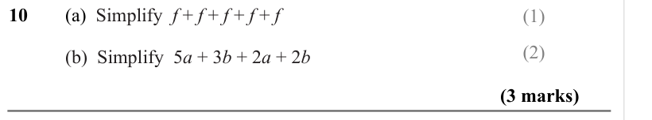

Text (lossy): 10 / (a)  Simplify  f + f + f + f + f  / (1) / (2) / (b)  Simplify  5 a + 3 b + 2 a + 2 b / (3 marks)

## Q11 (marks not printed · parts a, b)

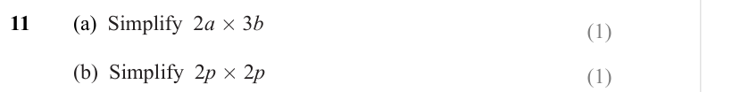

Text (lossy): 11 / (a)  Simplify  2 a ´ 3 b / (1) / (b)  Simplify  2 p ´ 2 p / (1)

## Q12 (marks not printed)

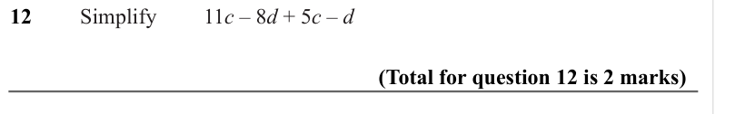

Text (lossy): 12     /  Simplify / 11 c – 8 d + 5 c – d / (Total for question 12 is 2 marks)

## Q13 (3 marks · parts a, b)

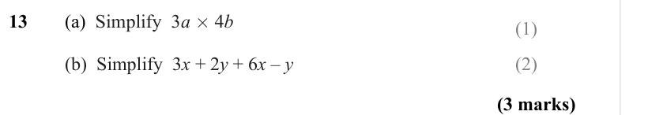

Text (lossy): 13 / (a)  Simplify  3 a ´ 4 b / (1) / (b)  Simplify  3 x + 2 y + 6 x – y  / (2) / (3 marks)

## Q14 (marks not printed · parts a, b)

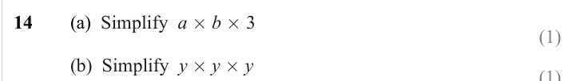

Text (lossy): 14 / (a)  Simplify  a ´ b ´ 3 / (1) / (b)  Simplify  y ´ y ´ y / (1)

## Q15 (marks not printed · parts a, b)

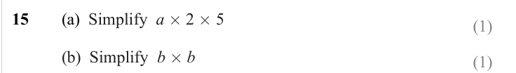

Text (lossy): 15 / (a)  Simplify  a ´ 2 ´ 5 / (1) / (b)  Simplify  b ´ b / (1)

## Q16 (3 marks · parts a, b)

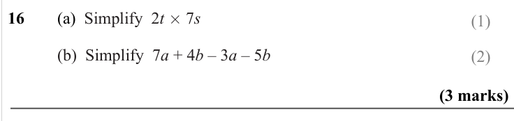

Text (lossy): 16 / (a)  Simplify  2 t ´ 7 s / (1) / (b)  Simplify  7 a + 4 b – 3 a – 5 b / (2) / (3 marks)

## Q17 (3 marks · parts a, b)

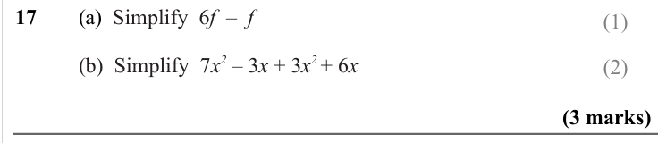

Text (lossy): 17 / (a)  Simplify  6 f  –  f  / (1) / (b)  Simplify  7 x 2 – 3 x + 3 x 2 + 6 x / (2) / (3 marks)

## Q18 (1 marks)

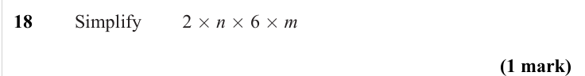

Text (lossy): 18     /  Simplify / 2 ´ n ´ 6 ´ m / (1 mark)

## Q19 (3 marks · parts a, b)

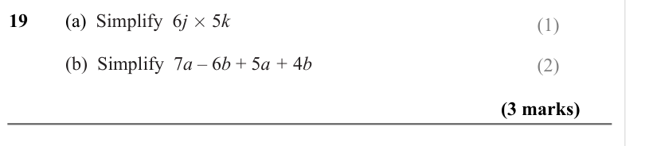

Text (lossy): 19 / (a)  Simplify  6 j ´ 5 k / (1) / (b)  Simplify  7 a – 6 b + 5 a + 4 b / (2) / (3 marks)

## Q20 (4 marks · parts a, b, c)

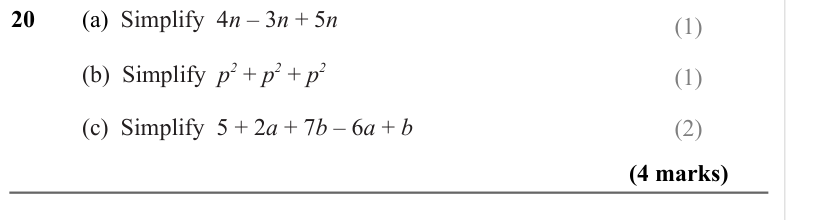

Text (lossy): 20 / (a)  Simplify  4 n – 3 n + 5 n / (1) / (b)  Simplify  p 2 + p 2 + p 2 / (1) / (c)  Simplify  5 + 2 a + 7 b – 6 a + b  / (2) / (4 marks)

## Q21 (4 marks · parts a, b, c)

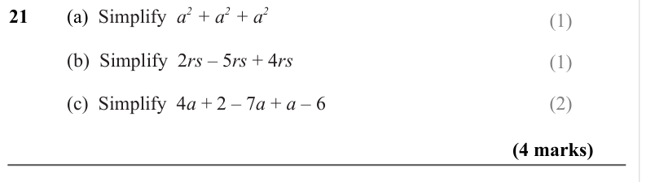

Text (lossy): 21 / (a)  Simplify  a 2 + a 2 + a 2  / (1) / (b)  Simplify  2 rs – 5 rs + 4 rs  / (1) / (c)  Simplify  4 a + 2 – 7 a + a – 6  / (2) / (4 marks)

## Q22 (4 marks · parts a, b, c)

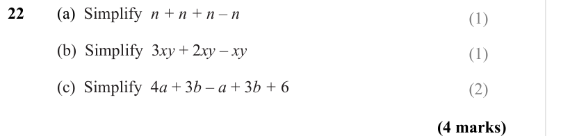

Text (lossy): 22 / (a)  Simplify  n + n + n – n / (1) / (b)  Simplify  3 xy + 2 xy – xy  / (1) / (c)  Simplify  4 a + 3 b – a + 3 b + 6  / (2) / (4 marks)

