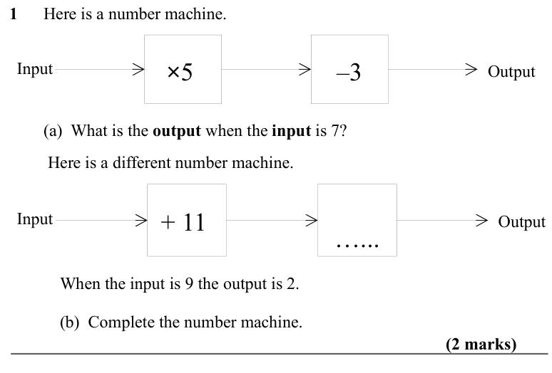
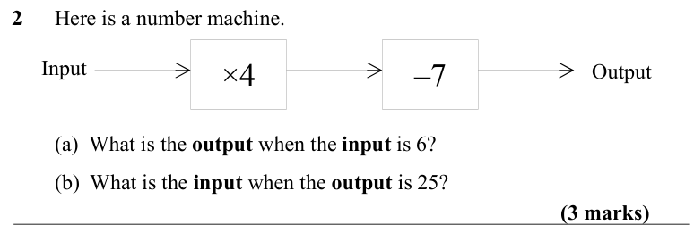
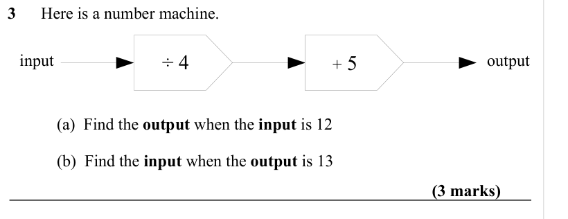
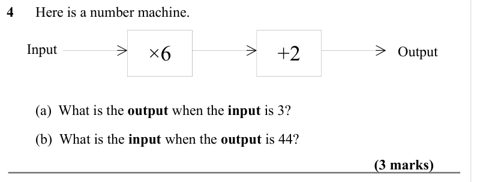
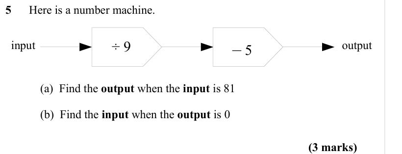
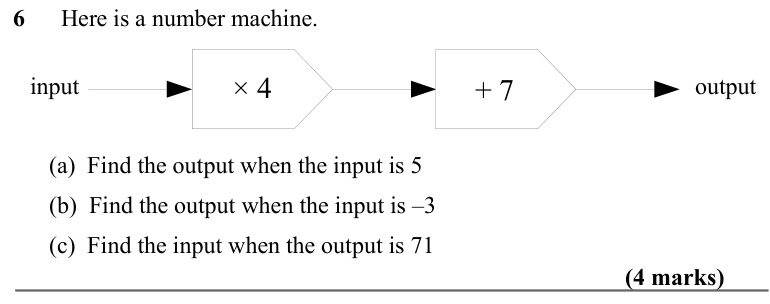
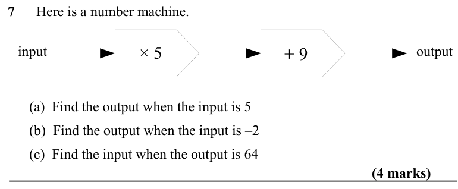
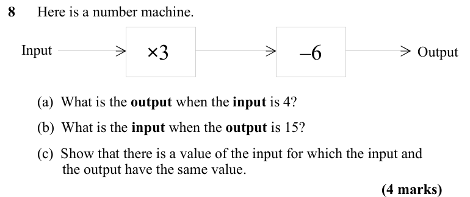
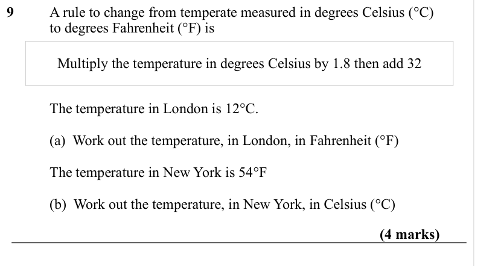
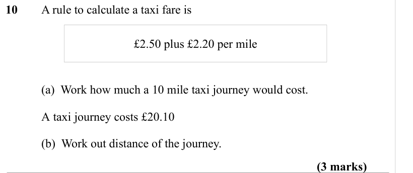

# Function Machines — Exam Questions (GCSE Maths · Edexcel · Grade 2)

Topic code `2.8` · slug `grade-2-2-8-function-machines` · source sheet sha256 `1eba8fee2d76457d…`

## Q1 (2 marks · parts a, b)

Text (lossy): 1      Here is a number machine. / Input / Output / –3 / ×5 /         (a)  What is the output when the input is 7?  /          Here is a different number machine. / Input / Output / …... / + 11 / When the input is 9 the output is 2.  / (b)  Complete the number machine.  / (2 marks)

## Q2 (3 marks · parts a, b)

Text (lossy): 2      Here is a number machine. / ×4 / Input / Output / –7 /         (a)  What is the output when the input is 6?  /         (b)  What is the input when the output is 25?  / (3 marks)

## Q3 (3 marks · parts a, b)

Text (lossy): 3      Here is a number machine.  / input / output / ÷ 4 / + 5 / (a)  Find the output when the input is 12 / (b)  Find the input when the output is 13 / (3 marks)

## Q4 (3 marks · parts a, b)

Text (lossy): 4      Here is a number machine. / ×6 / Input / Output / +2 /         (a)  What is the output when the input is 3?  /         (b)  What is the input when the output is 44?  / (3 marks)

## Q5 (3 marks · parts a, b)

Text (lossy): 5      Here is a number machine.  / input / output / ÷ 9 / – 5 / (a)  Find the output when the input is 81 / (b)  Find the input when the output is 0 / (3 marks)

## Q6 (4 marks · parts a, b, c)

Text (lossy): 6      Here is a number machine.  / input / output / × 4 / + 7 /       (a)  Find the output when the input is 5 /       (b)  Find the output when the input is –3 /       (c)  Find the input when the output is 71  / (4 marks)

## Q7 (4 marks · parts a, b, c)

Text (lossy): 7      Here is a number machine.  / input / output / × 5 / + 9 /       (a)  Find the output when the input is 5 /       (b)  Find the output when the input is –2 /       (c)  Find the input when the output is 64 / (4 marks)

## Q8 (4 marks · parts a, b, c)

Text (lossy): 8      Here is a number machine. / Input / Output / –6 / ×3 /         (a)  What is the output when the input is 4?  /         (b)  What is the input when the output is 15?  /         (c)  Show that there is a value of the input for which the input and /    the output have the same value.  / (4 marks)

## Q9 (4 marks · parts a, b)

Text (lossy): 9 / A rule to change from temperate measured in degrees Celsius (°C)  / to degrees Fahrenheit (°F) is / Multiply the temperature in degrees Celsius by 1.8 then add 32 / The temperature in London is 12°C.  /        / (a)  Work out the temperature, in London, in Fahrenheit (°F) / The temperature in New York is 54°F / (b)  Work out the temperature, in New York, in Celsius (°C) / (4 marks)

## Q10 (3 marks · parts a, b)

Text (lossy): 10 / A rule to calculate a taxi fare is / £2.50 plus £2.20 per mile /        / (a)  Work how much a 10 mile taxi journey would cost.  / A taxi journey costs £20.10 / (b)  Work out distance of the journey.  / (3 marks)

