# Error Intervals — Exam Questions (GCSE Maths · Edexcel · Grade 3)

Topic code `3.1` · slug `grade-3-3-1-error-intervals` · source sheet sha256 `7979aa866ebca1e4…`

## Q1 (2 marks · parts a, b)

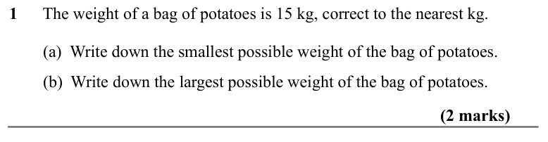

Text (lossy): 1      The weight of a bag of potatoes is 15 kg, correct to the nearest kg. /          /         (a)  Write down the smallest possible weight of the bag of potatoes. /             /         (b)  Write down the largest possible weight of the bag of potatoes. / (2 marks)

## Q2 (2 marks · parts a, b)

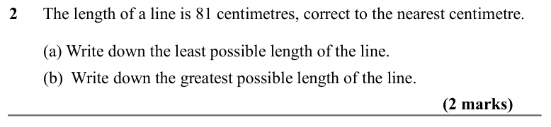

Text (lossy): 2      The length of a line is 81 centimetres, correct to the nearest centimetre.   /          /         (a) Write down the least possible length of the line.    /         (b)  Write down the greatest possible length of the line.  / (2 marks)

## Q3 (2 marks · parts a, b)

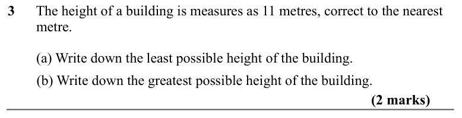

Text (lossy): 3      The height of a building is measures as 11 metres, correct to the nearest     /         metre.   /          /         (a) Write down the least possible height of the building.    /         (b) Write down the greatest possible height of the building.    / (2 marks)

## Q4 (marks not printed)

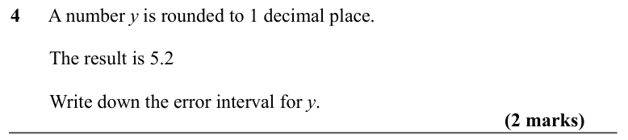

Text (lossy): 4      A number y is rounded to 1 decimal place.  /          /         The result is 5.2 /         Write down the error interval for y.

## Q5 (2 marks)

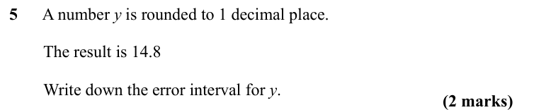

Text (lossy): 5      A number y is rounded to 1 decimal place.  /          /         The result is 14.8 /         Write down the error interval for y. / (2 marks)

## Q6 (2 marks)

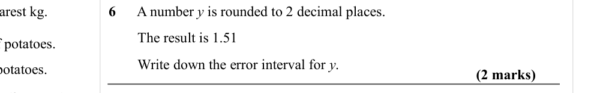

Text (lossy): 6      A number y is rounded to 2 decimal places.  /          /         The result is 1.51 /         Write down the error interval for y.            / (2 marks)

## Q7 (2 marks)

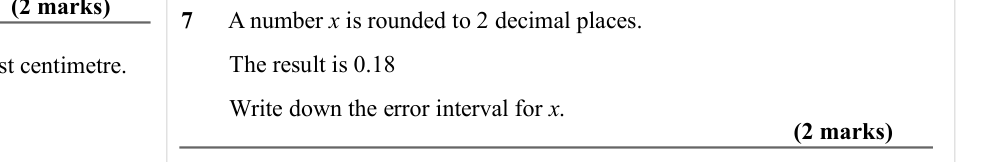

Text (lossy): 7      A number x is rounded to 2 decimal places.  /          /         The result is 0.18 /         Write down the error interval for x. / (2 marks)

## Q8 (2 marks)

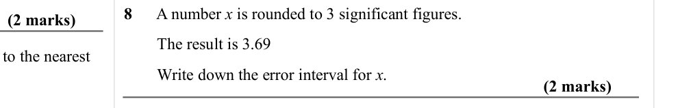

Text (lossy): 8      A number x is rounded to 3 significant figures.  /          /         The result is 3.69 /         Write down the error interval for x.            / (2 marks)

## Q9 (2 marks)

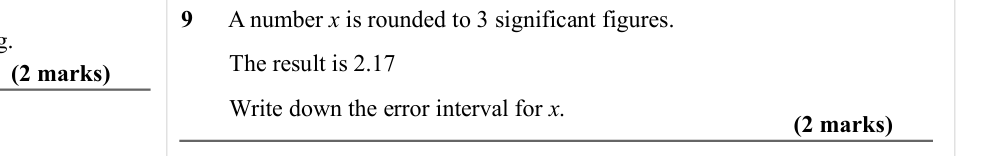

Text (lossy): 9      A number x is rounded to 3 significant figures.  /          /         The result is 2.17 /         Write down the error interval for x.            / (2 marks)

## Q10 (4 marks)

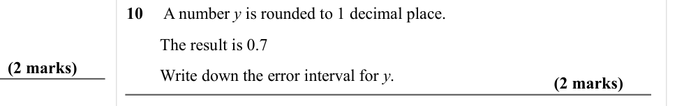

Text (lossy): 10     A number y is rounded to 1 decimal place.  /          /         The result is 0.7 /         Write down the error interval for y. / (2 marks) / (2 marks)

## Q11 (2 marks)

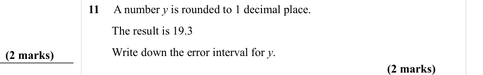

Text (lossy): 11     A number y is rounded to 1 decimal place.  /          /         The result is 19.3 /         Write down the error interval for y. / (2 marks)

## Q12 (marks not printed)

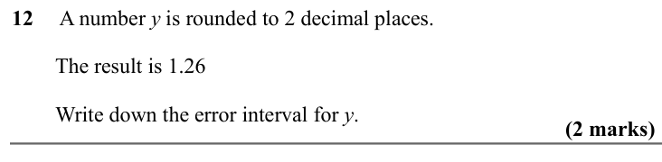

Text (lossy): 12     A number y is rounded to 2 decimal places.  /          /         The result is 1.26 /         Write down the error interval for y.

## Q13 (2 marks)

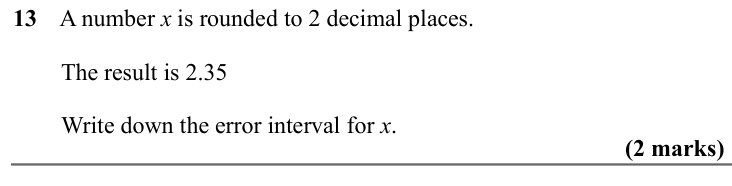

Text (lossy): 13    A number x is rounded to 2 decimal places.  /          /         The result is 2.35 /         Write down the error interval for x.          / (2 marks)

## Q14 (2 marks)

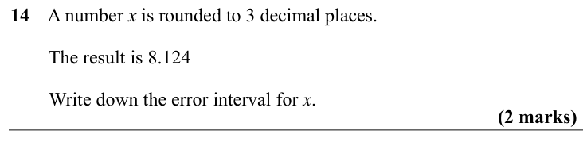

Text (lossy): 14    A number x is rounded to 3 decimal places.  /          /         The result is 8.124 /         Write down the error interval for x.            / (2 marks)

## Q15 (2 marks)

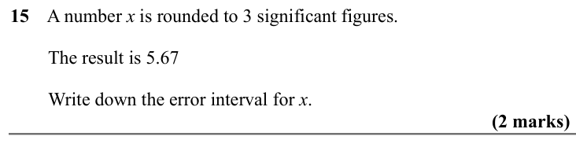

Text (lossy): 15    A number x is rounded to 3 significant figures.  /          /         The result is 5.67 /         Write down the error interval for x.             / (2 marks)

## Q16 (2 marks)

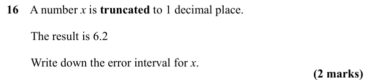

Text (lossy): 16    A number x is truncated to 1 decimal place.  /          /         The result is 6.2 /         Write down the error interval for x.            / (2 marks)

## Q17 (4 marks)

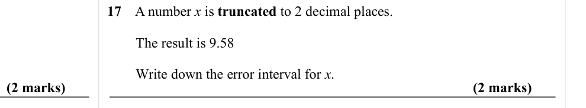

Text (lossy): 17    A number x is truncated to 2 decimal places.  /          /         The result is 9.58 /         Write down the error interval for x. / (2 marks) / (2 marks)

## Q18 (2 marks)

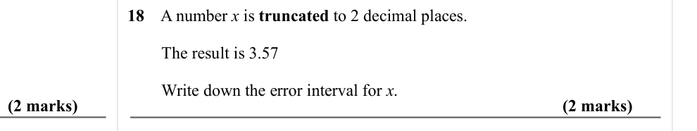

Text (lossy): 18    A number x is truncated to 2 decimal places.  /          /         The result is 3.57 /         Write down the error interval for x. / (2 marks)

## Q19 (2 marks)

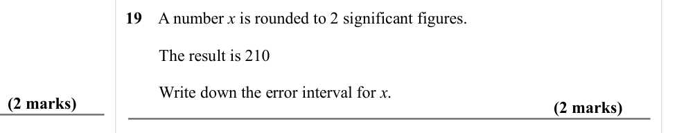

Text (lossy): 19    A number x is rounded to 2 significant figures.  /          /         The result is 210 /         Write down the error interval for x. / (2 marks)

## Q20 (2 marks)

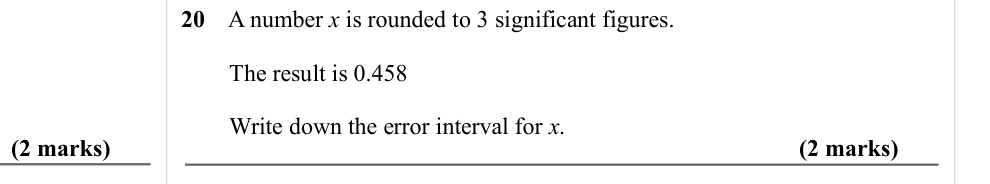

Text (lossy): 20    A number x is rounded to 3 significant figures.  /          /         The result is 0.458 /         Write down the error interval for x. / (2 marks)

## Q21 (2 marks)

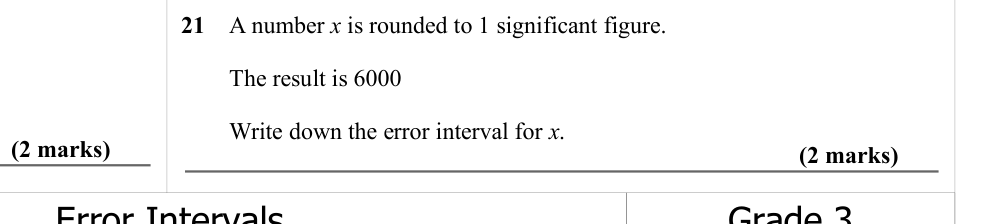

Text (lossy): 21    A number x is rounded to 1 significant figure.  /          /         The result is 6000 /         Write down the error interval for x. / (2 marks)

