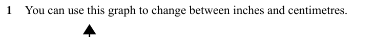
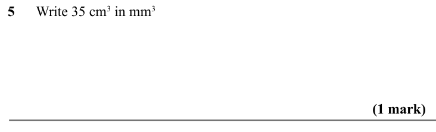
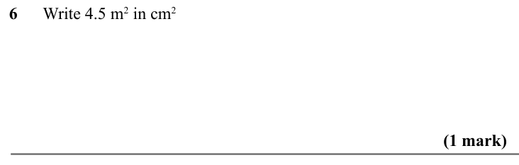
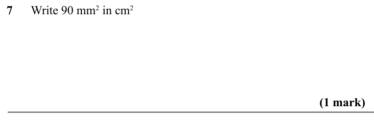
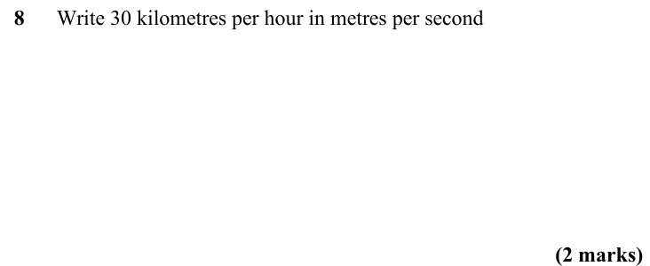

# Conversions and Units — Exam Questions (GCSE Maths · Edexcel · Grade 3)

Topic code `3.10` · slug `grade-3-3-10-conversions-and-units` · source sheet sha256 `42c9e4923105f8ac…`

## Q1 (marks not printed)

Text (lossy): 1    You can use this graph to change between inches and centimetres.

## Q2 (marks not printed)

Text (lossy): 2     / You can use this graph to change between litres and pints.

## Q3 (marks not printed)

Text (lossy): 3    You can use this graph to change between feet and metres.

## Q4 (marks not printed)

Text (lossy): 4

## Q5 (1 marks)

Text (lossy): 5      Write 35 cm 3 in mm 3 /                     / (1 mark)

## Q6 (1 marks)

Text (lossy): 6      Write 4.5 m 2 in cm 2 /                     / (1 mark)

## Q7 (1 marks)

Text (lossy): 7      Write 90 mm 2 in cm 2 /                     / (1 mark)

## Q8 (2 marks)

Text (lossy): 8      Write 30 kilometres per hour in metres per second /                     / (2 marks)

## Q9 (marks not printed)

Text (lossy): 9     You can use this graph to change between litres and pints.

## Q10 (marks not printed)

Text (lossy): 10

