# Substitution — Exam Questions (GCSE Maths · Edexcel · Grade 3)

Topic code `3.13` · slug `grade-3-3-13-substitution` · source sheet sha256 `20390f8d9c1f5e5c…`

## Q1 (2 marks)

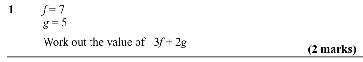

Text (lossy): 1      / f = 7 / g = 5 / Work out the value of   3 f + 2 g / (2 marks)

## Q2 (2 marks)

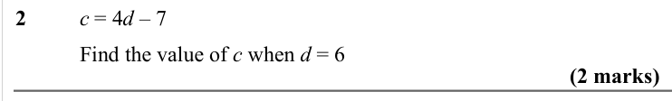

Text (lossy): 2      / c = 4 d – 7 / Find the value of c when d = 6 / (2 marks)

## Q3 (2 marks)

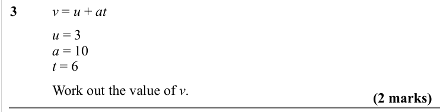

Text (lossy): 3      / v = u + at / u = 3 / a = 10 / t = 6 / Work out the value of v.  / (2 marks)

## Q4 (2 marks)

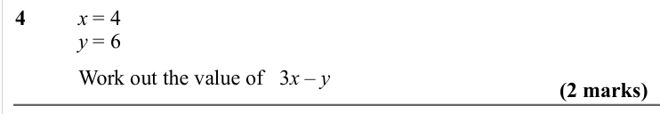

Text (lossy): 4      / x = 4 / y = 6 / Work out the value of   3 x – y / (2 marks)

## Q5 (2 marks)

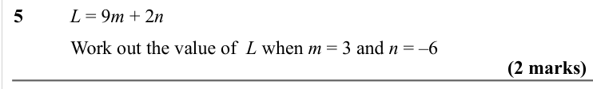

Text (lossy): 5      / L = 9 m + 2 n / Work out the value of  L when m = 3 and n = –6  / (2 marks)

## Q6 (2 marks)

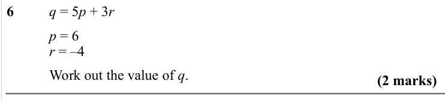

Text (lossy): 6      / q = 5 p + 3 r / p = 6 / r = –4  / Work out the value of q.  / (2 marks)

## Q7 (2 marks)

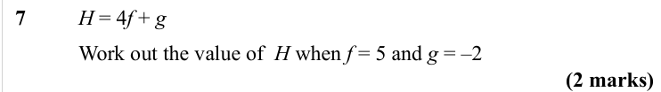

Text (lossy): 7      / H = 4 f + g / Work out the value of  H when f = 5 and g = –2  / (2 marks)

## Q8 (2 marks)

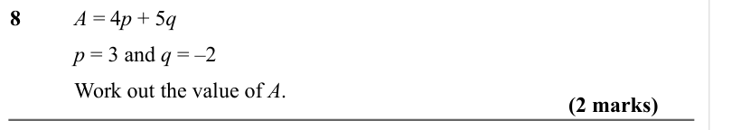

Text (lossy): 8      / A = 4 p + 5 q / p = 3 and q = –2  / Work out the value of A.  / (2 marks)

## Q9 (2 marks)

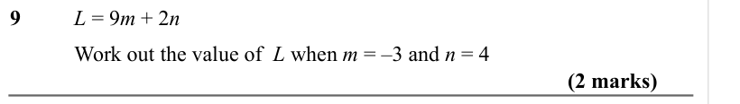

Text (lossy): 9      / L = 9 m + 2 n / Work out the value of  L when m = –3 and n = 4  / (2 marks)

## Q10 (2 marks)

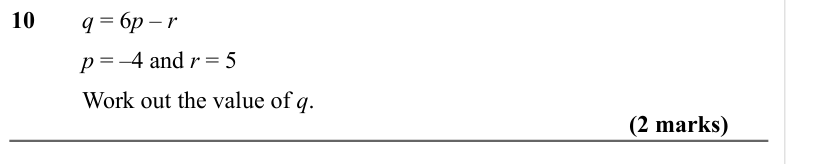

Text (lossy): 10     q = 6 p – r / p = –4 and r = 5 / Work out the value of q.  / (2 marks)

## Q11 (2 marks)

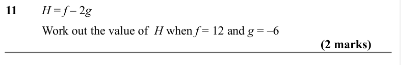

Text (lossy): 11     H = f – 2 g / Work out the value of  H when f = 12 and g = –6  / (2 marks)

## Q12 (2 marks)

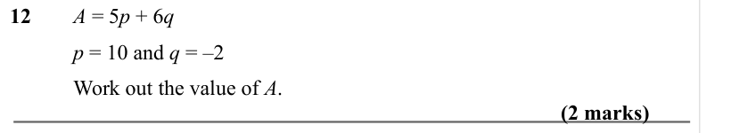

Text (lossy): 12     A = 5 p + 6 q / p = 10 and q = –2  / Work out the value of A.  / (2 marks)

## Q13 (2 marks)

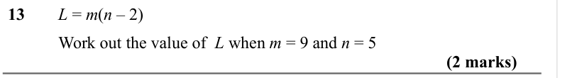

Text (lossy): 13     L = m(n – 2) / Work out the value of  L when m = 9 and n = 5  / (2 marks)

## Q14 (2 marks)

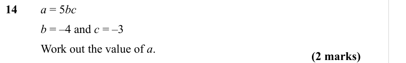

Text (lossy): 14     a = 5 bc / b = –4 and c = –3  / Work out the value of a.  / (2 marks)

## Q15 (2 marks)

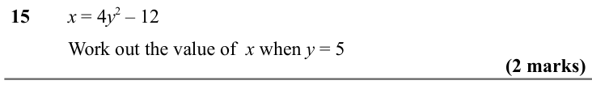

Text (lossy): 15     x = 4 y 2 – 12 / Work out the value of  x when y = 5 / (2 marks)

## Q16 (2 marks)

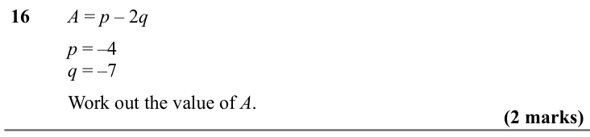

Text (lossy): 16     A = p – 2 q / p = –4 / q = –7  / Work out the value of A.  / (2 marks)

## Q17 (2 marks)

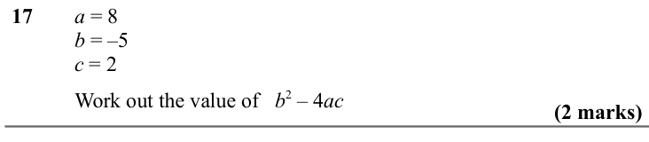

Text (lossy): 17     a = 8 / b = –5 / c = 2 / Work out the value of   b 2 – 4 ac / (2 marks) / d = m

## Q18 (2 marks)

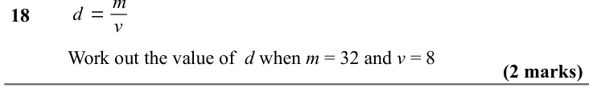

Text (lossy): 18      / v / Work out the value of  d when m = 32 and v = 8 / (2 marks)

## Q19 (2 marks)

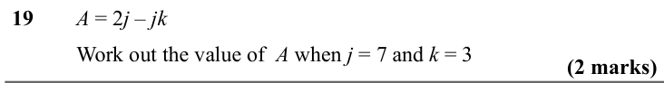

Text (lossy): 19     A = 2 j – jk / Work out the value of  A when j = 7 and k = 3  / (2 marks)

## Q20 (2 marks)

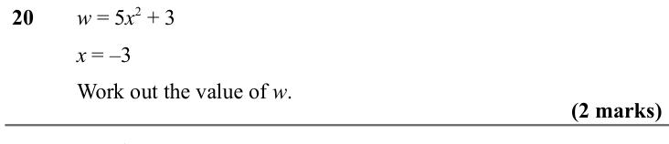

Text (lossy): 20     w = 5 x 2 + 3 / x = –3 / Work out the value of w.  / (2 marks) / A=1

## Q21 (marks not printed)

## Q22 (marks not printed)

## Q23 (2 marks)

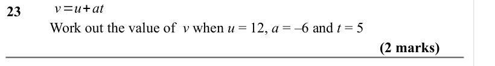

Text (lossy): 23      / Work out the value of  v when u = 12, a = –6 and t = 5  / (2 marks)

## Q24 (2 marks)

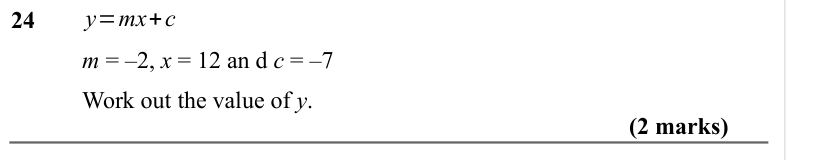

Text (lossy): y=mx+c / 24      / m = –2, x = 12 an d c = –7 / Work out the value of y.  / (2 marks) / s = ut + 1

## Q25 (2 marks)

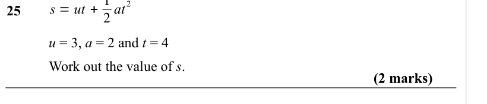

Text (lossy): 2 at / 25      / u = 3, a = 2 and t = 4 / Work out the value of s.  / (2 marks) / s = ut + 1

## Q26 (2 marks)

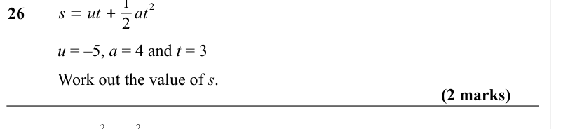

Text (lossy): 2 at / 26      / u = –5, a = 4 and t = 3 / Work out the value of s.  / (2 marks) / s = v 2 −u 2

## Q27 (marks not printed)

Text (lossy): 27

