# Solving Equations — Exam Questions (GCSE Maths · Edexcel · Grade 3)

Topic code `3.14` · slug `grade-3-3-14-solving-equations` · source sheet sha256 `65af2dd45c7b9789…`

## Q1 (2 marks)

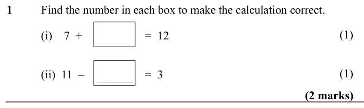

Text (lossy): 1      / Find the number in each box to make the calculation correct.  / (1) / (i)    7  +  / =  12 / (1) / (ii)  11  –  / =  3 / (2 marks)

## Q2 (1 marks)

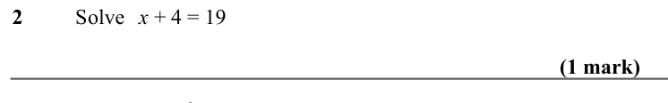

Text (lossy): 2      / Solve x + 4 = 19 / (1 mark) / d

## Q3 (marks not printed)

Text (lossy): 3      / Solve / = 9.5

## Q4 (1 marks)

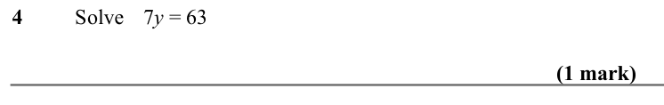

Text (lossy): 4      / Solve  7 y = 63 / (1 mark)

## Q5 (1 marks)

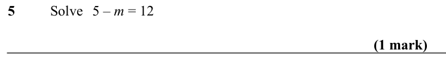

Text (lossy): 5      / Solve 5 – m = 12 / (1 mark)

## Q6 (1 marks)

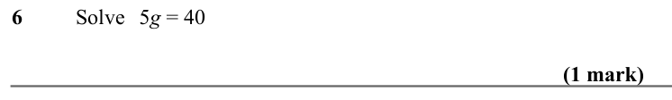

Text (lossy): 6      / Solve 5 g = 40 / (1 mark)

## Q7 (2 marks)

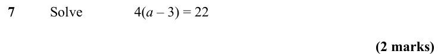

Text (lossy): 7      / Solve / 4(a – 3) = 22 / (2 marks)

## Q8 (2 marks)

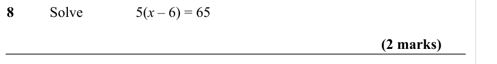

Text (lossy): 8      / Solve / 5(x – 6) = 65 / (2 marks)

## Q9 (2 marks)

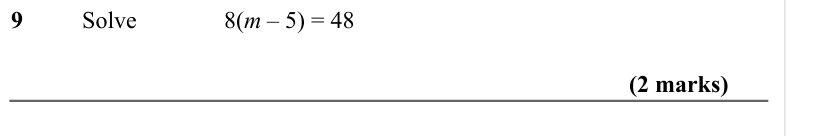

Text (lossy): 9      / Solve / 8(m – 5) = 48 / (2 marks)

## Q10 (3 marks · parts a, b)

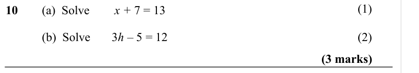

Text (lossy): (1) / 10 / (a)  Solve / x + 7 = 13 / (b)  Solve       3 h – 5 = 12 / (2) / (3 marks)

## Q11 (3 marks · parts a, b, c)

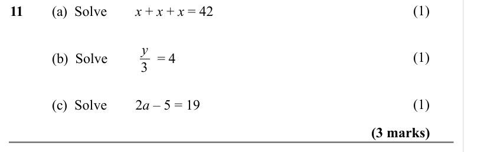

Text (lossy): (1) / 11 / (a)  Solve / x + x + x = 42 / y / 3 / (1) / (b)  Solve              = 4 / (1) / (c)  Solve / 2 a – 5 = 19 / (3 marks)

## Q12 (2 marks)

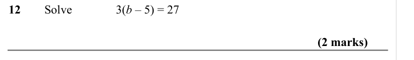

Text (lossy): 12     Solve / 3(b – 5) = 27 / (2 marks)

## Q13 (marks not printed)

## Q14 (4 marks · parts a, b, c)

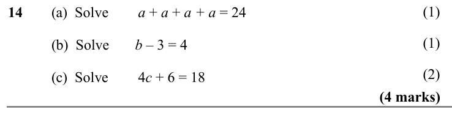

Text (lossy): 14 / (a)  Solve / a + a + a + a = 24 / (b)  Solve       b – 3 = 4 / (c)  Solve / 4 c + 6 = 18 / (4 marks)

## Q15 (3 marks · parts a, b)

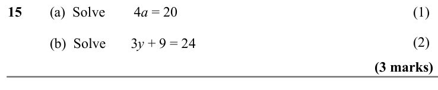

Text (lossy): 15 / (a)  Solve / 4 a = 20 / (b)  Solve       3 y + 9 = 24 / (3 marks) / y / 3

## Q16 (marks not printed)

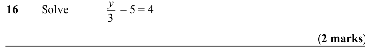

Text (lossy): 16     Solve /    – 5 = 4

## Q17 (marks not printed · parts a, b)

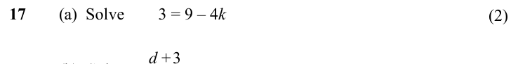

Text (lossy): 17 / (a)  Solve / 3 = 9 – 4 k / (2) / d +3 / (b)  Solve                = 5

## Q18 (4 marks · parts a, b)

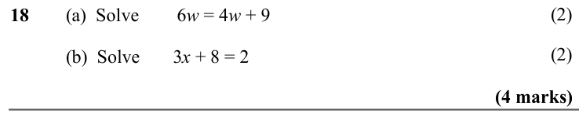

Text (lossy): 18 / (a)  Solve / 6 w = 4 w + 9 / (b)  Solve       3 x + 8 = 2 / (4 marks)

## Q19 (4 marks · parts b)

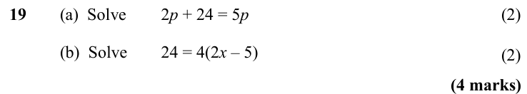

Text (lossy): 19     (a)  Solve / 2 p + 24 = 5 p / (b)  Solve / 24 = 4(2 x – 5) / (4 marks)

## Q20 (2 marks)

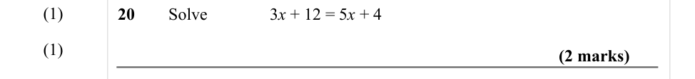

Text (lossy): (1) / 20     Solve / 3 x + 12 = 5 x + 4 / (1) / (2 marks) / (2)

## Q21 (2 marks)

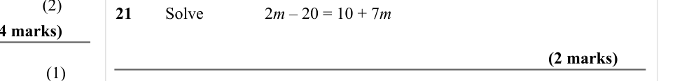

Text (lossy): 21     Solve / 2 m – 20 = 10 + 7 m  / (2 marks) / (1)

## Q22 (2 marks)

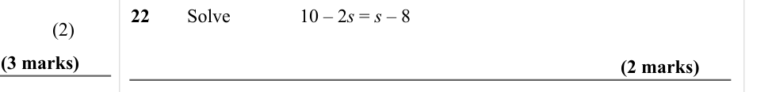

Text (lossy): 22     Solve / 10 – 2 s = s – 8  / (2) / (2 marks)

## Q23 (4 marks)

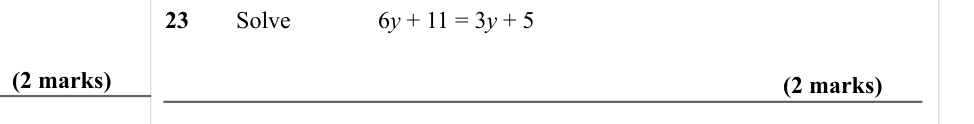

Text (lossy): 23     Solve / 6 y + 11 = 3 y + 5  / (2 marks) / (2 marks) / (2)

## Q24 (2 marks)

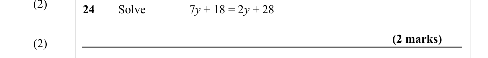

Text (lossy): 24     Solve / 7 y + 18 = 2 y + 28 / (2 marks)

## Q25 (2 marks)

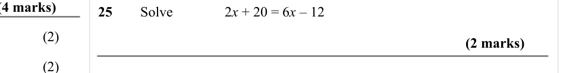

Text (lossy): 25     Solve / 2 x + 20 = 6 x – 12 / (2) / (2 marks) / (2)

## Q26 (2 marks)

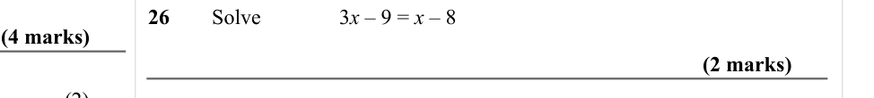

Text (lossy): 26     Solve / 3 x – 9 = x – 8  / (2 marks) / (2)

## Q27 (2 marks)

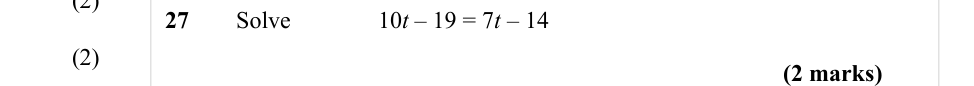

Text (lossy): 27     Solve / 10 t – 19 = 7 t – 14 / (2) / (2 marks)

