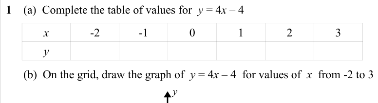
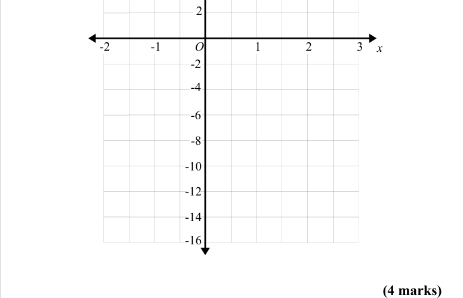
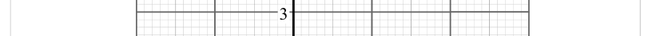
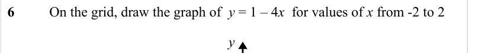
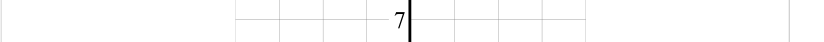

# Drawing Linear Graphs — Exam Questions (GCSE Maths · Edexcel · Grade 3)

Topic code `3.15` · slug `grade-3-3-15-drawing-linear-graphs` · source sheet sha256 `fb8468f8a338eb28…`

## Q1 (marks not printed · parts b)

Text (lossy): 1    (a)  Complete the table of values for  y = 4 x – 4  / x / -2 / -1 / 0 / 1 / 2 / 3 / y /       (b)  On the grid, draw the graph of  y = 4 x – 4  for values of  x  from -2 to 3 / y

## Q2 (4 marks)

Text (lossy): 2 / 1 / 2 / -1 / -2 / 3 / O / -2 / x / -4 / -6 / -8 / -10 / -12 / -14 / -16 / (4 marks)

## Q3 (marks not printed)

Text (lossy): 3

## Q4 (marks not printed)

Text (lossy): 4

## Q5 (marks not printed)

Text (lossy): 5

## Q6 (marks not printed)

Text (lossy): 6    / On the grid, draw the graph of  y = 1 – 4 x  for values of x from -2 to 2 / y

## Q7 (marks not printed)

Text (lossy): 7

