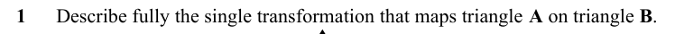
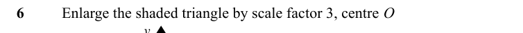
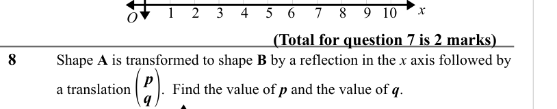

# Transformations — Exam Questions (GCSE Maths · Edexcel · Grade 3)

Topic code `3.17` · slug `grade-3-3-17-transformations` · source sheet sha256 `322d6d67f82abf8a…`

## Q1 (marks not printed)

Text (lossy): 1      Describe fully the single transformation that maps triangle A on triangle B.

## Q2 (marks not printed)

Text (lossy): 2

## Q3 (marks not printed)

Text (lossy): 3

## Q4 (marks not printed)

Text (lossy): 4

## Q5 (marks not printed)

Text (lossy): 5

## Q6 (marks not printed)

Text (lossy): 6       / Enlarge the shaded triangle by scale factor 3, centre O / y

## Q7 (marks not printed)

Text (lossy): 7

## Q8 (marks not printed)

Text (lossy): 8

## Q9 (marks not printed)

## Q10 (marks not printed)

Text (lossy): O / 1 / 2 / 3 / 4 / 5 / 6 / 7 / 8 / 9 / 10 / (Total for question 7 is 2 marks) / 8    / Shape A is transformed to shape B by a reflection in the x axis followed by / ( / p / q) /   / a translation        .  Find the value of p and the value of q.  / y

