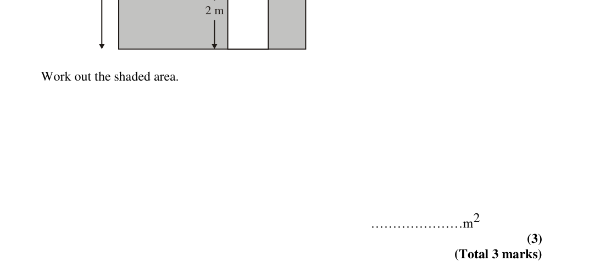
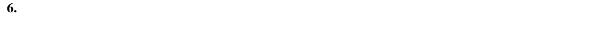

# Area of Compound Shapes — Exam Questions (GCSE Maths · Edexcel · Grade 3)

Topic code `3.18` · slug `grade-3-3-18-area-of-compound-shapes` · source sheet sha256 `429c828dacf66f2a…`

## Q1 (marks not printed)

Text (lossy): 1 m

## Q2 (marks not printed)

Text (lossy): 2 m /   /  Work out the shaded area.  /   /   /   /   / …………………m 2  / (3)   / (Total 3 marks)

