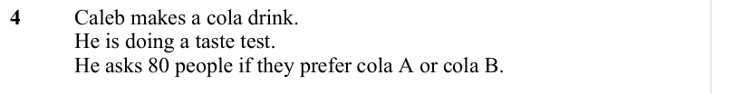
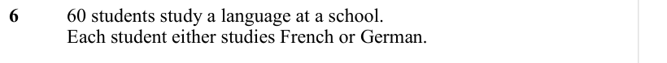

# Frequency Trees — Exam Questions (GCSE Maths · Edexcel · Grade 3)

Topic code `3.19` · slug `grade-3-3-19-frequency-trees` · source sheet sha256 `a2637fb04742040e…`

## Q1 (marks not printed)

Text (lossy): 1     / 30 people took a literacy test and a numeracy test.

## Q2 (marks not printed)

Text (lossy): 2     / 120 people were asked if they prefer tea or coffee.

## Q3 (marks not printed)

Text (lossy): 3     / 500 people were surveyed.  / All of the people were either left handed or right handed.

## Q4 (marks not printed)

Text (lossy): 4     / Caleb makes a cola drink.  / He is doing a taste test.  / He asks 80 people if they prefer cola A or cola B.

## Q5 (marks not printed)

Text (lossy): 5     / 80 people were asked if they like football.

## Q6 (marks not printed)

Text (lossy): 6     / 60 students study a language at a school.  /          / Each student either studies French or German.

## Q7 (marks not printed)

Text (lossy): 7     / 75 students either go to a football club or a rugby club at the weekend.   /          / Each student either goes to the club on Saturday or Sunday.

