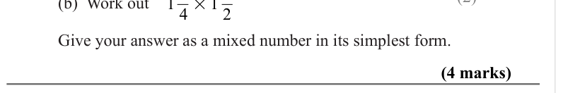

# Fractions — Exam Questions (GCSE Maths · Edexcel · Grade 3)

Topic code `3.2` · slug `grade-3-3-2-fractions` · source sheet sha256 `6d4759867563b563…`

## Q1 (marks not printed)

## Q2 (4 marks)

Text (lossy): 2 /   / Give your answer as a mixed number in its simplest form. / (4 marks)

## Q3 (marks not printed · parts b)

Text (lossy): 2 1 / 3 × 3 / (b)  Work out / (2)

