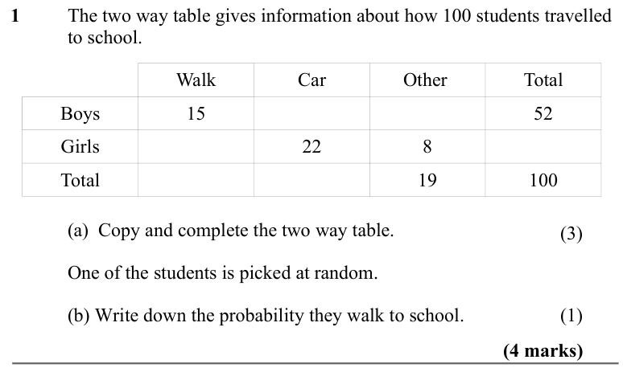
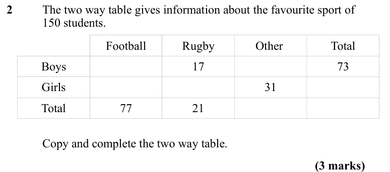
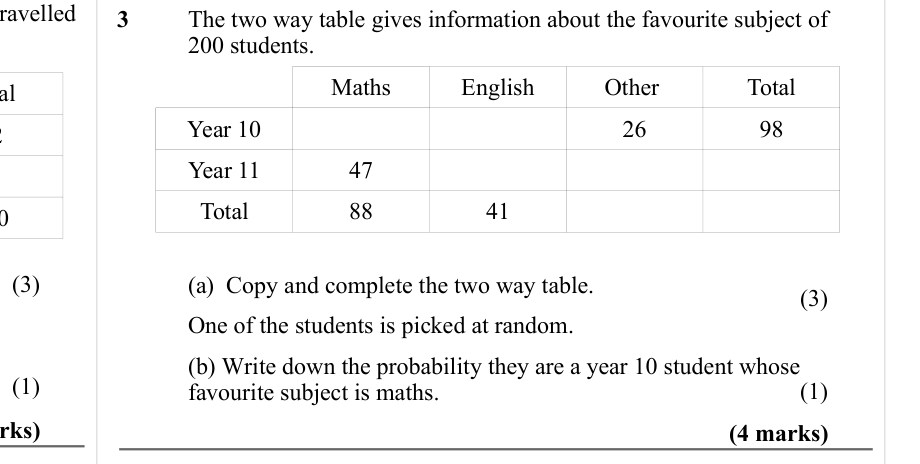
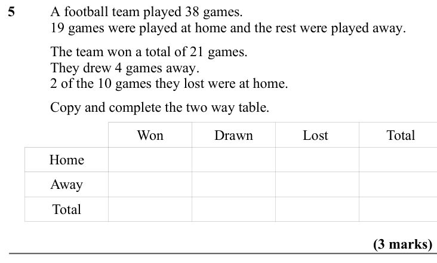
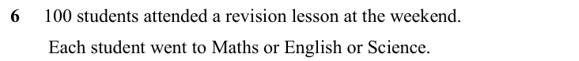
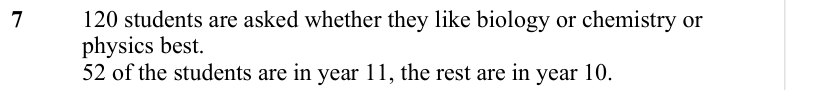
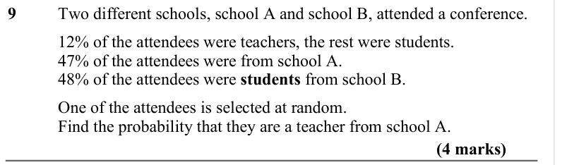
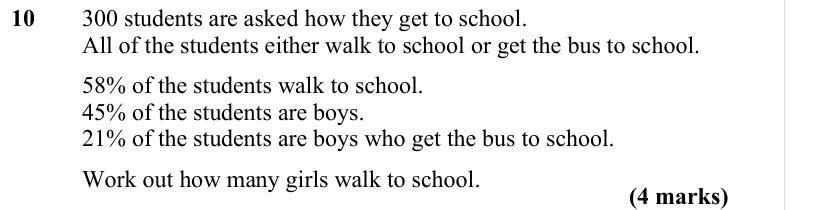

# Two Way Tables — Exam Questions (GCSE Maths · Edexcel · Grade 3)

Topic code `3.20` · slug `grade-3-3-20-two-way-tables` · source sheet sha256 `3f43dd83fa88d112…`

## Q1 (4 marks · parts a, b)

Text (lossy): 1 / The two way table gives information about how 100 students travelled  / to school.  / Walk / Car / Other  / Total / Boys / 15 / 52 / Girls / 22 / 8 / Total / 19 / 100 / (a)  Copy and complete the two way table.  / One of the students is picked at random.  / (b) Write down the probability they walk to school.  /          /          / (4 marks)

## Q2 (3 marks)

Text (lossy): 2 / The two way table gives information about the favourite sport of  / 150 students.   / Football / Rugby / Other  / Total / Boys / 17 / 73 / Girls / 31 / Total / 77 / 21 / Copy and complete the two way table.  / (3 marks)

## Q3 (4 marks · parts a, b)

Text (lossy): 3 / The two way table gives information about the favourite subject of  / 200 students.   / Maths / English / Other  / Total /        / Year 10 / 26 / 98 / Year 11 / 47 / Total / 88 / 41 / (3)        / (3)        / (a)  Copy and complete the two way table.  / One of the students is picked at random.  / (b) Write down the probability they are a year 10 student whose  / favourite subject is maths.  

## Q4 (marks not printed)

Text (lossy): 4 / There are 170 students in year 7 at a school. / All of these students either walk to school, get the bus to school  / or cycle to school.

## Q5 (3 marks)

Text (lossy): 5 / A football team played 38 games.  / 19 games were played at home and the rest were played away.  / The team won a total of 21 games.  / They drew 4 games away.  / 2 of the 10 games they lost were at home.  / Copy and complete the two way table.  /          /          / Won / Drawn / Lost  / Total / Home / Away / Total / (3 marks)

## Q6 (marks not printed)

Text (lossy): 6     100 students attended a revision lesson at the weekend.  /         Each student went to Maths or English or Science.

## Q7 (marks not printed)

Text (lossy): 7     / 120 students are asked whether they like biology or chemistry or  / physics best.  / 52 of the students are in year 11, the rest are in year 10.

## Q8 (marks not printed)

Text (lossy): 8     / 100 students in year 7 either study French or German or Spanish. / 45 of the students are boys and the rest are girls.

## Q9 (4 marks)

Text (lossy): 9     / Two different schools, school A and school B, attended a conference. / 12% of the attendees were teachers, the rest were students. / 47% of the attendees were from school A. / 48% of the attendees were students from school B. / One of the attendees is selected at random.  / Find the probability that they are a teacher from school A. / (4 marks)

## Q10 (4 marks)

Text (lossy): 10     / 300 students are asked how they get to school.  / All of the students either walk to school or get the bus to school.  / 58% of the students walk to school.  / 45% of the students are boys. / 21% of the students are boys who get the bus to school.   / Work out how many girls walk to school.  / (4 marks)

