# Writing and Simplifying Ratio — Exam Questions (GCSE Maths · Edexcel · Grade 3)

Topic code `3.4` · slug `grade-3-3-4-writing-and-simplifying-ratio` · source sheet sha256 `ac8f1073cf634527…`

## Q1 (marks not printed)

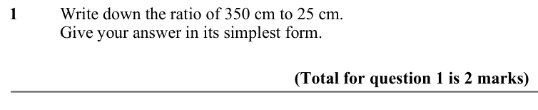

Text (lossy): 1       / Write down the ratio of 350 cm to 25 cm.  / Give your answer in its simplest form.  / (Total for question 1 is 2 marks)

## Q2 (marks not printed)

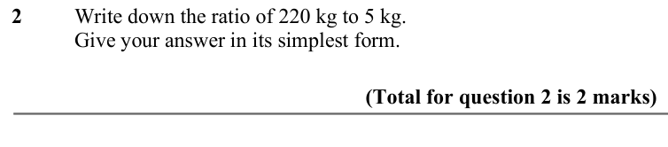

Text (lossy): 2       / Write down the ratio of 220 kg to 5 kg.  / Give your answer in its simplest form.  / (Total for question 2 is 2 marks)

## Q3 (marks not printed)

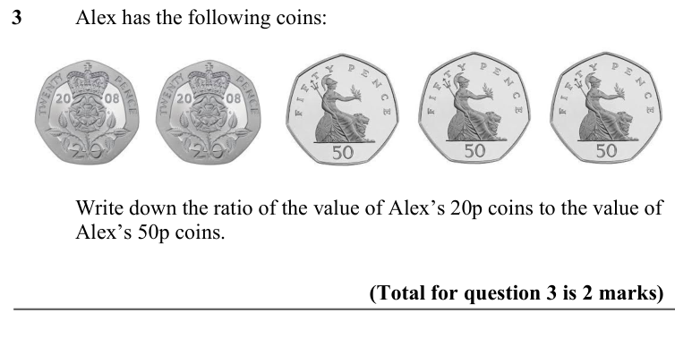

Text (lossy): 3       / Alex has the following coins: / Write down the ratio of the value of Alex’s 20p coins to the value of  / Alex’s 50p coins.  /                     / (Total for question 3 is 2 marks)

## Q4 (marks not printed · parts a, b)

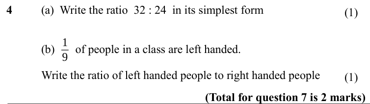

Text (lossy): 4     / (a)  Write the ratio  32 : 24  in its simplest form / 1 / 9 / (b)       of people in a class are left handed.  / Write the ratio of left handed people to right handed people / (Total for question 7 is 2 marks)

## Q5 (marks not printed · parts a, b)

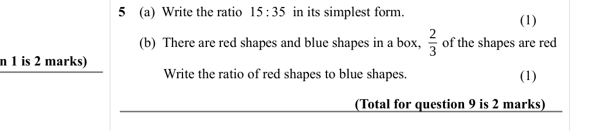

Text (lossy): 5     / (1) /       (a)  Write the ratio  15 : 35  in its simplest form. / 2 / 3 /       (b)  There are red shapes and blue shapes in a box,      of the shapes are red /  Write the ratio of red shapes to blue shapes.  / (1) / (Total for question 9 is 2 marks)

## Q6 (marks not printed · parts a, b)

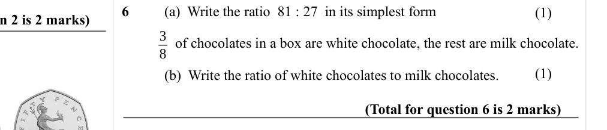

Text (lossy): 6     / (a)  Write the ratio  81 : 27  in its simplest form / (1) / 3 / 8 /    of chocolates in a box are white chocolate, the rest are milk chocolate.  /       / (1) / (b)  Write the ratio of white chocolates to milk chocolates.  / (Total for question 6 is 2 marks)

## Q7 (marks not printed · parts a, b)

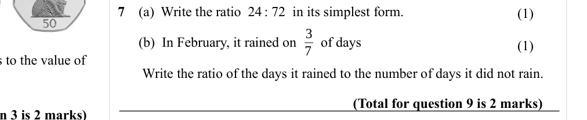

Text (lossy): 7     /       (a)  Write the ratio  24 : 72  in its simplest form. / (1) / 3 / 7 /       (b)  In February, it rained on       of days   / (1) /        Write the ratio of the days it rained to the number of days it did not rain. / (Total for question 9 is 2 marks)

## Q8 (marks not printed)

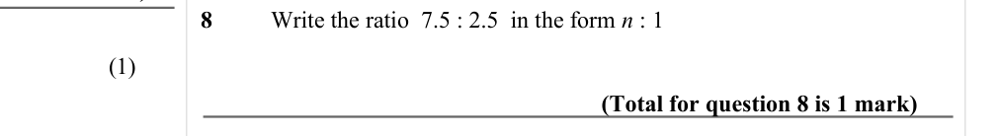

Text (lossy): 8       / Write the ratio  7.5 : 2.5  in the form n : 1 / (1) / (Total for question 8 is 1 mark)

## Q9 (marks not printed)

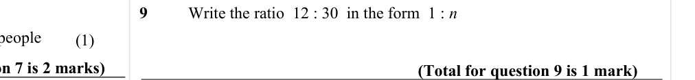

Text (lossy): 9       / Write the ratio  12 : 30  in the form  1 : n / (1) / (Total for question 9 is 1 mark)

## Q10 (marks not printed)

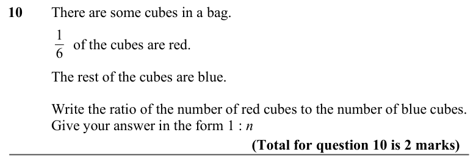

Text (lossy): 10      There are some cubes in a bag.  / 1 / 6 /       of the cubes are red.  / The rest of the cubes are blue.  / Write the ratio of the number of red cubes to the number of blue cubes.  / Give your answer in the form 1 : n  / (Total for question 10 is 2 marks)

## Q11 (marks not printed)

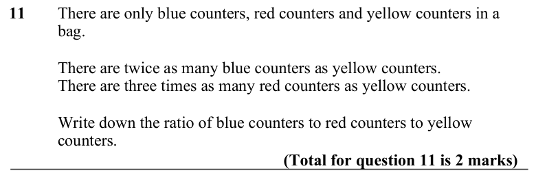

Text (lossy): 11      There are only blue counters, red counters and yellow counters in a  / bag.  / There are twice as many blue counters as yellow counters.  / There are three times as many red counters as yellow counters.  / Write down the ratio of blue counters to red counters to yellow  / counters.  / (Total for question 11 is 2 marks)

## Q12 (marks not printed)

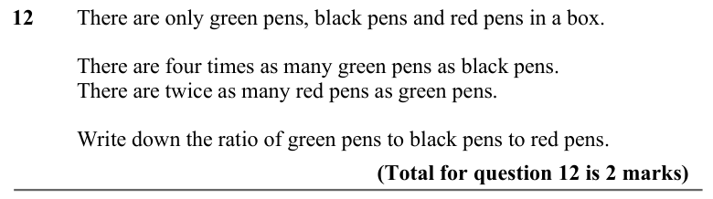

Text (lossy): 12      There are only green pens, black pens and red pens in a box.  / There are four times as many green pens as black pens. / There are twice as many red pens as green pens.  / Write down the ratio of green pens to black pens to red pens. / (Total for question 12 is 2 marks)

## Q13 (marks not printed)

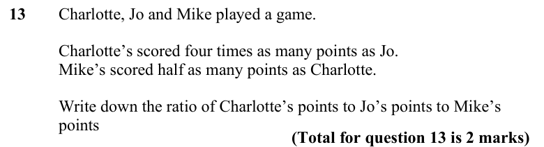

Text (lossy): 13      Charlotte, Jo and Mike played a game. / Charlotte’s scored four times as many points as Jo.  / Mike’s scored half as many points as Charlotte.  / Write down the ratio of Charlotte’s points to Jo’s points to Mike’s  / points / (Total for question 13 is 2 marks)

## Q14 (marks not printed)

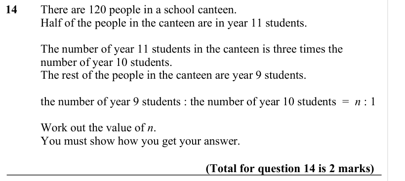

Text (lossy): 14      There are 120 people in a school canteen.  / Half of the people in the canteen are in year 11 students. /   / The number of year 11 students in the canteen is three times the  / number of year 10 students.  / The rest of the people in the canteen are year 9 students. / the number of year 9 students : the number of year 10 students  =  n : 1 / Work out the value of n.  / You must show how y

## Q15 (marks not printed)

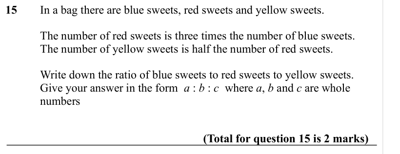

Text (lossy): 15  / In a bag there are blue sweets, red sweets and yellow sweets.  /         / The number of red sweets is three times the number of blue sweets.  /         / The number of yellow sweets is half the number of red sweets.  /         / Write down the ratio of blue sweets to red sweets to yellow sweets. /         / Give your answer in the form  a : b : c  where a, b and c are whole  / numbers    / 

## Q16 (marks not printed)

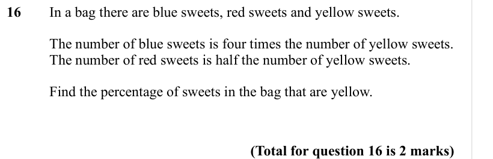

Text (lossy): 16  / In a bag there are blue sweets, red sweets and yellow sweets.  /         / The number of blue sweets is four times the number of yellow sweets.  /         / The number of red sweets is half the number of yellow sweets.  /         / Find the percentage of sweets in the bag that are yellow.   /       /        / (Total for question 16 is 2 marks)

