# Ratio — Exam Questions (GCSE Maths · Edexcel · Grade 3)

Topic code `3.5` · slug `grade-3-3-5-ratio` · source sheet sha256 `2d03a5519e2b089a…`

## Q1 (3 marks)

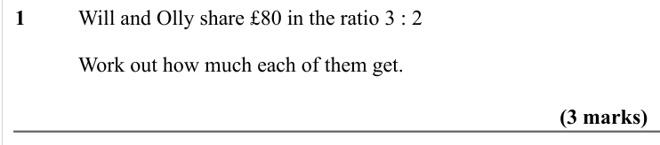

Text (lossy): 1     / Will and Olly share £80 in the ratio 3 : 2 / Work out how much each of them get. / (3 marks)

## Q2 (3 marks)

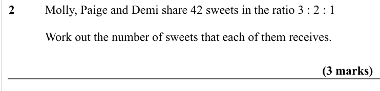

Text (lossy): 2     / Molly, Paige and Demi share 42 sweets in the ratio 3 : 2 : 1 / Work out the number of sweets that each of them receives. /   / (3 marks)

## Q3 (3 marks)

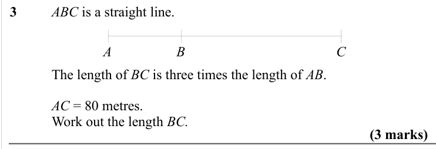

Text (lossy): 3     / ABC is a straight line. / A / B / C / The length of BC is three times the length of AB.  / AC = 80 metres. / Work out the length BC. / (3 marks)

## Q4 (marks not printed)

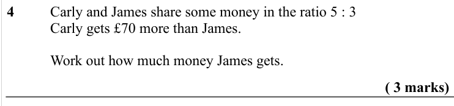

Text (lossy): 4     / Carly and James share some money in the ratio 5 : 3 / Carly gets £70 more than James.  / Work out how much money James gets.  / ( 3 marks)

## Q5 (marks not printed)

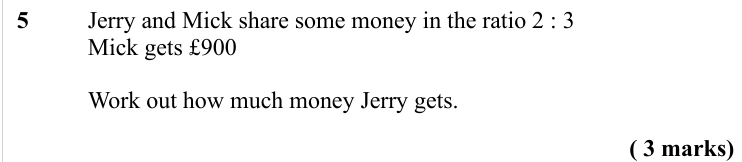

Text (lossy): 5     / Jerry and Mick share some money in the ratio 2 : 3 / Mick gets £900 / Work out how much money Jerry gets.  / ( 3 marks)

## Q6 (3 marks)

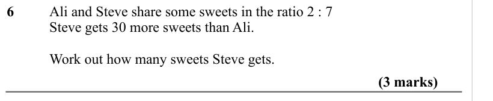

Text (lossy): 6     / Ali and Steve share some sweets in the ratio 2 : 7 / Steve gets 30 more sweets than Ali.  / Work out how many sweets Steve gets.  / (3 marks)

## Q7 (3 marks)

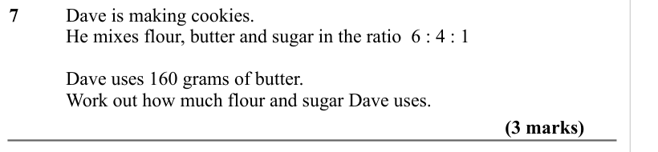

Text (lossy): 7     / Dave is making cookies.  / He mixes flour, butter and sugar in the ratio  6 : 4 : 1 / Dave uses 160 grams of butter. / Work out how much flour and sugar Dave uses.  / (3 marks)

## Q8 (3 marks)

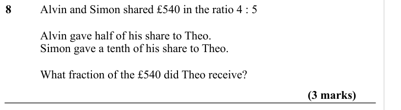

Text (lossy): 8    / Alvin and Simon shared £540 in the ratio 4 : 5 / Alvin gave half of his share to Theo. / Simon gave a tenth of his share to Theo. / What fraction of the £540 did Theo receive? / (3 marks)

## Q9 (3 marks)

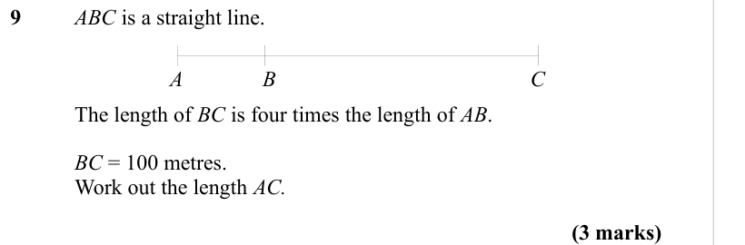

Text (lossy): 9     / ABC is a straight line. / A / B / C / The length of BC is four times the length of AB.  / BC = 100 metres. / Work out the length AC. / (3 marks)

## Q10 (4 marks)

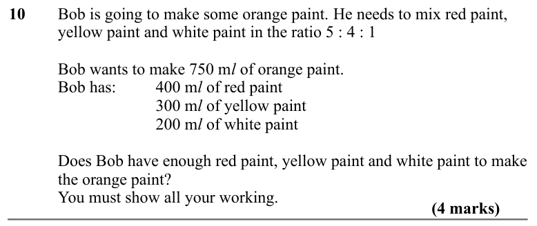

Text (lossy): 10     / Bob is going to make some orange paint. He needs to mix red paint,  / yellow paint and white paint in the ratio 5 : 4 : 1  / Bob wants to make 750 m l of orange paint.  / Bob has: / 400 m l of red paint / 300 m l of yellow paint / 200 m l of white paint / Does Bob have enough red paint, yellow paint and white paint to make  / the orange paint? / You must show all your working.  / (4 marks

## Q11 (3 marks)

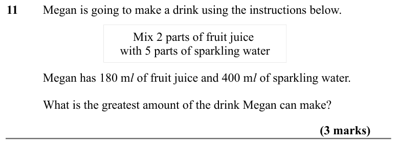

Text (lossy): 11     / Megan is going to make a drink using the instructions below.  /   / Mix 2 parts of fruit juice  / with 5 parts of sparkling water / Megan has 180 m l of fruit juice and 400 m l of sparkling water.  / What is the greatest amount of the drink Megan can make? / (3 marks)

## Q12 (4 marks)

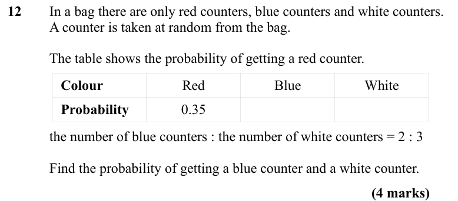

Text (lossy): 12     / In a bag there are only red counters, blue counters and white counters. / A counter is taken at random from the bag. / The table shows the probability of getting a red counter. / Colour / Red / Blue / White / Probability / 0.35 / the number of blue counters : the number of white counters = 2 : 3 / Find the probability of getting a blue counter and a white counter.  / (4 marks)

## Q13 (4 marks)

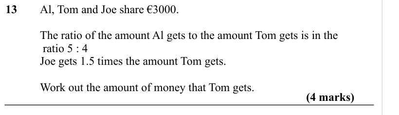

Text (lossy): 13     / Al, Tom and Joe share €3000. / The ratio of the amount Al gets to the amount Tom gets is in the /  ratio 5 : 4 / Joe gets 1.5 times the amount Tom gets.  / Work out the amount of money that Tom gets.   / (4 marks)

## Q14 (4 marks)

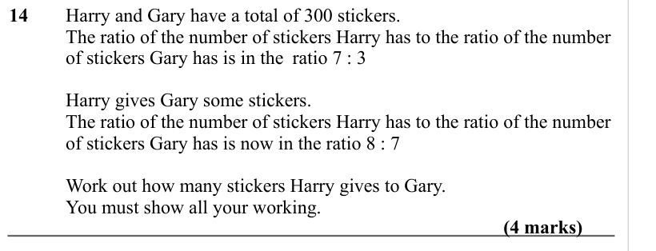

Text (lossy): 14     / Harry and Gary have a total of 300 stickers. / The ratio of the number of stickers Harry has to the ratio of the number  / of stickers Gary has is in the ratio 7 : 3 / Harry gives Gary some stickers.  / The ratio of the number of stickers Harry has to the ratio of the number  / of stickers Gary has is now in the ratio 8 : 7 / Work out how many stickers Harry gives to Gary.  / You must sho

## Q15 (4 marks)

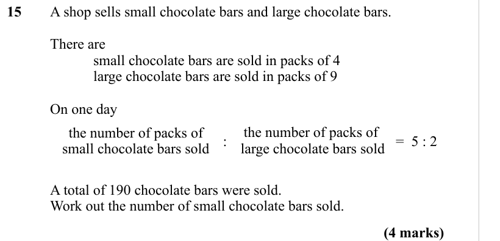

Text (lossy): 15     / A shop sells small chocolate bars and large chocolate bars. / There are  / small chocolate bars are sold in packs of 4 / large chocolate bars are sold in packs of 9 / On one day  / the number of packs of  / large chocolate bars sold / the number of packs of  / small chocolate bars sold  / :    / =  5 : 2 / A total of 190 chocolate bars were sold.  / Work out the number of small chocolate 

## Q16 (4 marks)

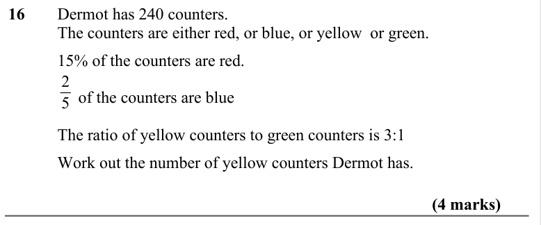

Text (lossy): 16  / Dermot has 240 counters. /   / The counters are either red, or blue, or yellow  or green.  /   / 15% of the counters are red.  / 2 / 5 /      of the counters are blue / The ratio of yellow counters to green counters is 3:1 /   / Work out the number of yellow counters Dermot has. /                     / (4 marks)

## Q17 (4 marks)

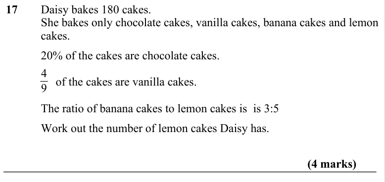

Text (lossy): 17  / Daisy bakes 180 cakes. /   / She bakes only chocolate cakes, vanilla cakes, banana cakes and lemon  / cakes. /   / 20% of the cakes are chocolate cakes.   / 4 / 9 /      of the cakes are vanilla cakes.  / The ratio of banana cakes to lemon cakes is  is 3:5 /   / Work out the number of lemon cakes Daisy has. /                     / (4 marks)

## Q18 (4 marks)

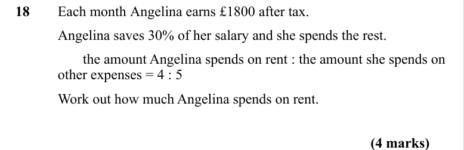

Text (lossy): 18 / Each month Angelina earns £1800 after tax.  / Angelina saves 30% of her salary and she spends the rest.  /        the amount Angelina spends on rent : the amount she spends on  / other expenses = 4 : 5 / Work out how much Angelina spends on rent.  / (4 marks)

## Q19 (2 marks)

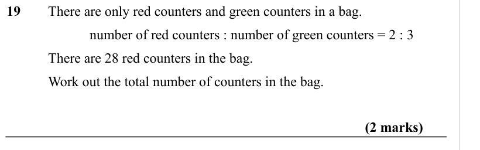

Text (lossy): 19 / There are only red counters and green counters in a bag. / number of red counters : number of green counters = 2 : 3 /   / There are 28 red counters in the bag. /   / Work out the total number of counters in the bag. / (2 marks)

## Q20 (3 marks)

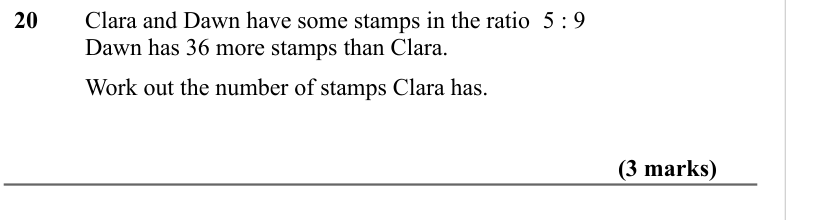

Text (lossy): 20 / Clara and Dawn have some stamps in the ratio  5 : 9 /   / Dawn has 36 more stamps than Clara.  / Work out the number of stamps Clara has.  / (3 marks)

## Q21 (3 marks)

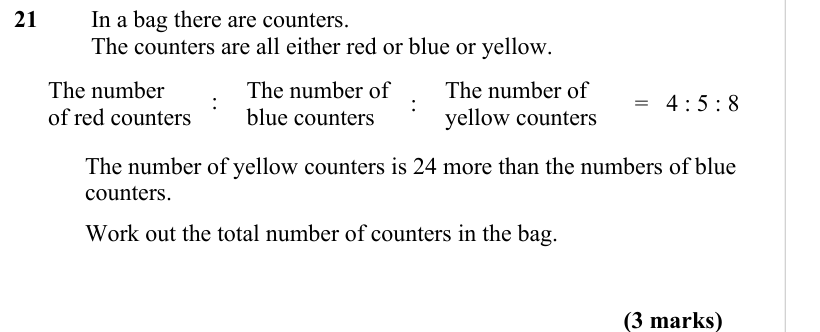

Text (lossy): 21   /  In a bag there are counters.  /  The counters are all either red or blue or yellow.  / The number of  / yellow counters /  : / The number / of red counters    / =   4 : 5 : 8 / : / The number of  / blue counters / The number of yellow counters is 24 more than the numbers of blue  / counters. / Work out the total number of counters in the bag.  / (3 marks)

## Q22 (4 marks)

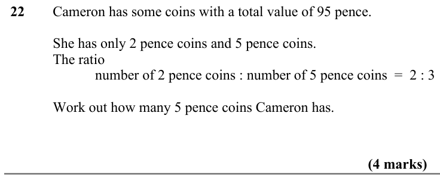

Text (lossy): 22    / Cameron has some coins with a total value of 95 pence. /   / She has only 2 pence coins and 5 pence coins. /   / The ratio  / number of 2 pence coins : number of 5 pence coins  =  2 : 3 /   / Work out how many 5 pence coins Cameron has. / (4 marks)

## Q23 (marks not printed)

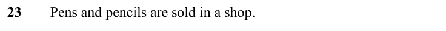

Text (lossy): 23  / Pens and pencils are sold in a shop.

## Q24 (4 marks)

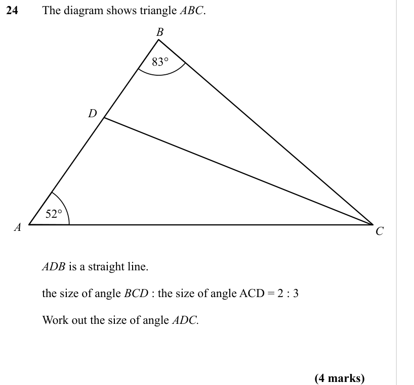

Text (lossy): 24 / The diagram shows triangle ABC. / B / 83° / D / 52° / C / A / ADB is a straight line. /   / the size of angle BCD : the size of angle ACD = 2 : 3 /   / Work out the size of angle ADC. / (4 marks)

