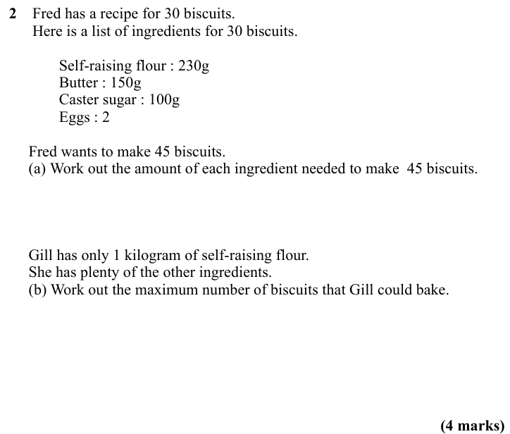
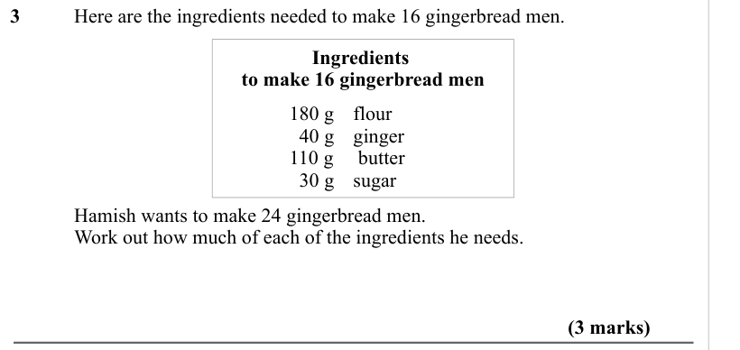
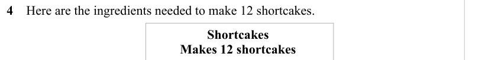
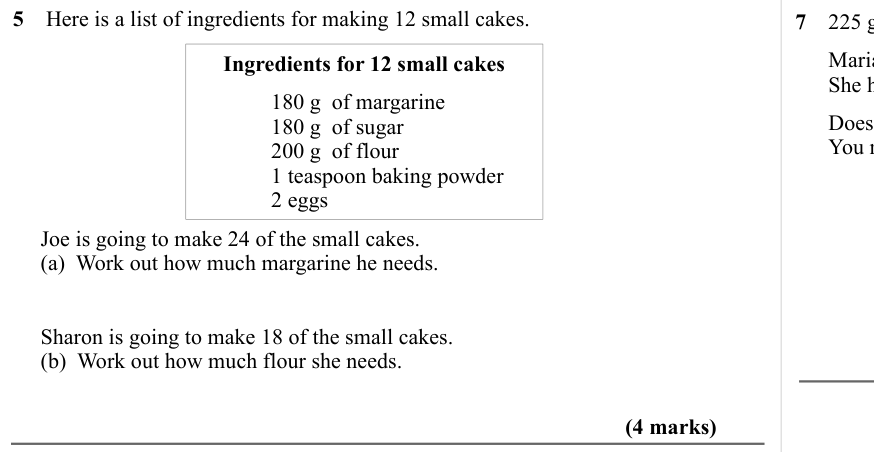
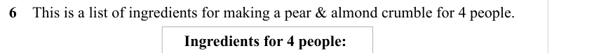
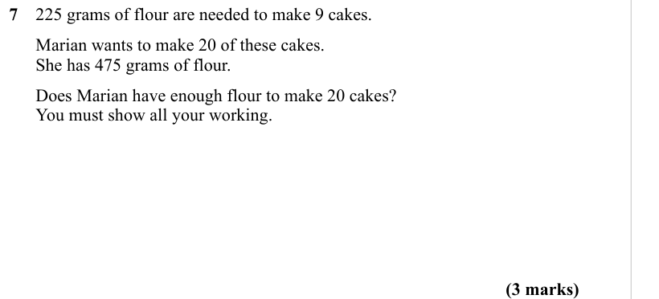

# Proportion — Exam Questions (GCSE Maths · Edexcel · Grade 3)

Topic code `3.6` · slug `grade-3-3-6-proportion` · source sheet sha256 `fb1eab398f680936…`

## Q1 (marks not printed)

Text (lossy): 1    Here is a list of ingredients for making 10 Flapjacks. / Ingredients for 10 Flapjacks

## Q2 (4 marks · parts a, b)

Text (lossy): 2    Fred has a recipe for 30 biscuits. /       Here is a list of ingredients for 30 biscuits. / Self-raising flour : 230g / Butter : 150g / Caster sugar : 100g / Eggs : 2 /      Fred wants to make 45 biscuits. /      (a) Work out the amount of each ingredient needed to make  45 biscuits. /      Gill has only 1 kilogram of self-raising flour.  /      She has plenty of the other ingredients. /     

## Q3 (3 marks)

Text (lossy): 3  / Here are the ingredients needed to make 16 gingerbread men.  / Ingredients  / to make 16 gingerbread men /   / 180 g flour  /   40 g / ginger  / 110 g /  butter  /   30 g / sugar  / Hamish wants to make 24 gingerbread men.  / Work out how much of each of the ingredients he needs.  / (3 marks)

## Q4 (marks not printed)

Text (lossy): 4    Here are the ingredients needed to make 12 shortcakes.  / Shortcakes  / Makes 12 shortcakes

## Q5 (4 marks · parts a, b)

Text (lossy): 5    Here is a list of ingredients for making 12 small cakes. / Ingredients for 12 small cakes / 180 g  of margarine  / 180 g  of sugar  / 200 g  of flour / 1 teaspoon baking powder / 2 eggs /      Joe is going to make 24 of the small cakes.   /      (a)  Work out how much margarine he needs. /   /      Sharon is going to make 18 of the small cakes.   /      (b)  Work out how much flour she needs.

## Q6 (marks not printed)

Text (lossy): 6    This is a list of ingredients for making a pear & almond crumble for 4 people. / Ingredients for 4 people:

## Q7 (3 marks)

Text (lossy): 7    225 grams of flour are needed to make 9 cakes.  /       Marian wants to make 20 of these cakes.  /       She has 475 grams of flour.  /       Does Marian have enough flour to make 20 cakes?  /       You must show all your working. / (3 marks)

