# Percentage Change — Exam Questions (GCSE Maths · Edexcel · Grade 3)

Topic code `3.8` · slug `grade-3-3-8-percentage-change` · source sheet sha256 `3de7a7e642bd3b0c…`

## Q1 (marks not printed)

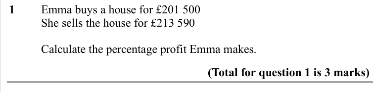

Text (lossy): 1  / Emma buys a house for £201 500 / She sells the house for £213 590 / Calculate the percentage profit Emma makes. / (Total for question 1 is 3 marks)

## Q2 (marks not printed)

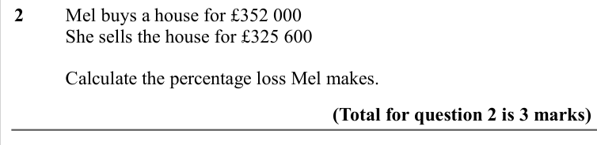

Text (lossy): 2  / Mel buys a house for £352 000 / She sells the house for £325 600 / Calculate the percentage loss Mel makes. / (Total for question 2 is 3 marks)

## Q3 (marks not printed)

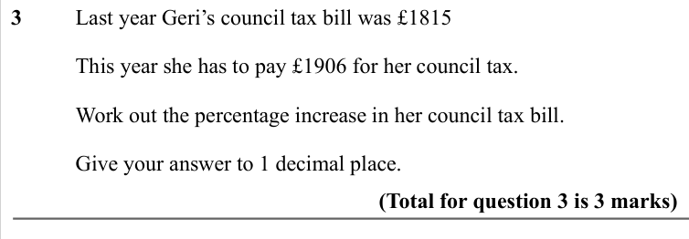

Text (lossy): 3  / Last year Geri’s council tax bill was £1815 /   / This year she has to pay £1906 for her council tax. /   / Work out the percentage increase in her council tax bill. / Give your answer to 1 decimal place. / (Total for question 3 is 3 marks)

## Q4 (marks not printed)

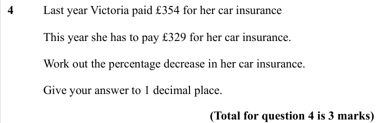

Text (lossy): 4  / Last year Victoria paid £354 for her car insurance /   / This year she has to pay £329 for her car insurance. /   / Work out the percentage decrease in her car insurance. / Give your answer to 1 decimal place. / (Total for question 4 is 3 marks)

## Q5 (marks not printed)

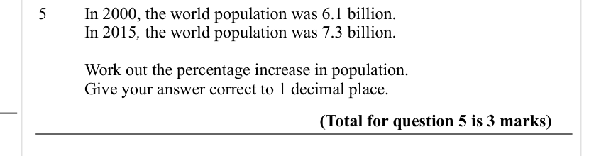

Text (lossy): 5  / In 2000, the world population was 6.1 billion. / In 2015, the world population was 7.3 billion. / Work out the percentage increase in population. / Give your answer correct to 1 decimal place. / (Total for question 5 is 3 marks)

## Q6 (marks not printed)

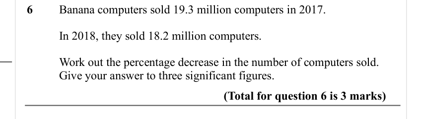

Text (lossy): 6 / Banana computers sold 19.3 million computers in 2017. / In 2018, they sold 18.2 million computers. / Work out the percentage decrease in the number of computers sold. / Give your answer to three significant figures.  / (Total for question 6 is 3 marks)

## Q7 (marks not printed)

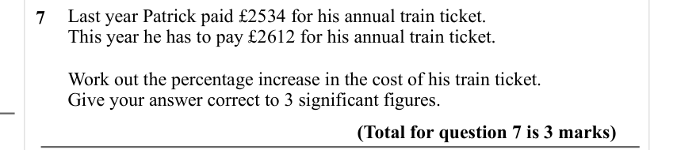

Text (lossy): 7      Last year Patrick paid £2534 for his annual train ticket.  /       This year he has to pay £2612 for his annual train ticket.  /       Work out the percentage increase in the cost of his train ticket.  /       Give your answer correct to 3 significant figures.  / (Total for question 7 is 3 marks)

## Q8 (marks not printed)

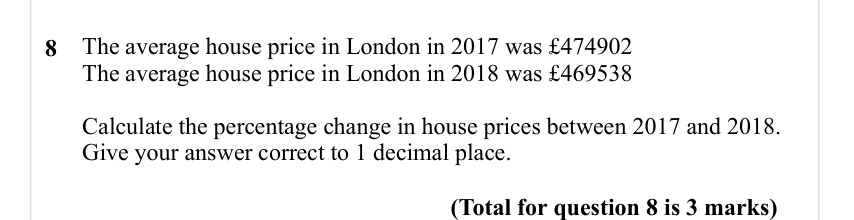

Text (lossy): 8 /     /          / The average house price in London in 2017 was £474902 / The average house price in London in 2018 was £469538 / Calculate the percentage change in house prices between 2017 and 2018.  / Give your answer correct to 1 decimal place. / (Total for question 8 is 3 marks)

## Q9 (marks not printed)

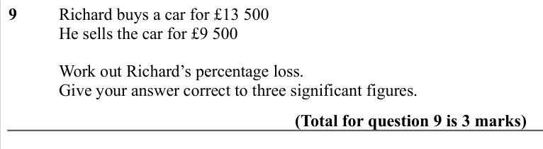

Text (lossy): 9  / Richard buys a car for £13 500 /   / He sells the car for £9 500 /   / Work out Richard’s percentage loss. / Give your answer correct to three significant figures. / (Total for question 9 is 3 marks)

## Q10 (marks not printed)

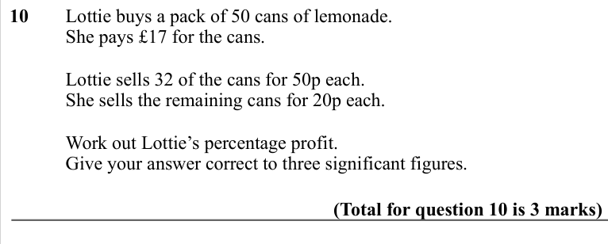

Text (lossy): 10  / Lottie buys a pack of 50 cans of lemonade.  / She pays £17 for the cans.  /   / Lottie sells 32 of the cans for 50p each.  / She sells the remaining cans for 20p each.  /   / Work out Lottie’s percentage profit. / Give your answer correct to three significant figures. / (Total for question 10 is 3 marks)

## Q11 (marks not printed)

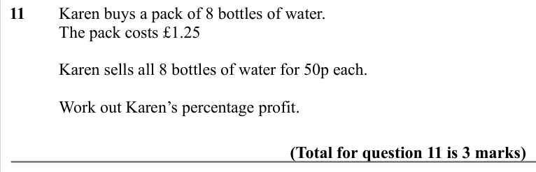

Text (lossy): 11  / Karen buys a pack of 8 bottles of water. /   / The pack costs £1.25 /   / Karen sells all 8 bottles of water for 50p each. /   / Work out Karen’s percentage profit. / (Total for question 11 is 3 marks)

## Q12 (marks not printed)

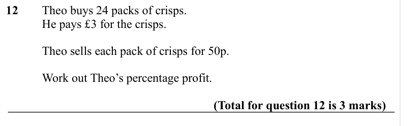

Text (lossy): 12  / Theo buys 24 packs of crisps. /   / He pays £3 for the crisps.  /   / Theo sells each pack of crisps for 50p.  /   / Work out Theo’s percentage profit. / (Total for question 12 is 3 marks)

## Q13 (marks not printed)

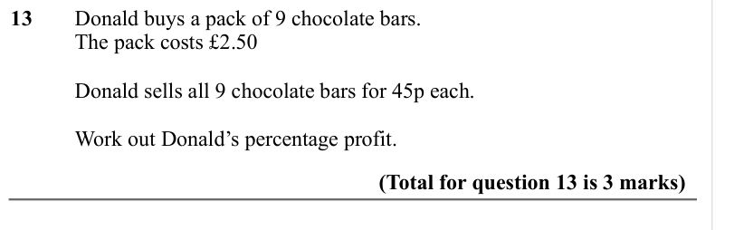

Text (lossy): 13  / Donald buys a pack of 9 chocolate bars. /   / The pack costs £2.50 /   / Donald sells all 9 chocolate bars for 45p each. /   / Work out Donald’s percentage profit. / (Total for question 13 is 3 marks)

## Q14 (marks not printed)

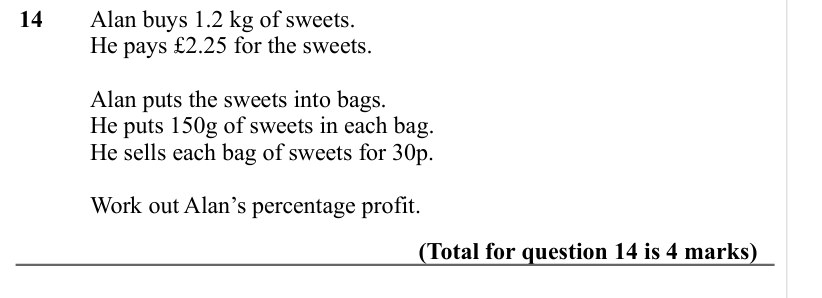

Text (lossy): 14  / Alan buys 1.2 kg of sweets. /   / He pays £2.25 for the sweets.  /   / Alan puts the sweets into bags.  / He puts 150g of sweets in each bag. / He sells each bag of sweets for 30p.  /   / Work out Alan’s percentage profit. / (Total for question 14 is 4 marks)

