# Exchange Rates — Exam Questions (GCSE Maths · Edexcel · Grade 3)

Topic code `3.9` · slug `grade-3-3-9-exchange-rates` · source sheet sha256 `47799248bcf8d276…`

## Q1 (marks not printed · parts a, b)

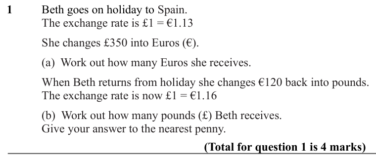

Text (lossy): 1 / Beth goes on holiday to Spain. / The exchange rate is £1 = €1.13  / She changes £350 into Euros (€).  / (a)  Work out how many Euros she receives. / When Beth returns from holiday she changes €120 back into pounds.  / The exchange rate is now £1 = €1.16 / (b)  Work out how many pounds (£) Beth receives.  / Give your answer to the nearest penny.   / (Total for question 1 is 4 marks)

## Q2 (marks not printed · parts a, b)

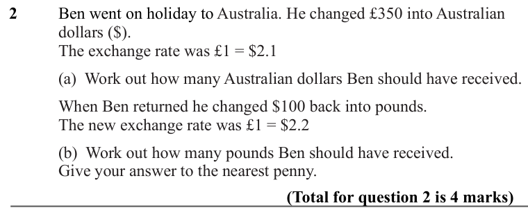

Text (lossy): 2 / Ben went on holiday to Australia. He changed £350 into Australian  / dollars ($).  / The exchange rate was £1 = $2.1 / (a)  Work out how many Australian dollars Ben should have received. / When Ben returned he changed $100 back into pounds.  / The new exchange rate was £1 = $2.2 / (b)  Work out how many pounds Ben should have received.  / Give your answer to the nearest penny.   / (Total for q

## Q3 (marks not printed)

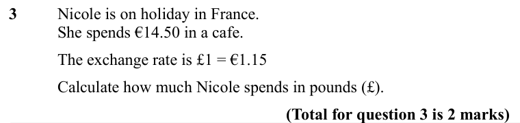

Text (lossy): 3     / Nicole is on holiday in France.  / She spends €14.50 in a cafe.   / The exchange rate is £1 = €1.15 /   /        / Calculate how much Nicole spends in pounds (£).  / (Total for question 3 is 2 marks)

## Q4 (marks not printed)

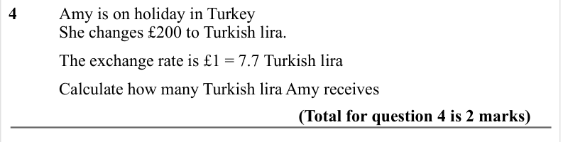

Text (lossy): 4     / Amy is on holiday in Turkey  / She changes £200 to Turkish lira.  / The exchange rate is £1 = 7.7 Turkish lira /        / Calculate how many Turkish lira Amy receives / (Total for question 4 is 2 marks)

## Q5 (marks not printed)

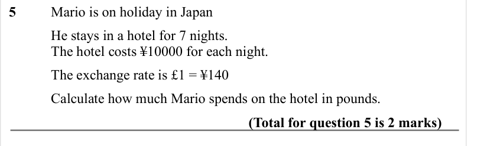

Text (lossy): 5     / Mario is on holiday in Japan  / He stays in a hotel for 7 nights.  / The hotel costs ¥10000 for each night.  / The exchange rate is £1 = ¥140  /   /        / Calculate how much Mario spends on the hotel in pounds.  / (Total for question 5 is 2 marks)

## Q6 (marks not printed)

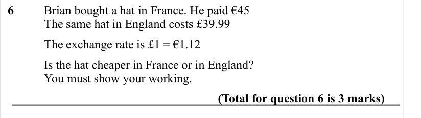

Text (lossy): 6       / Brian bought a hat in France. He paid €45 /          / The same hat in England costs £39.99  /          / The exchange rate is £1 = €1.12 /   /         / Is the hat cheaper in France or in England?  /          / You must show your working.  / (Total for question 6 is 3 marks)

## Q7 (marks not printed)

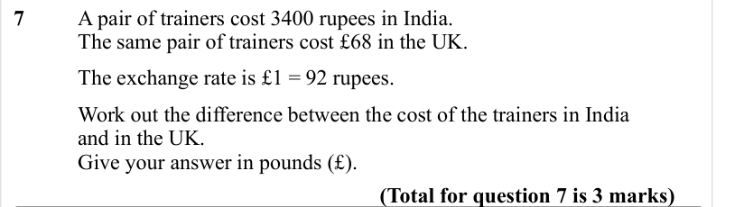

Text (lossy): 7     / A pair of trainers cost 3400 rupees in India.  / The same pair of trainers cost £68 in the UK.  /     / The exchange rate is £1 = 92 rupees. / Work out the difference between the cost of the trainers in India  / and in the UK. / Give your answer in pounds (£). /   / (Total for question 7 is 3 marks)

## Q8 (marks not printed)

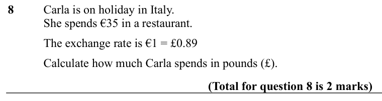

Text (lossy): 8     / Carla is on holiday in Italy.  / She spends €35 in a restaurant.   / The exchange rate is €1 = £0.89 /   /        / Calculate how much Carla spends in pounds (£).  / (Total for question 8 is 2 marks)

## Q9 (marks not printed)

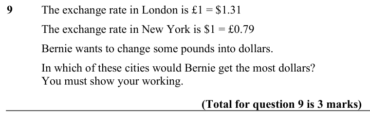

Text (lossy): 9      / The exchange rate in London is £1 = $1.31 /          / The exchange rate in New York is $1 = £0.79 /          / Bernie wants to change some pounds into dollars.  /          / In which of these cities would Bernie get the most dollars? /          / You must show your working.  / (Total for question 9 is 3 marks)

## Q10 (marks not printed)

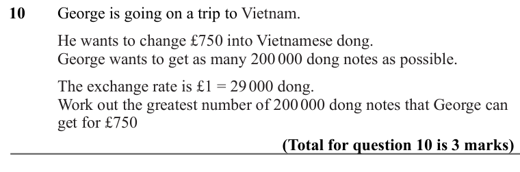

Text (lossy): 10 / George is going on a trip to Vietnam. / He wants to change £750 into Vietnamese dong. / George wants to get as many 200 000 dong notes as possible. / The exchange rate is £1 = 29 000 dong. / Work out the greatest number of 200 000 dong notes that George can  / get for £750 / (Total for question 10 is 3 marks)

## Q11 (marks not printed)

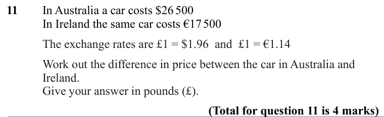

Text (lossy): 11 / In Australia a car costs $26 500 / In Ireland the same car costs €17 500 / The exchange rates are £1 = $1.96  and  £1 = €1.14 / Work out the difference in price between the car in Australia and  / Ireland.  / Give your answer in pounds (£).  / (Total for question 11 is 4 marks)

## Q12 (marks not printed)

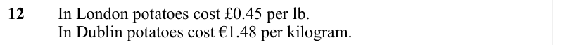

Text (lossy): 12     / In London potatoes cost £0.45 per lb.  / In Dublin potatoes cost €1.48 per kilogram.

## Q13 (marks not printed)

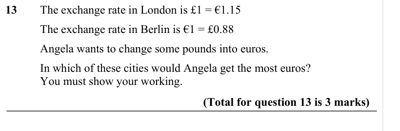

Text (lossy): 13   / The exchange rate in London is £1 = €1.15 /       / The exchange rate in Berlin is €1 = £0.88 / Angela wants to change some pounds into euros.  / In which of these cities would Angela get the most euros? / You must show your working.  / (Total for question 13 is 3 marks)

## Q14 (marks not printed)

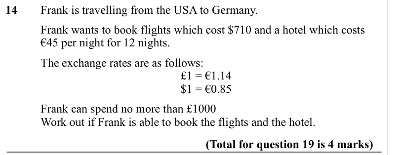

Text (lossy): 14     / Frank is travelling from the USA to Germany.  /          / Frank wants to book flights which cost $710 and a hotel which costs  / €45 per night for 12 nights.  /          / The exchange rates are as follows: / £1 = €1.14 /        / $1 = €0.85 /          / Frank can spend no more than £1000 /          / Work out if Frank is able to book the flights and the hotel.  /        / (Total for que

