# Compound Interest and Depreciation — Exam Questions (GCSE Maths · Edexcel · Grade 4)

Topic code `4.1` · slug `grade-4-4-1-compound-interest-and-depreciation` · source sheet sha256 `9839634c4ab3b214…`

## Q1 (marks not printed · parts a, b)

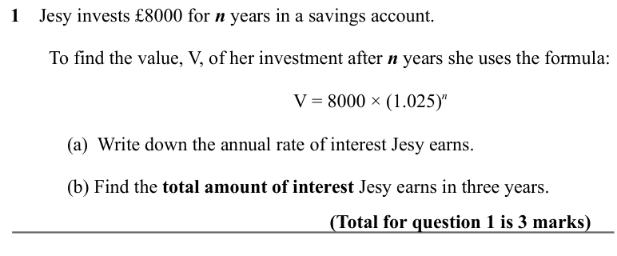

Text (lossy): 1    Jesy invests £8000 for n years in a savings account.  /         To find the value, V, of her investment after n years she uses the formula: / V = 8000 × (1.025)n  / (a)  Write down the annual rate of interest Jesy earns.  / (b) Find the total amount of interest Jesy earns in three years.  / (Total for question 1 is 3 marks)

## Q2 (marks not printed)

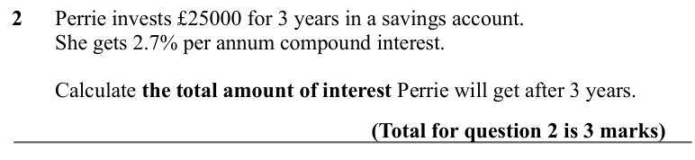

Text (lossy): 2      Perrie invests £25000 for 3 years in a savings account.  /         She gets 2.7% per annum compound interest.  /         Calculate the total amount of interest Perrie will get after 3 years.  / (Total for question 2 is 3 marks)

## Q3 (marks not printed)

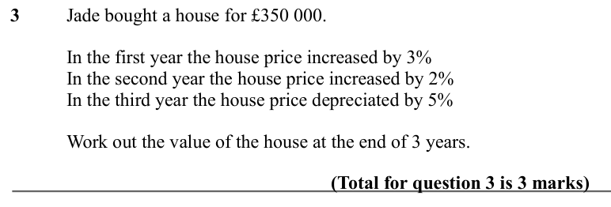

Text (lossy): 3 / Jade bought a house for £350 000. / In the first year the house price increased by 3% / In the second year the house price increased by 2% / In the third year the house price depreciated by 5% / Work out the value of the house at the end of 3 years.  / (Total for question 3 is 3 marks)

## Q4 (marks not printed)

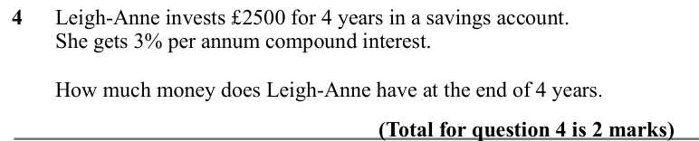

Text (lossy): 4      Leigh-Anne invests £2500 for 4 years in a savings account.  /         She gets 3% per annum compound interest.  /         How much money does Leigh-Anne have at the end of 4 years.  / (Total for question 4 is 2 marks)

## Q5 (marks not printed)

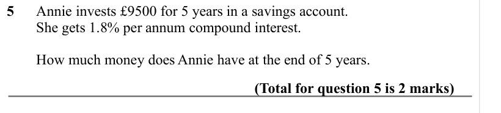

Text (lossy): 5      Annie invests £9500 for 5 years in a savings account.  /         She gets 1.8% per annum compound interest.  /         How much money does Annie have at the end of 5 years.  / (Total for question 5 is 2 marks)

## Q6 (marks not printed)

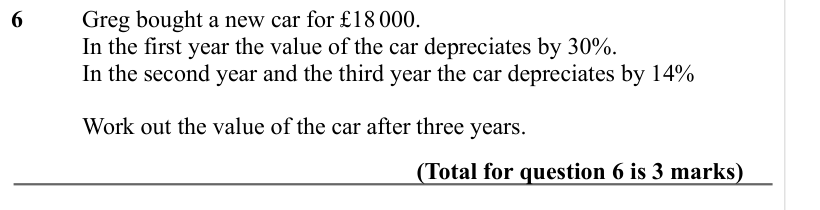

Text (lossy): 6    / Greg bought a new car for £18 000.  / In the first year the value of the car depreciates by 30%.  / In the second year and the third year the car depreciates by 14% /        / Work out the value of the car after three years.  / (Total for question 6 is 3 marks)

## Q7 (marks not printed)

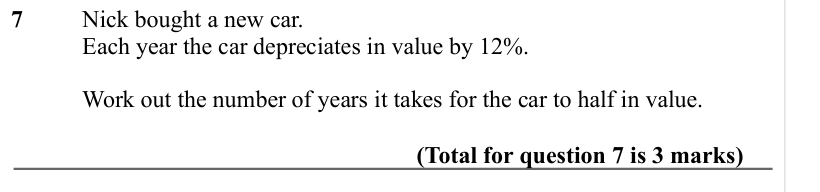

Text (lossy): 7    / Nick bought a new car.  /        / Each year the car depreciates in value by 12%.  /        / Work out the number of years it takes for the car to half in value.  / (Total for question 7 is 3 marks)

## Q8 (marks not printed)

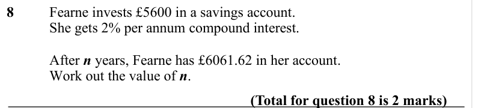

Text (lossy): 8     / Fearne invests £5600 in a savings account.  /          / She gets 2% per annum compound interest.  /          / After n years, Fearne has £6061.62 in her account.  / Work out the value of n.  / (Total for question 8 is 2 marks)

## Q9 (marks not printed)

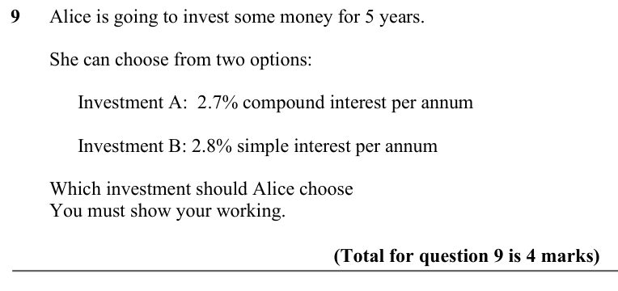

Text (lossy): 9      Alice is going to invest some money for 5 years.  /         She can choose from two options: /   Investment A:  2.7% compound interest per annum /   Investment B: 2.8% simple interest per annum /         Which investment should Alice choose  /         You must show your working. / (Total for question 9 is 4 marks)

## Q10 (marks not printed)

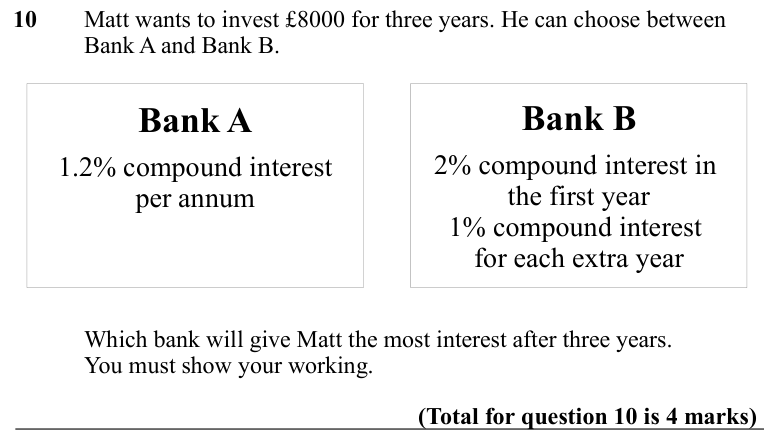

Text (lossy): 10     / Matt wants to invest £8000 for three years. He can choose between  / Bank A and Bank B.  / Bank B / Bank A / 2% compound interest in  / 1.2% compound interest / the first year / 1% compound interest  / per annum /       / for each extra year / Which bank will give Matt the most interest after three years.  / You must show your working.  / (Total for question 10 is 4 marks)

## Q11 (marks not printed)

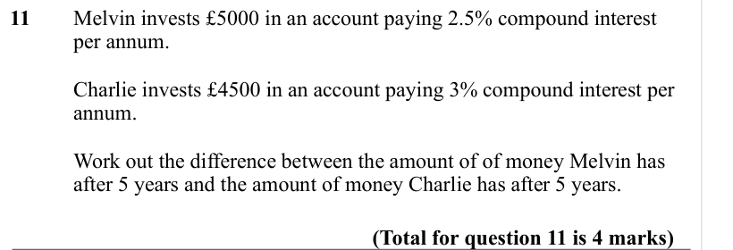

Text (lossy): 11     / Melvin invests £5000 in an account paying 2.5% compound interest  / per annum.  / Charlie invests £4500 in an account paying 3% compound interest per  / annum.  / Work out the difference between the amount of of money Melvin has  / after 5 years and the amount of money Charlie has after 5 years.   / (Total for question 11 is 4 marks)

