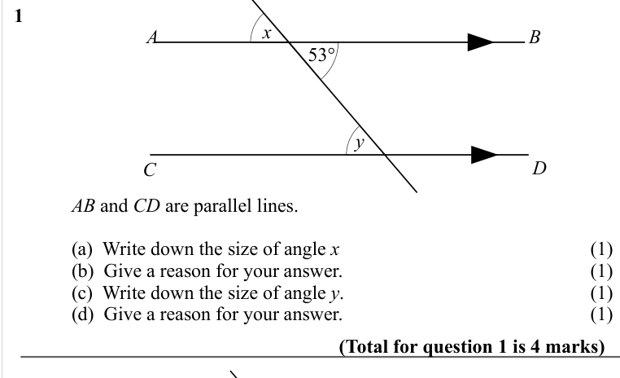
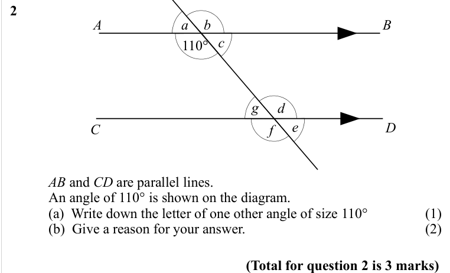
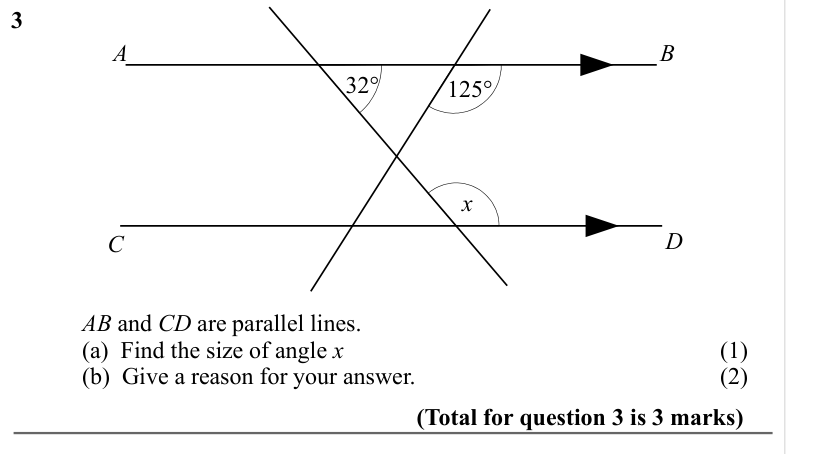
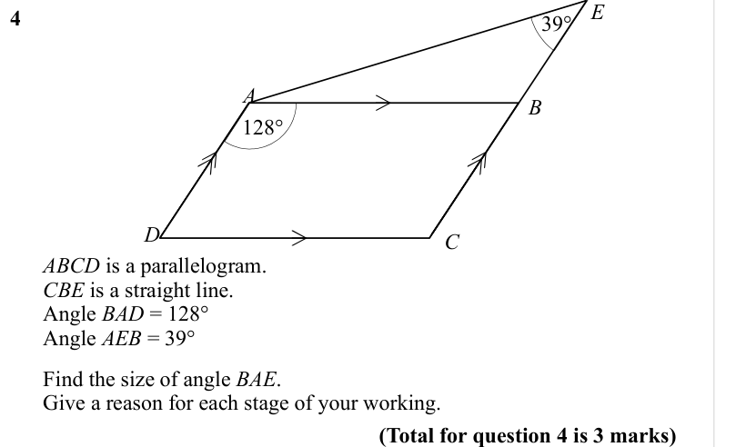
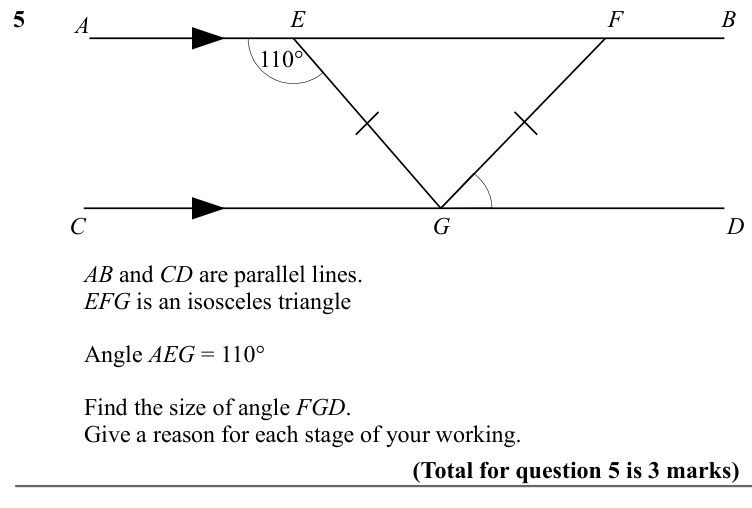
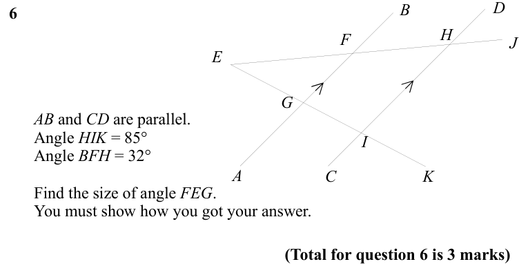
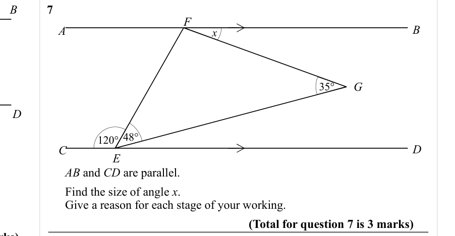
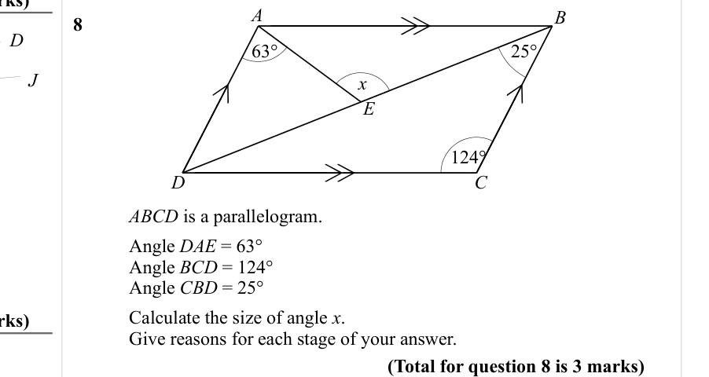

# Angles in Parallel Lines — Exam Questions (GCSE Maths · Edexcel · Grade 4)

Topic code `4.10` · slug `grade-4-4-10-angles-in-parallel-lines` · source sheet sha256 `8205e3c54e96228d…`

## Q1 (marks not printed · parts a, b, c, d)

Text (lossy): 1     / 53° / x / B / A / D / y / C /        / AB and CD are parallel lines.  / (a)  Write down the size of angle x / (1) / (b)  Give a reason for your answer. / (1) / (c)  Write down the size of angle y.  / (1) / (d)  Give a reason for your answer. / (1) / (Total for question 1 is 4 marks)

## Q2 (marks not printed · parts a, b)

Text (lossy): 2     / 110° / a / B / b / A / c / g / d / e / f / D / C /        / AB and CD are parallel lines.  / An angle of 110° is shown on the diagram.  / (a)  Write down the letter of one other angle of size 110°  / (1) / (b)  Give a reason for your answer. /   / (2) / (Total for question 2 is 3 marks)

## Q3 (marks not printed · parts a, b)

Text (lossy): 3     / A / B / 32° / 125° / x / D / C /        / AB and CD are parallel lines.  / (a)  Find the size of angle x / (1) / (b)  Give a reason for your answer. / (2) /   / (Total for question 3 is 3 marks)

## Q4 (marks not printed)

Text (lossy): 4     / 39° / A / B / 128°  / C / D /       ABCD is a parallelogram.  /       CBE is a straight line.       /       Angle BAD = 128°  /       Angle AEB = 39°  /       Find the size of angle BAE.  /       Give a reason for each stage of your working.  / (Total for question 4 is 3 marks)

## Q5 (marks not printed)

Text (lossy): 5     / A / B / E / F / 110° / C / D / G /        / AB and CD are parallel lines.  / EFG is an isosceles triangle  /        / Angle AEG = 110°       /        / Find the size of angle FGD.  /        / Give a reason for each stage of your working.  / (Total for question 5 is 3 marks)

## Q6 (marks not printed)

Text (lossy): 6     / H / F / E / G /       AB and CD are parallel.  /       Angle HIK = 85°       /       Angle BFH = 32°  / I / A / C / K /       Find the size of angle FEG.  /       You must show how you got your answer.  / (Total for question 6 is 3 marks)

## Q7 (marks not printed)

Text (lossy): 7     / F / A / B / x / G / 35° / 120° 48° / C / D / E /       AB and CD are parallel.  /       Find the size of angle x.  /       Give a reason for each stage of your working. / (Total for question 7 is 3 marks)

## Q8 (marks not printed)

Text (lossy): 8     / A / B / D / 63°  / 25°  / J / x / E / 124° / C / D /        / ABCD is a parallelogram. /        / Angle DAE = 63°    /        / Angle BCD = 124°    /        / Angle CBD = 25° / Calculate the size of angle x.  / Give reasons for each stage of your answer.  / (Total for question 8 is 3 marks)

