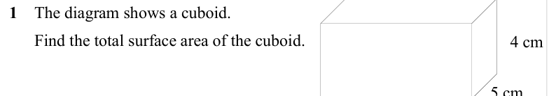
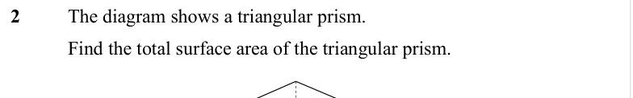
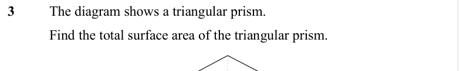
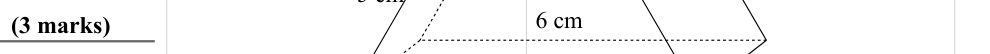
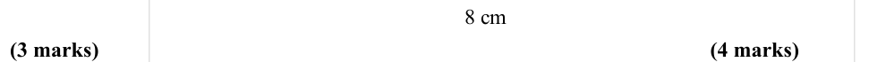

# Surface Area — Exam Questions (GCSE Maths · Edexcel · Grade 4)

Topic code `4.12` · slug `grade-4-4-12-surface-area` · source sheet sha256 `b5f77fcbc8da7f1e…`

## Q1 (marks not printed)

Text (lossy): 1    The diagram shows a cuboid. /       Find the total surface area of the cuboid.  / 4 cm

## Q2 (marks not printed)

Text (lossy): 2   / The diagram shows a triangular prism. / Find the total surface area of the triangular prism.

## Q3 (marks not printed)

Text (lossy): 3   / The diagram shows a triangular prism. / Find the total surface area of the triangular prism.

## Q4 (marks not printed)

Text (lossy): 4 cm

## Q5 (marks not printed)

## Q6 (3 marks)

Text (lossy): 6 cm / (3 marks)

## Q7 (marks not printed)

Text (lossy): 7 cm / 3 cm / 5 cm

## Q8 (7 marks)

Text (lossy): 8 cm / (3 marks) / (4 marks)

