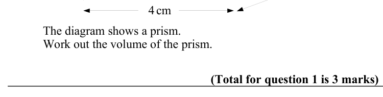
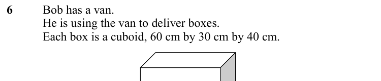
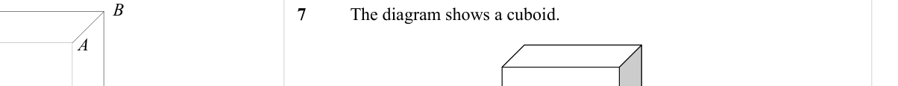
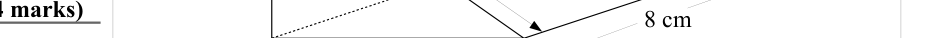

# Volume of a Prism — Exam Questions (GCSE Maths · Edexcel · Grade 4)

Topic code `4.13` · slug `grade-4-4-13-volume-of-a-prism` · source sheet sha256 `1884837360cfb4d0…`

## Q1 (marks not printed)

Text (lossy): 1

## Q2 (marks not printed)

Text (lossy): 2 cm

## Q3 (marks not printed)

Text (lossy): 3 cm

## Q4 (marks not printed)

Text (lossy): 4 cm / The diagram shows a prism.  / Work out the volume of the prism.  / (Total for question 1 is 3 marks)

## Q5 (marks not printed)

Text (lossy): 5 cm / 3 cm

## Q6 (marks not printed)

Text (lossy): 6 / Bob has a van.  / He is using the van to deliver boxes. / Each box is a cuboid, 60 cm by 30 cm by 40 cm.

## Q7 (marks not printed)

Text (lossy): 7 / The diagram shows a cuboid.

## Q8 (marks not printed)

Text (lossy): 8 cm

