# Cylinders — Exam Questions (GCSE Maths · Edexcel · Grade 4)

Topic code `4.14` · slug `grade-4-4-14-cylinders` · source sheet sha256 `c05e8306836bc1dd…`

## Q1 (marks not printed)

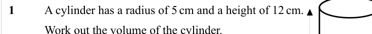

Text (lossy): 1     / A cylinder has a radius of 5 cm and a height of 12 cm.  /       / Work out the volume of the cylinder.  / Give your answer in terms of π.

## Q2 (marks not printed)

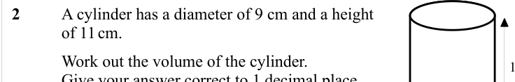

Text (lossy): 2     / A cylinder has a diameter of 9 cm and a height  / of 11 cm.  /       / Work out the volume of the cylinder.  / Give your answer correct to 1 decimal place.

## Q3 (3 marks)

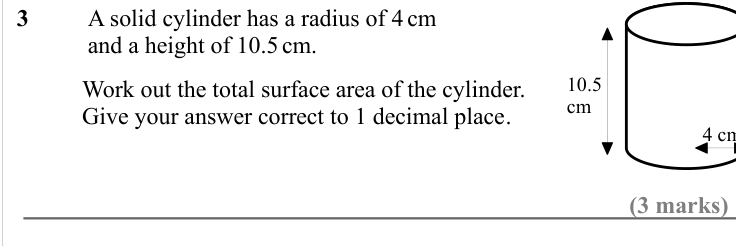

Text (lossy): 3     / A solid cylinder has a radius of 4 cm / and a height of 10.5 cm.  / 10.5  / cm   /       / Work out the total surface area of the cylinder.  / Give your answer correct to 1 decimal place. / (3 marks)

## Q4 (marks not printed)

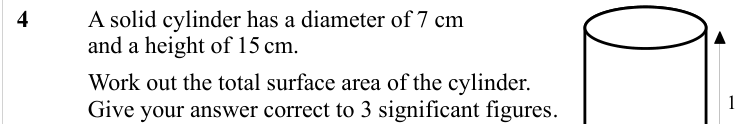

Text (lossy): 4    / A solid cylinder has a diameter of 7 cm / and a height of 15 cm.  /       / Work out the total surface area of the cylinder.  / Give your answer correct to 3 significant figures.

## Q5 (marks not printed)

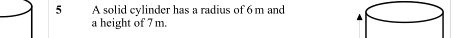

Text (lossy): 5     / A solid cylinder has a radius of 6 m and  / a height of 7 m.  /       / Work out the total surface area of the cylinder.  / Give your answer in terms of π.

## Q6 (4 marks)

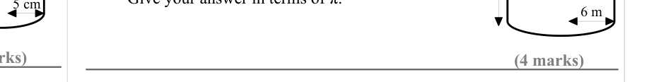

Text (lossy): 6 m   / (4 marks)

## Q7 (marks not printed)

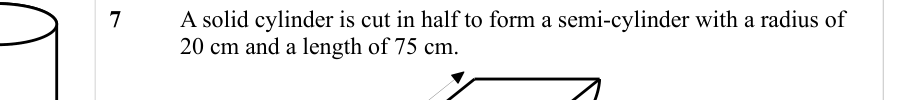

Text (lossy): 7     / A solid cylinder is cut in half to form a semi-cylinder with a radius of  / 20 cm and a length of 75 cm.

## Q8 (marks not printed)

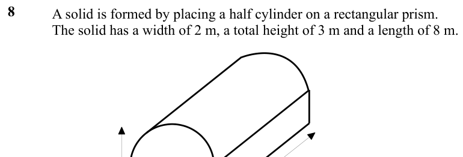

Text (lossy): 8     / A solid is formed by placing a half cylinder on a rectangular prism.  / The solid has a width of 2 m, a total height of 3 m and a length of 8 m.

## Q9 (marks not printed)

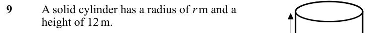

Text (lossy): 9     / A solid cylinder has a radius of r m and a / height of 12 m.

## Q10 (marks not printed)

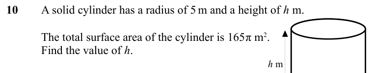

Text (lossy): 10     / A solid cylinder has a radius of 5 m and a height of h  m.  /       / The total surface area of the cylinder is 165π m 2. / Find the value of h.  / h m

## Q11 (marks not printed)

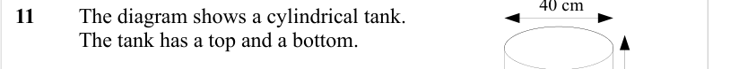

Text (lossy): 11   / The diagram shows a cylindrical tank.  / The tank has a top and a bottom.

## Q12 (marks not printed · parts a)

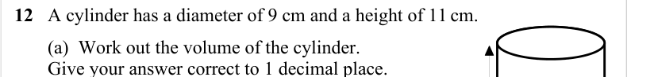

Text (lossy): 12   A cylinder has a diameter of 9 cm and a height of 11 cm.  /        (a)  Work out the volume of the cylinder.  /        Give your answer correct to 1 decimal place.

## Q13 (marks not printed)

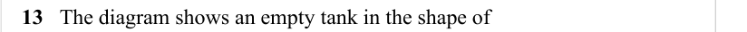

Text (lossy): 13   The diagram shows an empty tank in the shape of     /        a cylinder.

