# Loci and Construction — Exam Questions (GCSE Maths · Edexcel · Grade 4)

Topic code `4.15` · slug `grade-4-4-15-loci-and-construction` · source sheet sha256 `2f57abcbe9136331…`

## Q1 (marks not printed)

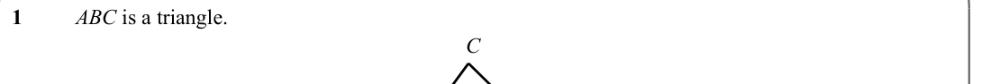

Text (lossy): 1 / ABC is a triangle.  / C

## Q2 (marks not printed)

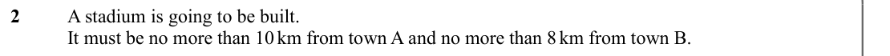

Text (lossy): 2 / A stadium is going to be built.  / It must be no more than 10 km from town A and no more than 8 km from town B.

## Q3 (marks not printed)

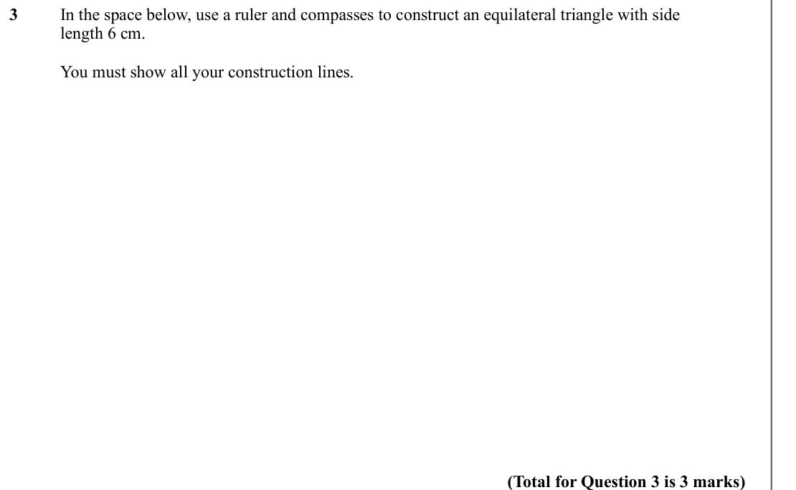

Text (lossy): 3 / In the space below, use a ruler and compasses to construct an equilateral triangle with side  / length 6 cm.   / You must show all your construction lines.  / (Total for Question 3 is 3 marks)

## Q4 (marks not printed)

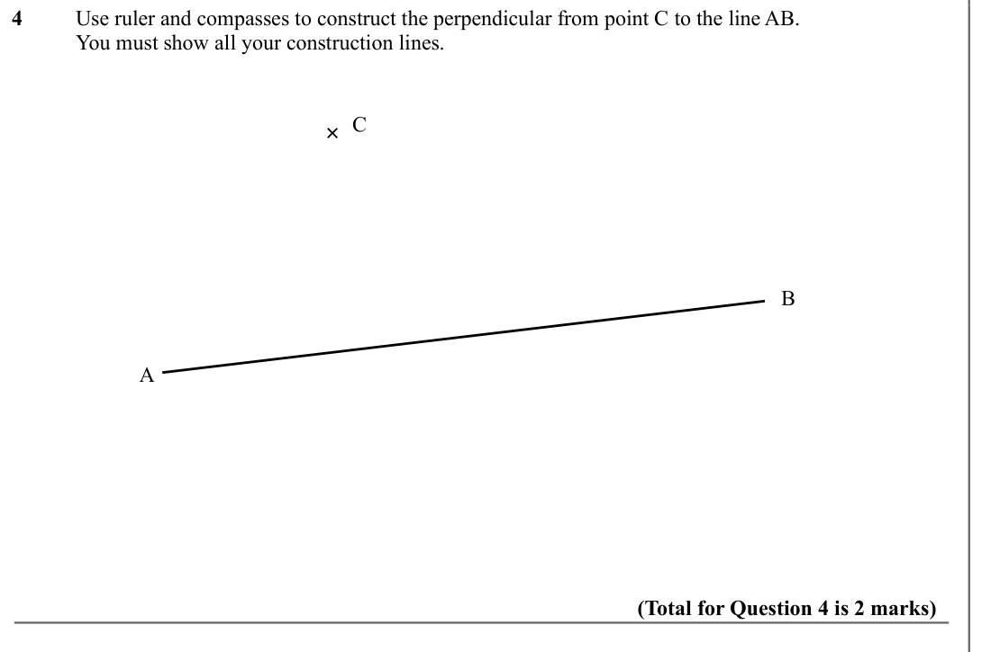

Text (lossy): 4 / Use ruler and compasses to construct the perpendicular from point C to the line AB. /   / You must show all your construction lines. / × C / B  / A  / (Total for Question 4 is 2 marks)

## Q5 (marks not printed)

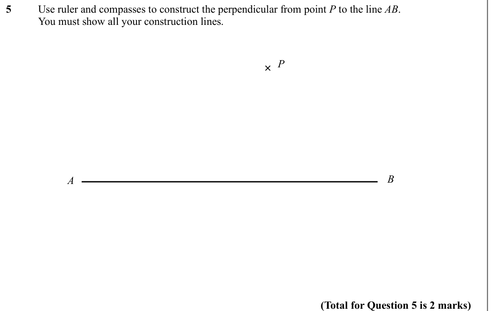

Text (lossy): 5 / Use ruler and compasses to construct the perpendicular from point P to the line AB. /   / You must show all your construction lines. / × P / A  / B  / (Total for Question 5 is 2 marks)

## Q6 (marks not printed)

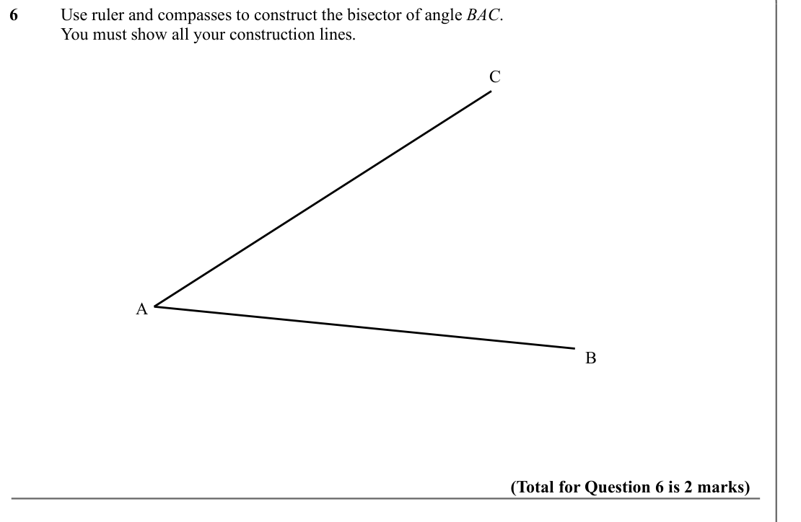

Text (lossy): 6 / Use ruler and compasses to construct the bisector of angle BAC. /   / You must show all your construction lines. / C / A  / B  / (Total for Question 6 is 2 marks)

## Q7 (marks not printed)

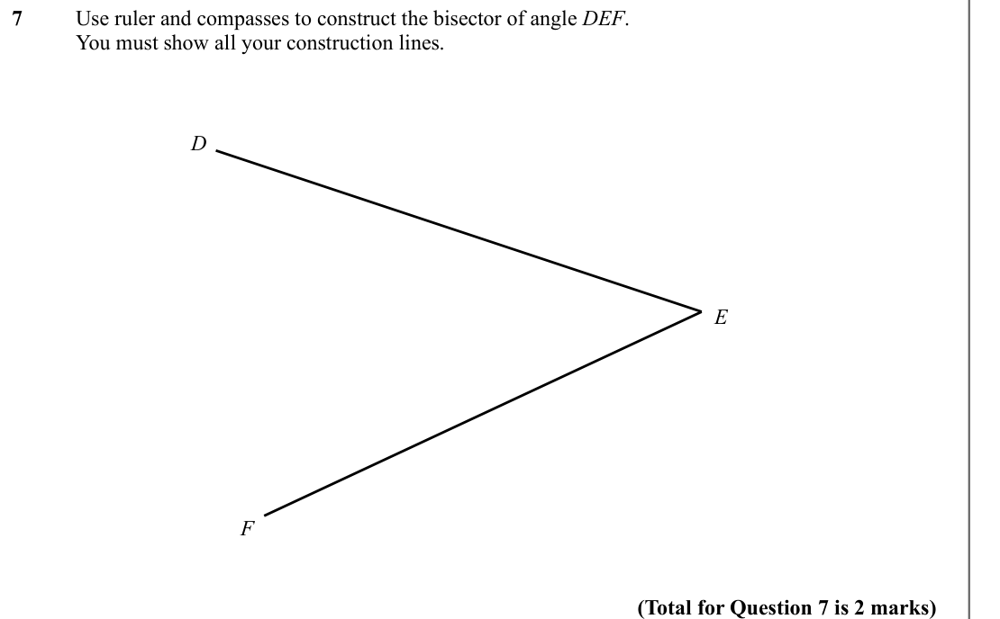

Text (lossy): 7 / Use ruler and compasses to construct the bisector of angle DEF. /   / You must show all your construction lines. / D / E  / F / (Total for Question 7 is 2 marks)

## Q8 (marks not printed)

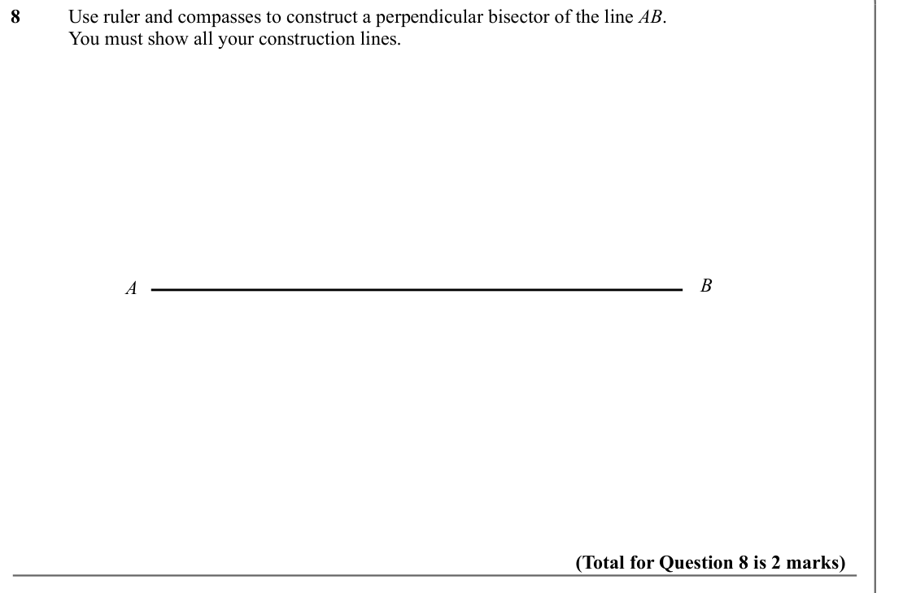

Text (lossy): 8 / Use ruler and compasses to construct a perpendicular bisector of the line AB. /   / You must show all your construction lines. / A  / B  / (Total for Question 8 is 2 marks)

## Q9 (marks not printed)

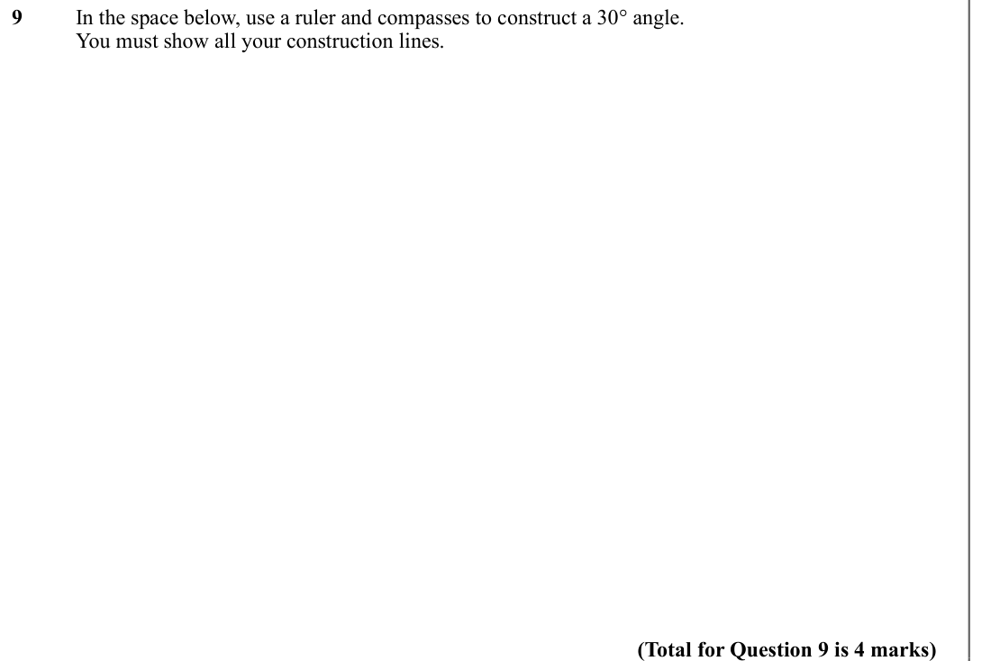

Text (lossy): 9 / In the space below, use a ruler and compasses to construct a 30° angle.  / You must show all your construction lines.  / (Total for Question 9 is 4 marks)

## Q10 (marks not printed)

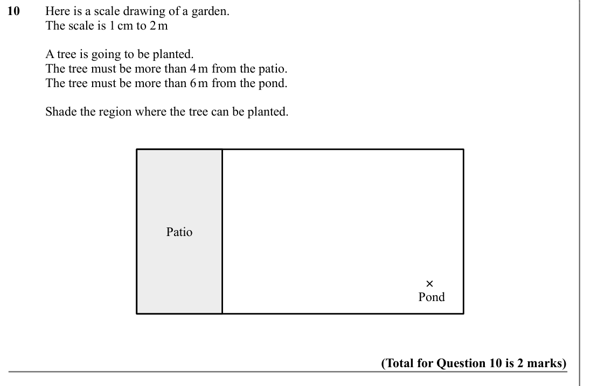

Text (lossy): 10 / Here is a scale drawing of a garden.  / The scale is 1 cm to 2 m / A tree is going to be planted.  / The tree must be more than 4 m from the patio. / The tree must be more than 6 m from the pond.   / Shade the region where the tree can be planted.  / Patio / ×  / Pond / (Total for Question 10 is 2 marks)

## Q11 (marks not printed)

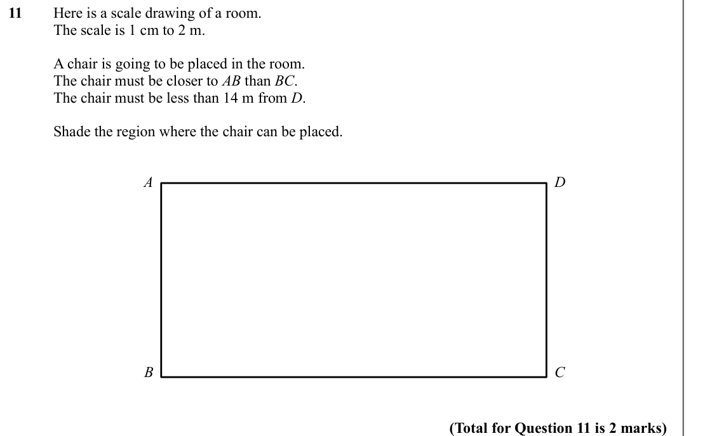

Text (lossy): 11 / Here is a scale drawing of a room.  / The scale is 1 cm to 2 m.  / A chair is going to be placed in the room.  / The chair must be closer to AB than BC. / The chair must be less than 14 m from D. / Shade the region where the chair can be placed.  / A / D / B / C / (Total for Question 11 is 2 marks)

## Q12 (marks not printed)

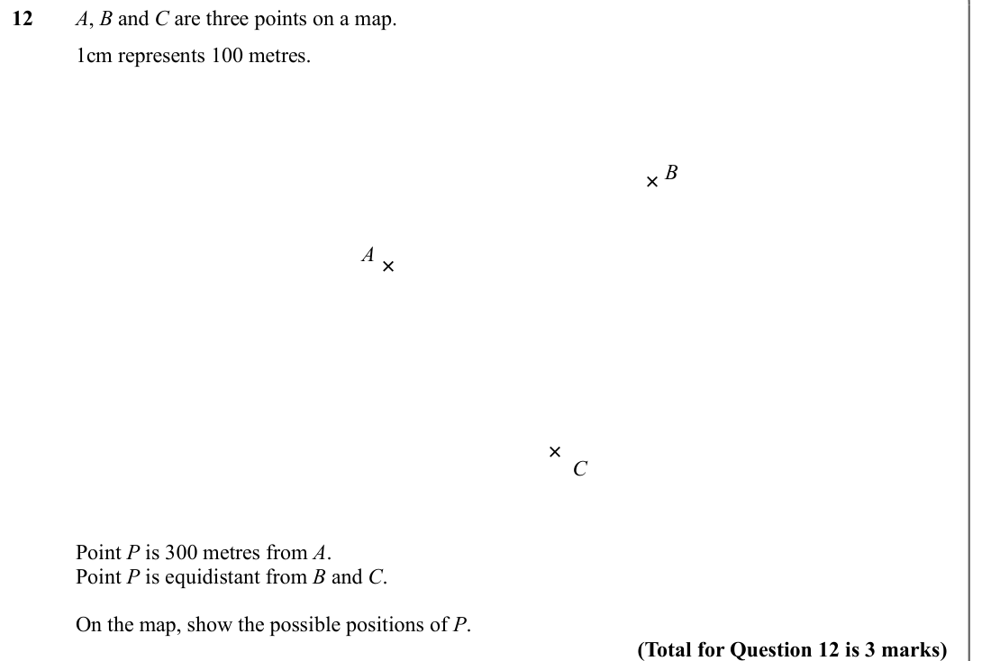

Text (lossy): 12 / A, B and C are three points on a map. / 1cm represents 100 metres.   / B /   / × /   / ×  / A /   / × C /   / Point P is 300 metres from A. / Point P is equidistant from B and C. / On the map, show the possible positions of P.  / (Total for Question 12 is 3 marks)

