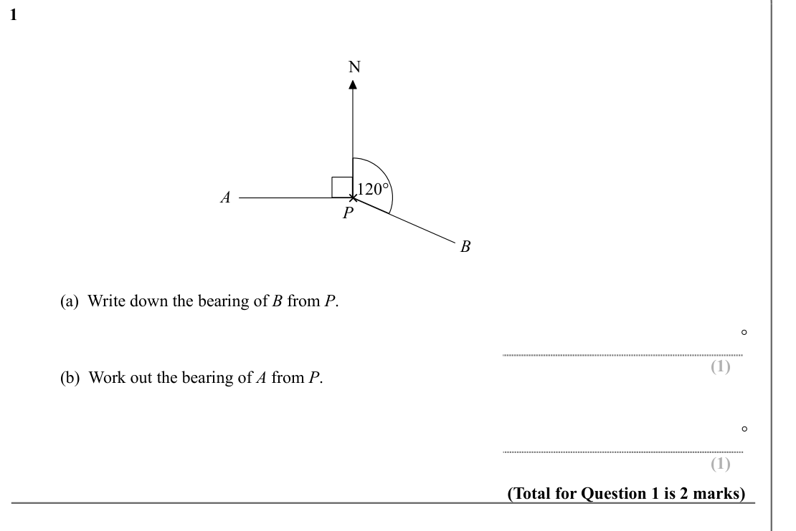
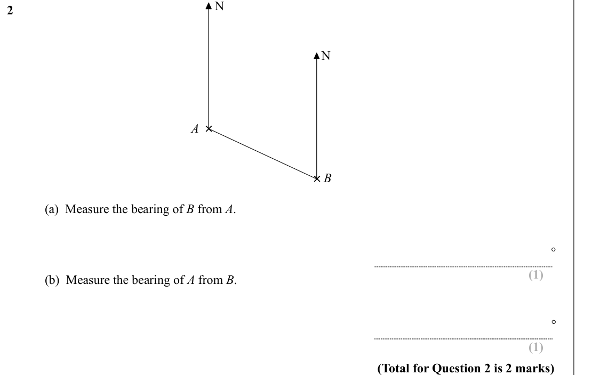
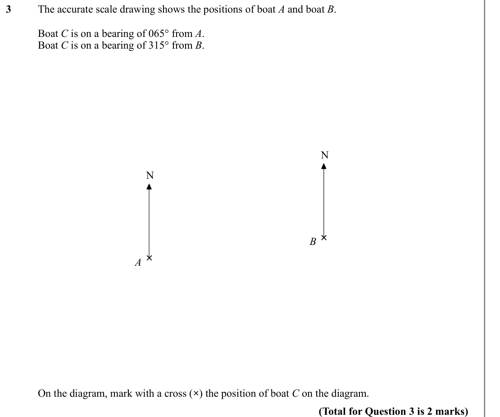
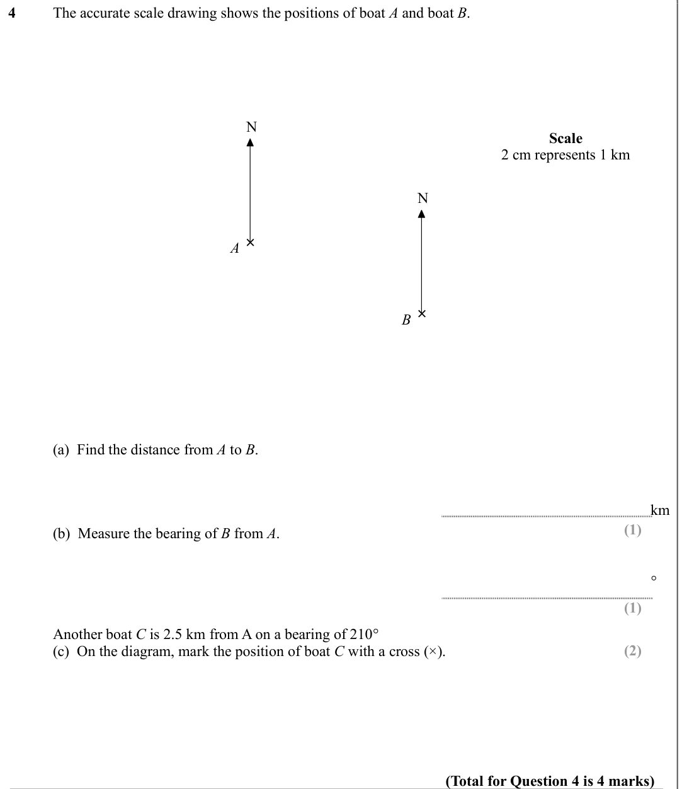
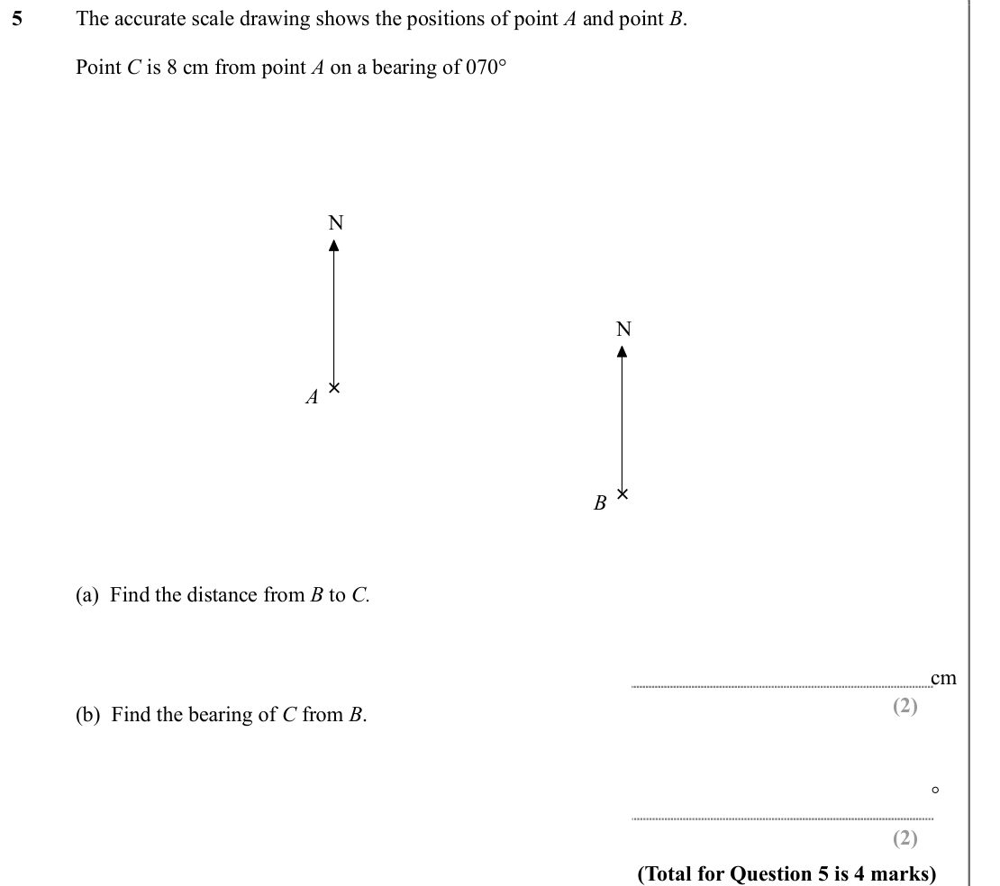
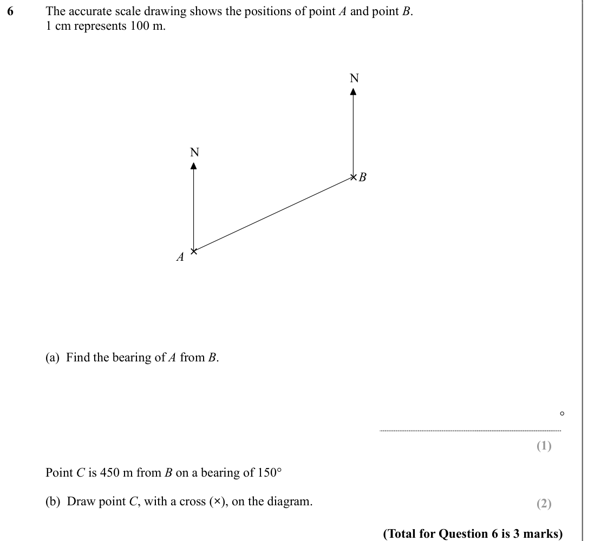
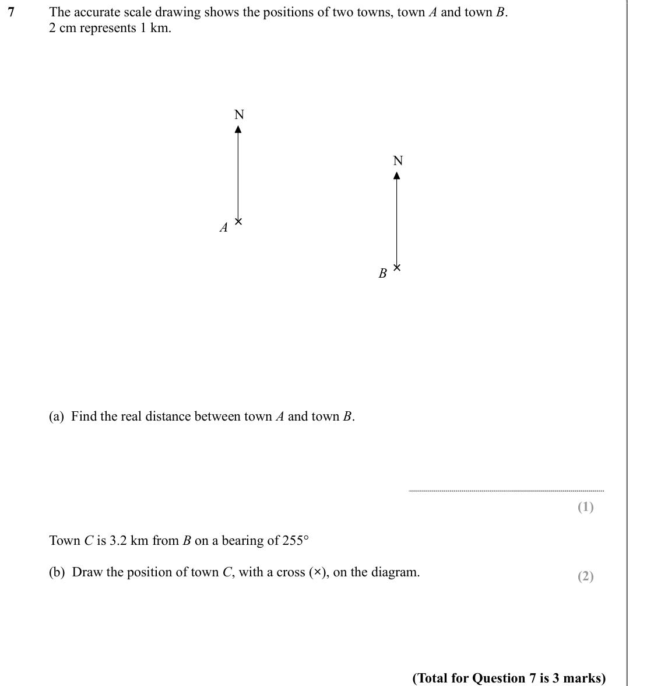
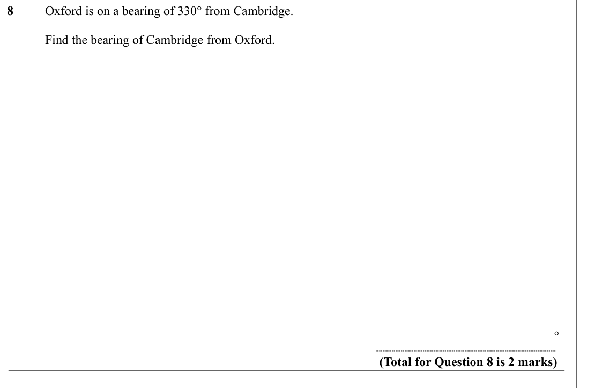
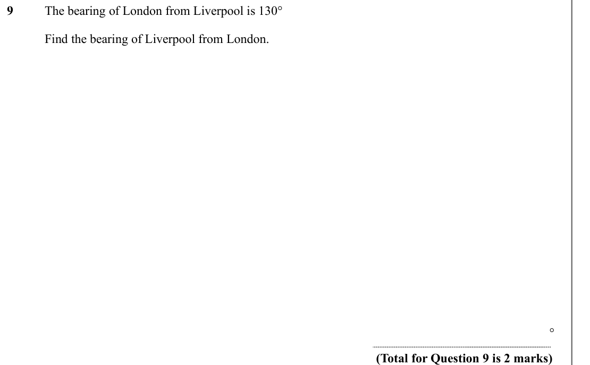

# Bearings — Exam Questions (GCSE Maths · Edexcel · Grade 4)

Topic code `4.16` · slug `grade-4-4-16-bearings` · source sheet sha256 `f2d7d70dae9fe3a8…`

## Q1 (marks not printed · parts a, b)

Text (lossy): 1 / N / 120° / ×  / A / P / B / (a)  Write down the bearing of B from P.  / ° / (1) / (b)  Work out the bearing of A from P.  / ° / (1) / (Total for Question 1 is 2 marks)

## Q2 (marks not printed · parts a, b)

Text (lossy): 2 / N / ×  / A / B / ×  / (a)  Measure the bearing of B from A.  / ° / (1) / (b)  Measure the bearing of A from B.  / ° / (1) / (Total for Question 2 is 2 marks)

## Q3 (marks not printed)

Text (lossy): 3 / The accurate scale drawing shows the positions of boat A and boat B.  / Boat C is on a bearing of 065° from A. / Boat C is on a bearing of 315° from B.  / N / N / ×  / B / ×  / A / On the diagram, mark with a cross (×) the position of boat C on the diagram.  / (Total for Question 3 is 2 marks)

## Q4 (marks not printed · parts a, b, c)

Text (lossy): 4 / The accurate scale drawing shows the positions of boat A and boat B.  / N / Scale  / 2 cm represents 1 km  / N / ×  / A / ×  / B / (a)  Find the distance from A to B.  / km / (1) / (b)  Measure the bearing of B from A.  / ° / (1) / Another boat C is 2.5 km from A on a bearing of 210° / (c)  On the diagram, mark the position of boat C with a cross (×).  / (2) / (Total for Question 4 is 4 marks)

## Q5 (marks not printed · parts a, b)

Text (lossy): 5 / The accurate scale drawing shows the positions of point A and point B.  / Point C is 8 cm from point A on a bearing of 070° / N / N / ×  / A / ×  / B / (a)  Find the distance from B to C. / cm / (2) / (b)  Find the bearing of C from B.  / ° / (2) / (Total for Question 5 is 4 marks)

## Q6 (marks not printed · parts a, b)

Text (lossy): 6 / The accurate scale drawing shows the positions of point A and point B.  / 1 cm represents 100 m.  / N / N / × B / ×  / A / (a)  Find the bearing of A from B. / ° / (1) / Point C is 450 m from B on a bearing of 150° / (b)  Draw point C, with a cross (×), on the diagram.   / (2) / (Total for Question 6 is 3 marks)

## Q7 (marks not printed · parts a, b)

Text (lossy): 7 / The accurate scale drawing shows the positions of two towns, town A and town B.  / 2 cm represents 1 km.  / N / N / ×  / A / ×  / B / (a)  Find the real distance between town A and town B.  / (1) / Town C is 3.2 km from B on a bearing of 255° / (b)  Draw the position of town C, with a cross (×), on the diagram.   / (2) / (Total for Question 7 is 3 marks)

## Q8 (marks not printed)

Text (lossy): 8 / Oxford is on a bearing of 330° from Cambridge. / Find the bearing of Cambridge from Oxford. / ° / (Total for Question 8 is 2 marks)

## Q9 (marks not printed)

Text (lossy): 9 / The bearing of London from Liverpool is 130° / Find the bearing of Liverpool from London.  / ° / (Total for Question 9 is 2 marks)

