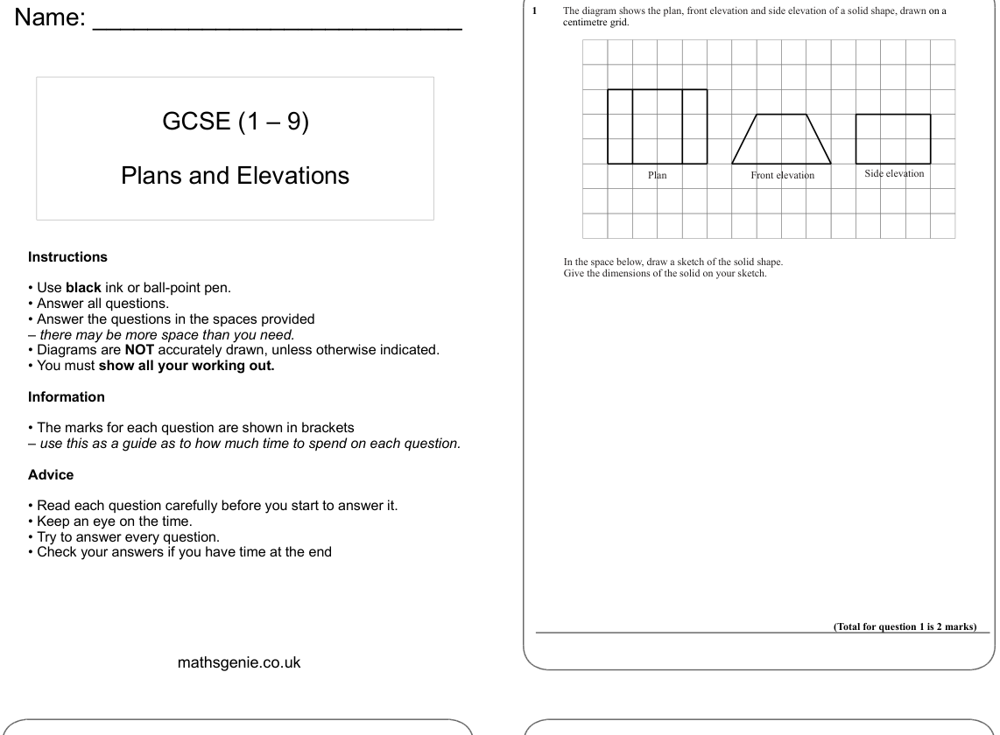
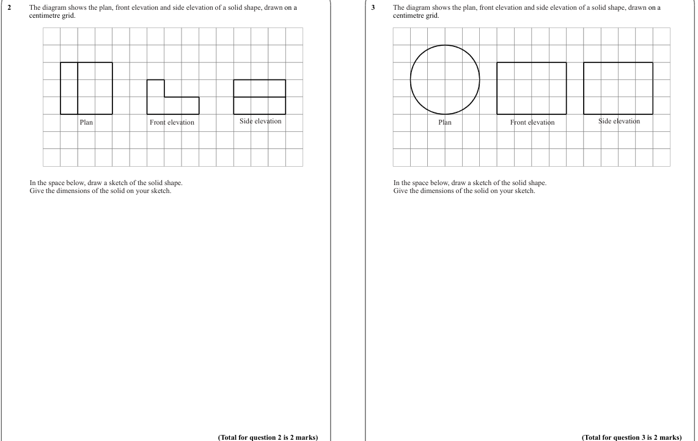
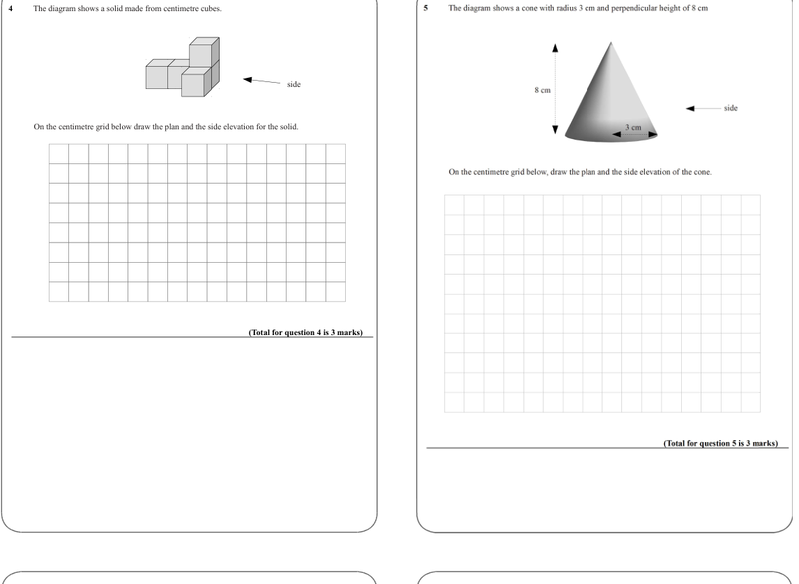

# Plans and Elevations — Exam Questions (GCSE Maths · Edexcel · Grade 4)

Topic code `4.17` · slug `grade-4-4-17-plans-and-elevations` · source sheet sha256 `b62d1c8f10f9e12d…`

## Q1 (marks not printed)

Text (lossy): Name: ___________________________ / 1      / The diagram shows the plan, front elevation and side elevation of a solid shape, drawn on a  / centimetre grid. / Plans and Elevations / Plan /  Front elevation / Side elevation / Instructions / In the space below, draw a sketch of the solid shape. / Give the dimensions of the solid on your sketch. / • Use black ink or ball-point pen. / • Answer all que

## Q2 (marks not printed)

## Q3 (marks not printed)

Text (lossy): 2      / The diagram shows the plan, front elevation and side elevation of a solid shape, drawn on a  / centimetre grid. / 3      / The diagram shows the plan, front elevation and side elevation of a solid shape, drawn on a  / centimetre grid. / Plan /  Front elevation / Side elevation / Plan /  Front elevation / Side elevation / In the space below, draw a sketch of the solid shape. / Give the dim

## Q4 (marks not printed)

Text (lossy): 4      / The diagram shows a solid made from centimetre cubes.  / side / On the centimetre grid below draw the plan and the side elevation for the solid.  / (Total for question 4 is 3 marks)

