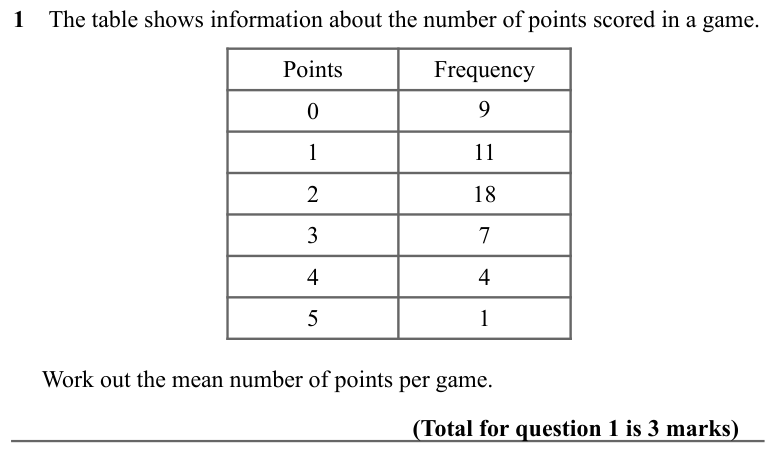
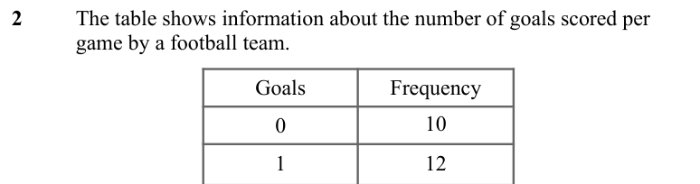
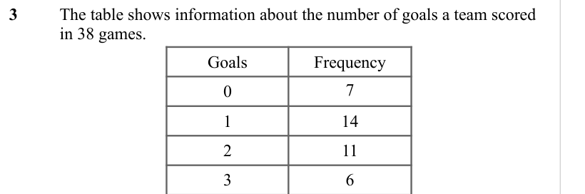
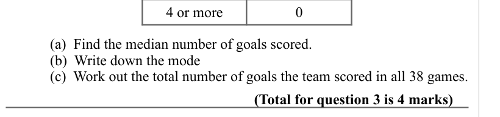
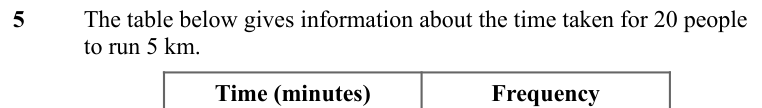
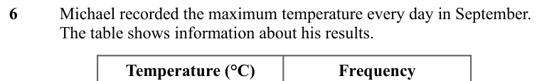
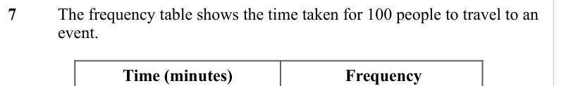
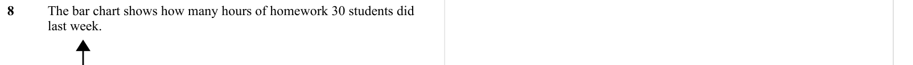

# Averages from Frequency Tables — Exam Questions (GCSE Maths · Edexcel · Grade 4)

Topic code `4.18` · slug `grade-4-4-18-averages-from-frequency-tables` · source sheet sha256 `659faea411869684…`

## Q1 (marks not printed)

Text (lossy): 1    The table shows information about the number of points scored in a game.  / Points / Frequency / 0 / 9 / 1 / 11 / 2 / 18 / 3 / 7 / 4 / 4 / 5 / 1 /      Work out the mean number of points per game.  / (Total for question 1 is 3 marks)

## Q2 (marks not printed)

Text (lossy): 2     / The table shows information about the number of goals scored per  / game by a football team.  / Goals / Frequency / 0 / 10 / 1 / 12

## Q3 (marks not printed)

Text (lossy): 3    / The table shows information about the number of goals a team scored  / in 38 games.  / Goals / Frequency / 0 / 7 / 1 / 14 / 2 / 11 / 3 / 6

## Q4 (marks not printed · parts a, b, c)

Text (lossy): 4 or more / 0 /       / (a)  Find the median number of goals scored.  / (b)  Write down the mode /       / (c)  Work out the total number of goals the team scored in all 38 games.  / (Total for question 3 is 4 marks)

## Q5 (marks not printed)

Text (lossy): 5      / The table below gives information about the time taken for 20 people  / to run 5 km. / Time (minutes) / Frequency

## Q6 (marks not printed)

Text (lossy): 6 / Michael recorded the maximum temperature every day in September.  / The table shows information about his results.  / Temperature (°C) / Frequency

## Q7 (marks not printed)

Text (lossy): 7   / The frequency table shows the time taken for 100 people to travel to an  / event. / Time (minutes) /  Frequency

## Q8 (marks not printed)

Text (lossy): 8    / The bar chart shows how many hours of homework 30 students did  / last week.

