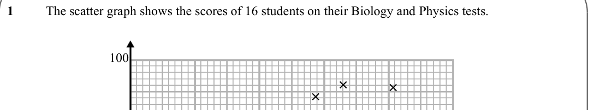
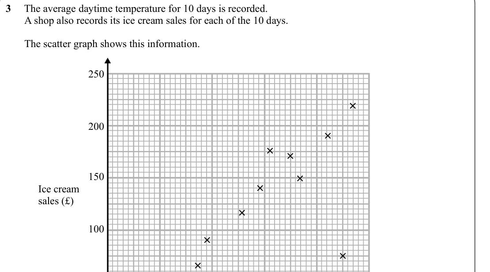
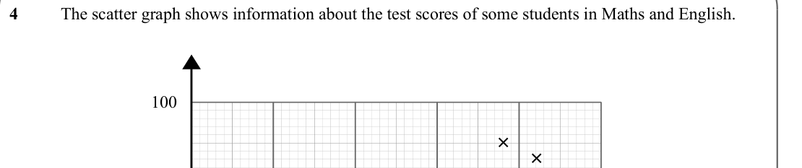
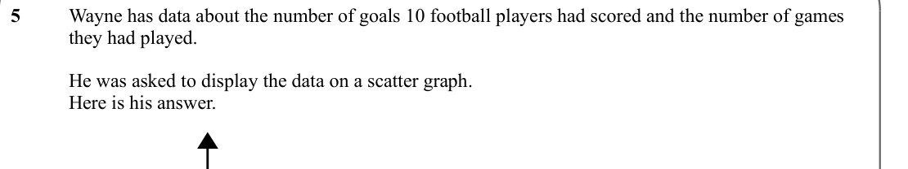
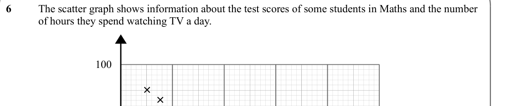
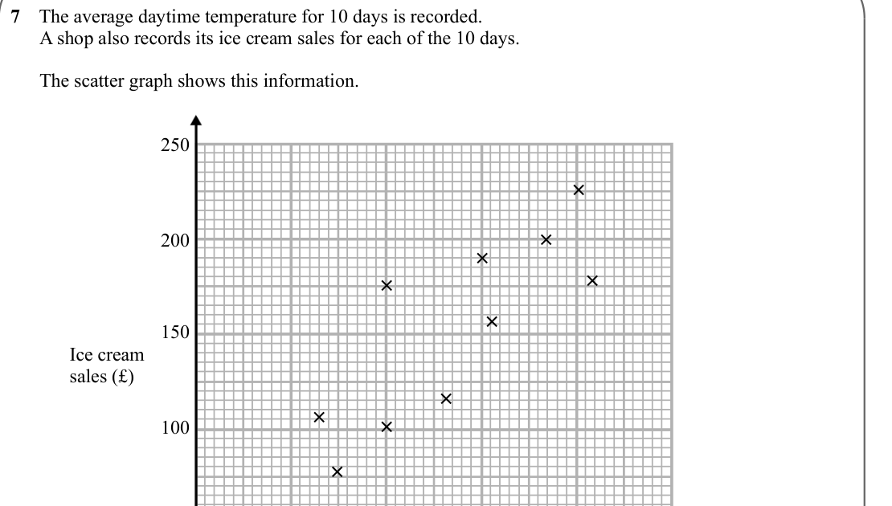

# Scatter Graphs — Exam Questions (GCSE Maths · Edexcel · Grade 4)

Topic code `4.20` · slug `grade-4-4-20-scatter-graphs` · source sheet sha256 `4e4496cfca74db3d…`

## Q1 (marks not printed)

Text (lossy): 1     / The scatter graph shows the scores of 16 students on their Biology and Physics tests.  / 100 / × / × / × / ×

## Q2 (marks not printed)

Text (lossy): 2    / Gary recorded how many goals 10 football teams scored.  / He also recorded how many goals they conceded  / The information is shown on the scatter graph.

## Q3 (marks not printed)

Text (lossy): 3     The average daytime temperature for 10 days is recorded.  /        A shop also records its ice cream sales for each of the 10 days.  /       /        The scatter graph shows this information.  / 250 / × / 200 / × / × / × / 150 / × / × / Ice cream  / sales (£) / × / 100 / × / × / ×

## Q4 (marks not printed)

Text (lossy): 4    / The scatter graph shows information about the test scores of some students in Maths and English.  / 100 / × / ×

## Q5 (marks not printed)

Text (lossy): 5    / Wayne has data about the number of goals 10 football players had scored and the number of games  / they had played.  / He was asked to display the data on a scatter graph.  / Here is his answer.

## Q6 (marks not printed)

Text (lossy): 6   / The scatter graph shows information about the test scores of some students in Maths and the number  / of hours they spend watching TV a day.  / 100 / × ×

## Q7 (marks not printed)

Text (lossy): 7    The average daytime temperature for 10 days is recorded.  /       A shop also records its ice cream sales for each of the 10 days.  /       /       The scatter graph shows this information.  / 250 / × / × / × / 200 / × / × / × / 150 / Ice cream  / sales (£) / × / × / × / 100 / ×

