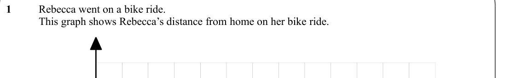
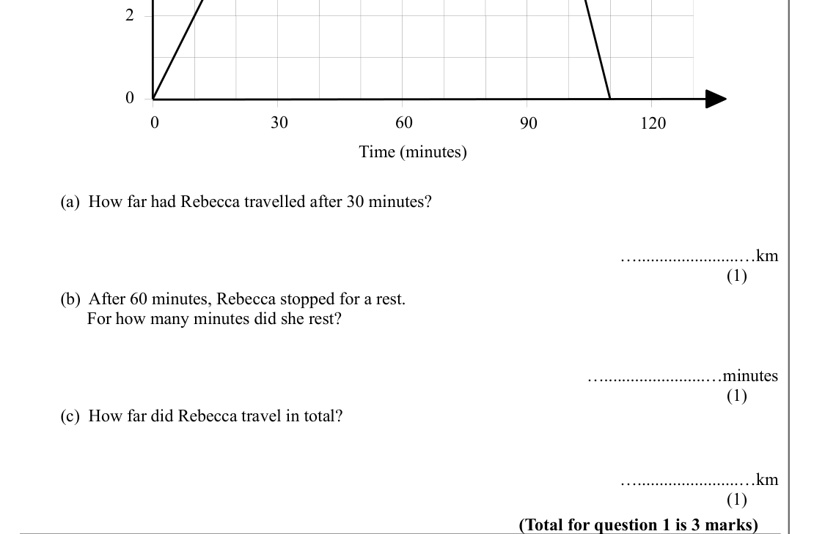
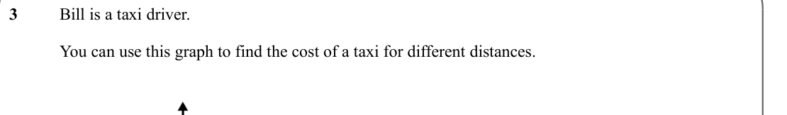
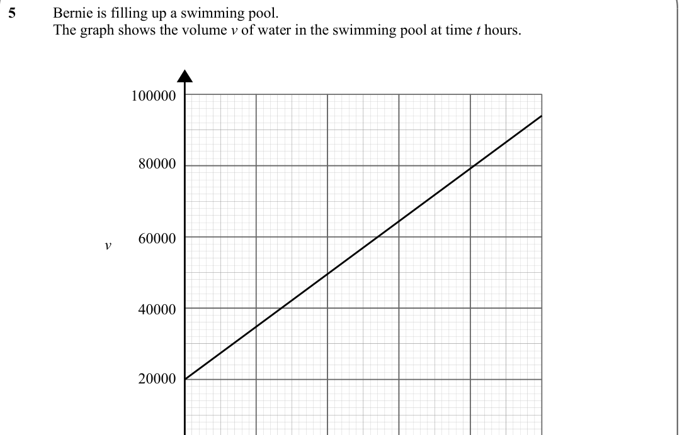
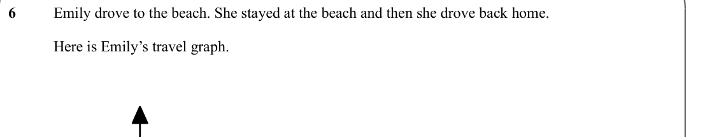
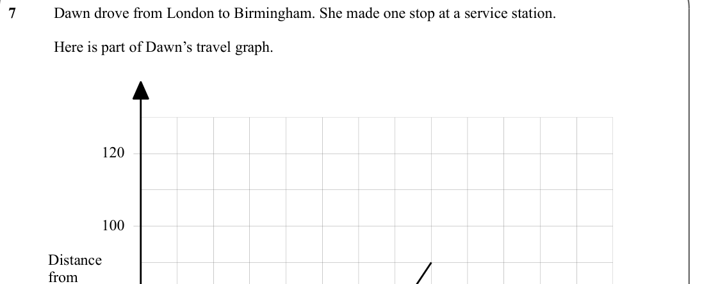

# Real Life and Distance Time Graphs — Exam Questions (GCSE Maths · Edexcel · Grade 4)

Topic code `4.4` · slug `grade-4-4-4-real-life-and-distance-time-graphs` · source sheet sha256 `7880910d13475c11…`

## Q1 (marks not printed)

Text (lossy): 1     / Rebecca went on a bike ride.  / This graph shows Rebecca’s distance from home on her bike ride.

## Q2 (marks not printed · parts a, b, c)

Text (lossy): 2 / 0 / 30 / 60 / 90 / 120 / 0 / Time (minutes) / (a)  How far had Rebecca travelled after 30 minutes? / ….......................…km / (1) / (b)  After 60 minutes, Rebecca stopped for a rest.  /       For how many minutes did she rest? / ….......................…minutes / (1) / (c)  How far did Rebecca travel in total? / ….......................…km / (1) / (Total for question 1 is 3 marks)

## Q3 (marks not printed)

Text (lossy): 3     / Bill is a taxi driver.  / You can use this graph to find the cost of a taxi for different distances.

## Q4 (marks not printed)

Text (lossy): 4     / John draws a graph to show the amount of petrol his car used on a 250 mile journey.

## Q5 (marks not printed)

Text (lossy): 5     / Bernie is filling up a swimming pool.  / The graph shows the volume v of water in the swimming pool at time t hours.  / 100000 / 80000 / 60000 / v / 40000 / 20000

## Q6 (marks not printed)

Text (lossy): 6     / Emily drove to the beach. She stayed at the beach and then she drove back home.  / Here is Emily’s travel graph.

## Q7 (marks not printed)

Text (lossy): 7     / Dawn drove from London to Birmingham. She made one stop at a service station.  / Here is part of Dawn’s travel graph.  / 120 / 100 / Distance  / from  / London  / (miles)

