# Sequences (Nth Term) — Exam Questions (GCSE Maths · Edexcel · Grade 4)

Topic code `4.7` · slug `grade-4-4-7-sequences-nth-term` · source sheet sha256 `97e5feede9287d87…`

## Q1 (marks not printed)

Text (lossy): 1      / Here are the first five terms of a sequence.

## Q2 (2 marks)

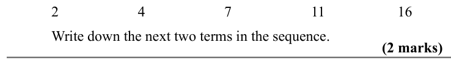

Text (lossy): 2 /   / 4 / 7 / 11 / 16 / Write down the next two terms in the sequence.  / (2 marks)

## Q3 (marks not printed)

Text (lossy): 3      / Here are the first five terms of a Fibonacci sequence

## Q4 (2 marks · parts a, b)

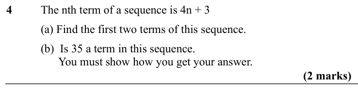

Text (lossy): 4      / The nth term of a sequence is 4n + 3 / (a) Find the first two terms of this sequence.  / (b)  Is 35 a term in this sequence.  /       You must show how you get your answer.  / (2 marks)

## Q5 (2 marks · parts a, b)

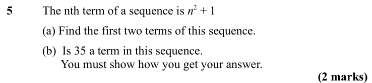

Text (lossy): 5      / The nth term of a sequence is n 2 + 1 / (a) Find the first two terms of this sequence.  / (b)  Is 35 a term in this sequence.  /       You must show how you get your answer.  / (2 marks)

## Q6 (2 marks · parts a, b)

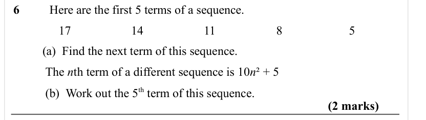

Text (lossy): 6   / Here are the first 5 terms of a sequence.  / 17 / 14 / 11 / 8 / 5 /           / (a)  Find the next term of this sequence.  /          / The n th term of a different sequence is 10 n ² + 5 /          / (b)  Work out the 5 th term of this sequence.  / (2 marks)

## Q7 (2 marks · parts a, b)

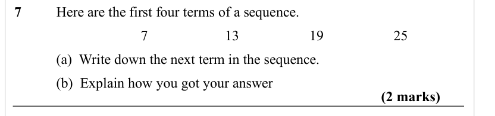

Text (lossy): 7      / Here are the first four terms of a sequence.  / 7 / 13 / 19 / 25 / (a)  Write down the next term in the sequence.  / (b)  Explain how you got your answer  / (2 marks)

## Q8 (marks not printed)

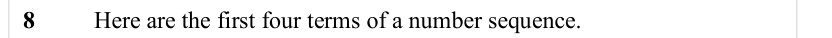

Text (lossy): 8      / Here are the first four terms of a number sequence.

## Q9 (2 marks)

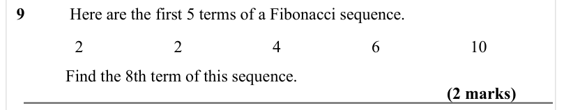

Text (lossy): 9 /  Here are the first 5 terms of a Fibonacci sequence.  / 2 / 2 / 4 / 6 / 10 /           / Find the 8th term of this sequence.  / (2 marks)

## Q10 (3 marks · parts a, b)

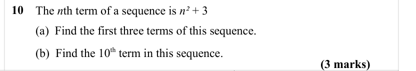

Text (lossy): 10       /         The n th term of a sequence is n² + 3 /         (a)  Find the first three terms of this sequence.  / (3 marks) /         (b)  Find the 10 th term in this sequence.

## Q11 (4 marks · parts a, b, c)

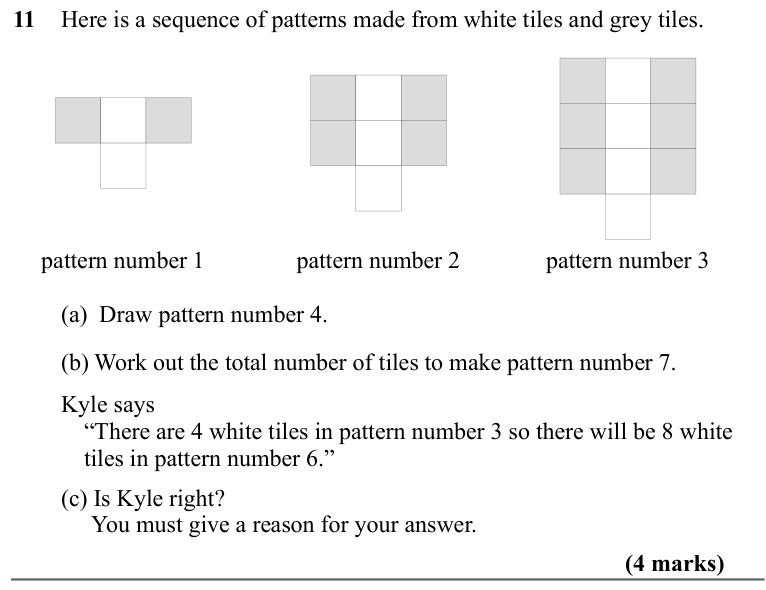

Text (lossy): 11       /         Here is a sequence of patterns made from white tiles and grey tiles. / pattern number 1 / pattern number 2 / pattern number 3 /         (a)  Draw pattern number 4. /         (b) Work out the total number of tiles to make pattern number 7. /         Kyle says / “There are 4 white tiles in pattern number 3 so there will be 8 white  / tiles in pattern number 6.” /         (c) Is Ky

## Q12 (3 marks · parts a, b)

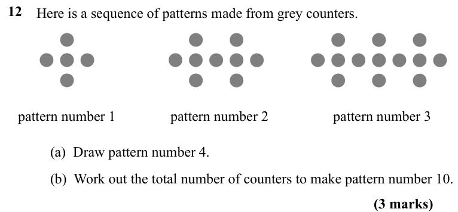

Text (lossy): 12       /         Here is a sequence of patterns made from grey counters. / pattern number 1 / pattern number 2 / pattern number 3 / (a)  Draw pattern number 4. / (b)  Work out the total number of counters to make pattern number 10. / (3 marks)

## Q13 (3 marks · parts a, b)

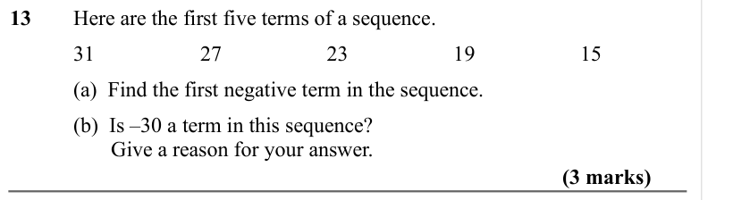

Text (lossy): 13     Here are the first five terms of a sequence.  / 31 / 27 / 23 / 19 / 15 / (a)  Find the first negative term in the sequence. / (b)  Is –30 a term in this sequence? /        Give a reason for your answer.  / (3 marks)

## Q14 (4 marks · parts a, b)

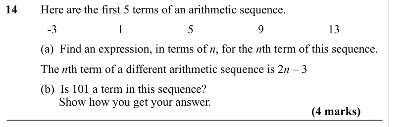

Text (lossy): 14     Here are the first 5 terms of an arithmetic sequence.  / -3 / 1 / 5 / 9 / 13 /    / (a)  Find an expression, in terms of n, for the n th term of this sequence.  /          / The n th term of a different arithmetic sequence is 2 n – 3 /          / (b)  Is 101 a term in this sequence? /                   Show how you get your answer.   / (4 marks)

## Q15 (2 marks)

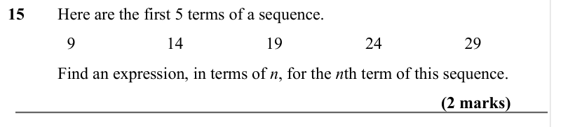

Text (lossy): 15  / Here are the first 5 terms of a sequence.  / 9 / 14 / 19 / 24 / 29 /    / Find an expression, in terms of n, for the n th term of this sequence.  / (2 marks)

## Q16 (2 marks)

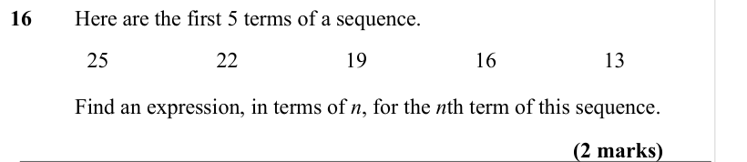

Text (lossy): 16  / Here are the first 5 terms of a sequence.  / 25 / 22 / 19 / 16 / 13 /    / Find an expression, in terms of n, for the n th term of this sequence.  / (2 marks)

## Q17 (marks not printed)

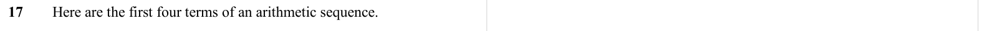

Text (lossy): 17     Here are the first four terms of an arithmetic sequence.

## Q18 (2 marks)

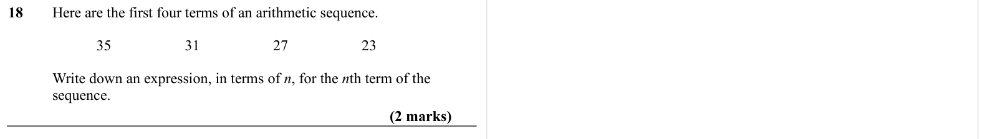

Text (lossy): 18     Here are the first four terms of an arithmetic sequence.  / 35 / 31 / 27 / 23 / Write down an expression, in terms of n, for the n th term of the  / sequence.  / (2 marks)

## Q19 (marks not printed)

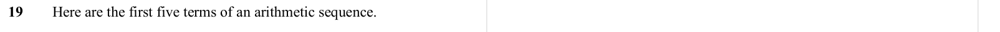

Text (lossy): 19     Here are the first five terms of an arithmetic sequence.

## Q20 (marks not printed)

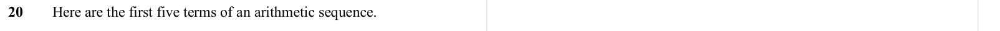

Text (lossy): 20     Here are the first five terms of an arithmetic sequence.

