# Writing a Ratio as a Fraction or Linear Function — Exam Questions (GCSE Maths · Edexcel · Grade 5)

Topic code `5.1` · slug `grade-5-5-1-writing-a-ratio-as-a-fraction-or-linear-function` · source sheet sha256 `e8c42c1d93440a52…`

## Q1 (marks not printed)

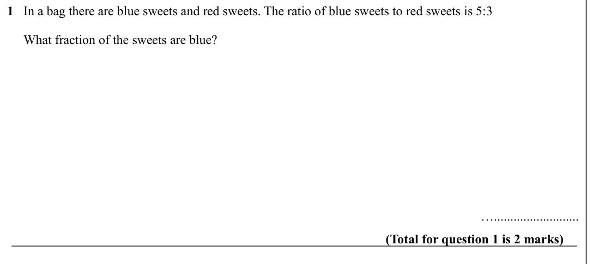

Text (lossy): 1   In a bag there are blue sweets and red sweets. The ratio of blue sweets to red sweets is 5:3  /      What fraction of the sweets are blue?  /       /        / ….......................... / (Total for question 1 is 2 marks)

## Q2 (marks not printed)

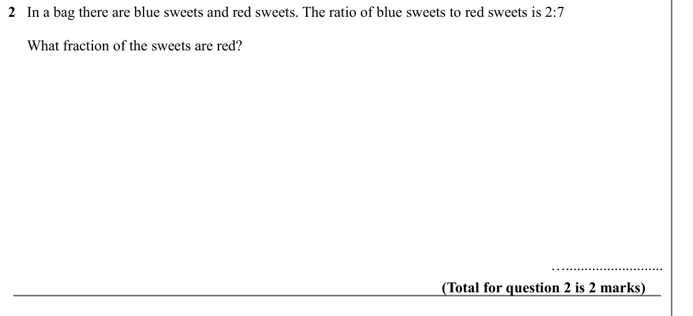

Text (lossy): 2   In a bag there are blue sweets and red sweets. The ratio of blue sweets to red sweets is 2:7  /      What fraction of the sweets are red?  /       /        / ….......................... / (Total for question 2 is 2 marks)

## Q3 (marks not printed)

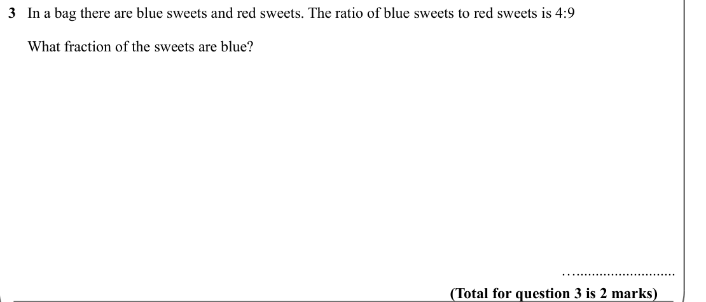

Text (lossy): 3   In a bag there are blue sweets and red sweets. The ratio of blue sweets to red sweets is 4:9  /      What fraction of the sweets are blue?  /       /        / ….......................... / (Total for question 3 is 2 marks)

## Q4 (marks not printed)

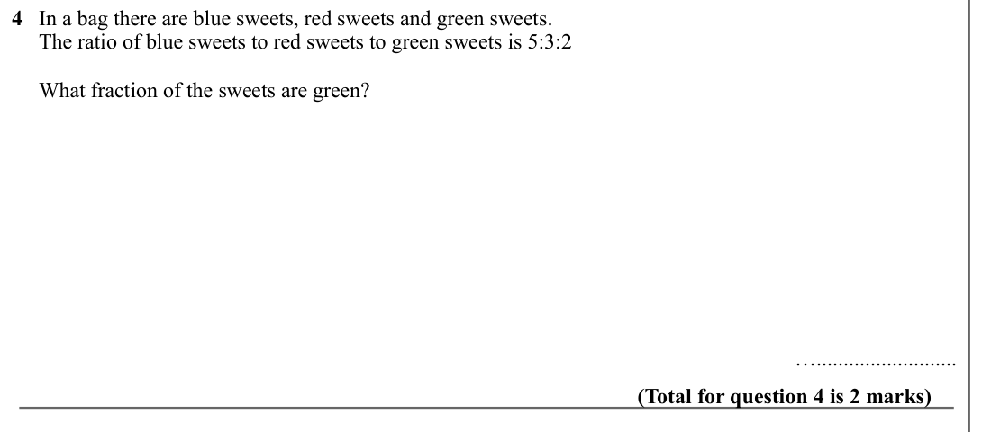

Text (lossy): 4   In a bag there are blue sweets, red sweets and green sweets.  /      The ratio of blue sweets to red sweets to green sweets is 5:3:2  /      What fraction of the sweets are green?  /       /        / ….......................... / (Total for question 4 is 2 marks)

## Q5 (marks not printed)

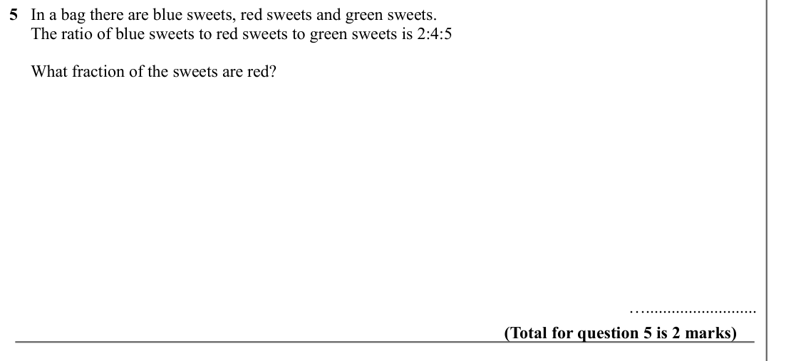

Text (lossy): 5   In a bag there are blue sweets, red sweets and green sweets.  /      The ratio of blue sweets to red sweets to green sweets is 2:4:5  /      What fraction of the sweets are red?  /       /        / ….......................... / (Total for question 5 is 2 marks)

## Q6 (marks not printed)

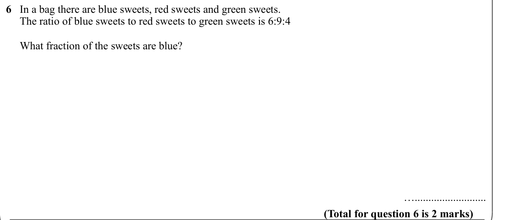

Text (lossy): 6   In a bag there are blue sweets, red sweets and green sweets.  /      The ratio of blue sweets to red sweets to green sweets is 6:9:4  /      What fraction of the sweets are blue?  /       /        / ….......................... / (Total for question 6 is 2 marks)

## Q7 (marks not printed)

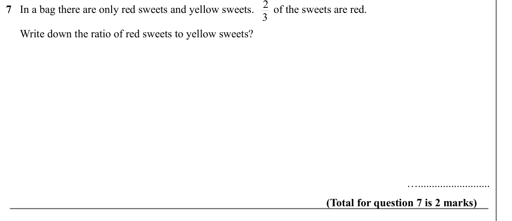

Text (lossy): 7   In a bag there are only red sweets and yellow sweets.       of the sweets are red.      /      Write down the ratio of red sweets to yellow sweets?  /       /        / ….......................... / (Total for question 7 is 2 marks) / 3 / 5

## Q8 (marks not printed)

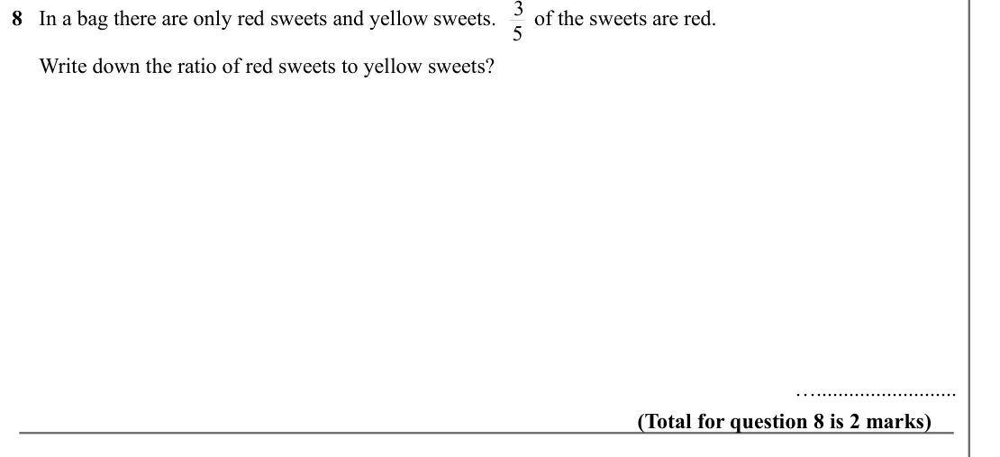

Text (lossy): 8   In a bag there are only red sweets and yellow sweets.       of the sweets are red.      /      Write down the ratio of red sweets to yellow sweets?  /       /        / ….......................... / (Total for question 8 is 2 marks) / 5 / 6

## Q9 (marks not printed)

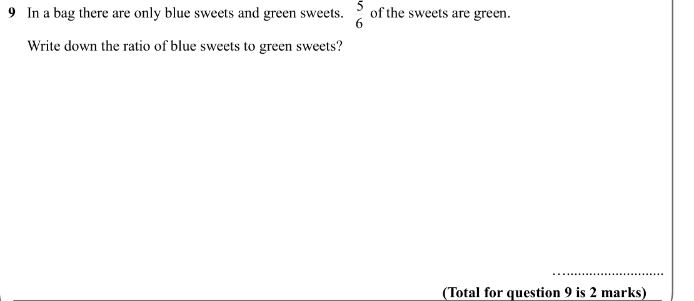

Text (lossy): 9   In a bag there are only blue sweets and green sweets.       of the sweets are green.      /      Write down the ratio of blue sweets to green sweets?  /       /        / ….......................... / (Total for question 9 is 2 marks)

## Q10 (marks not printed · parts a)

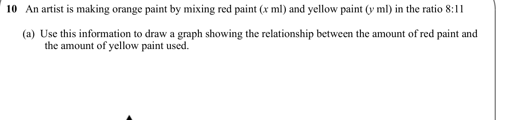

Text (lossy): 10   An artist is making orange paint by mixing red paint (x ml) and yellow paint (y ml) in the ratio 8:11  /       (a)  Use this information to draw a graph showing the relationship between the amount of red paint and     /               the amount of yellow paint used.

## Q11 (marks not printed · parts a)

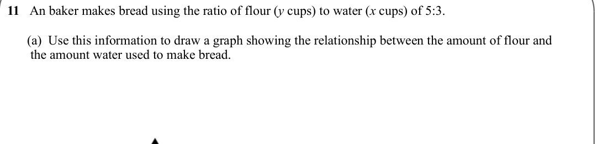

Text (lossy): 11   An baker makes bread using the ratio of flour (y cups) to water (x cups) of 5:3. /       (a)  Use this information to draw a graph showing the relationship between the amount of flour and            /        the amount water used to make bread.

## Q12 (marks not printed)

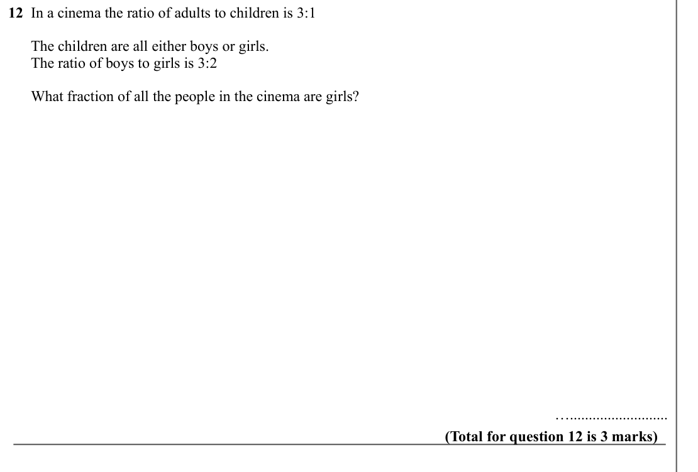

Text (lossy): 12  In a cinema the ratio of adults to children is 3:1 /       The children are all either boys or girls.  /       The ratio of boys to girls is 3:2 /        /       What fraction of all the people in the cinema are girls? /        / ….......................... / (Total for question 12 is 3 marks)

## Q13 (marks not printed)

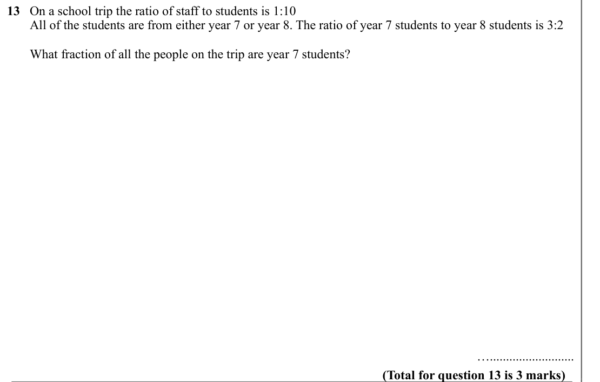

Text (lossy): 13   On a school trip the ratio of staff to students is 1:10 /        All of the students are from either year 7 or year 8. The ratio of year 7 students to year 8 students is 3:2 /        What fraction of all the people on the trip are year 7 students? /        / ….......................... / (Total for question 13 is 3 marks)

## Q14 (marks not printed)

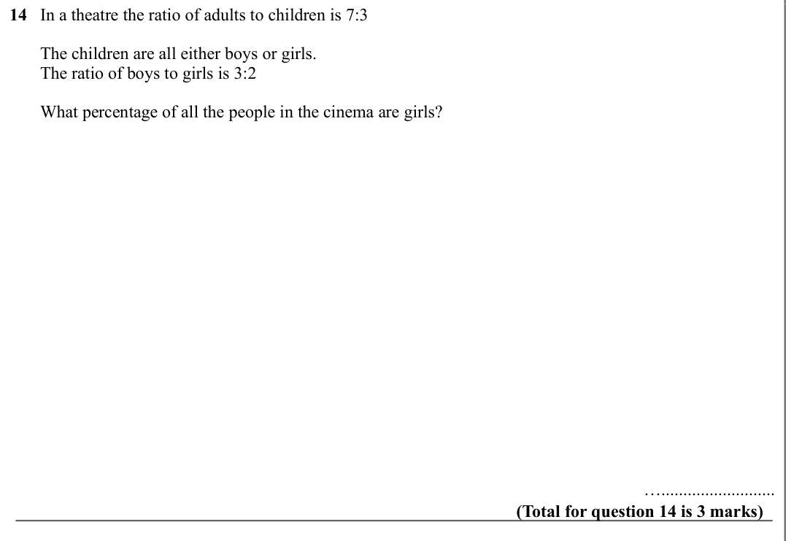

Text (lossy): 14   In a theatre the ratio of adults to children is 7:3 /        The children are all either boys or girls.  /        The ratio of boys to girls is 3:2 /        What percentage of all the people in the cinema are girls? /        / ….......................... / (Total for question 14 is 3 marks)

## Q15 (marks not printed)

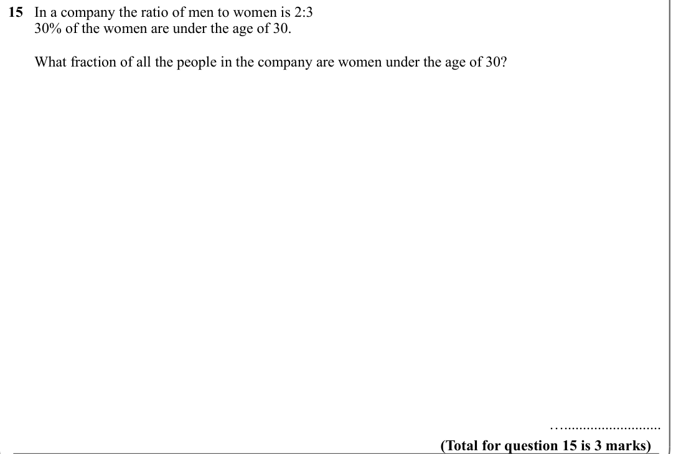

Text (lossy): 15   In a company the ratio of men to women is 2:3 /        30% of the women are under the age of 30.  /        What fraction of all the people in the company are women under the age of 30? /        / ….......................... / (Total for question 15 is 3 marks)

