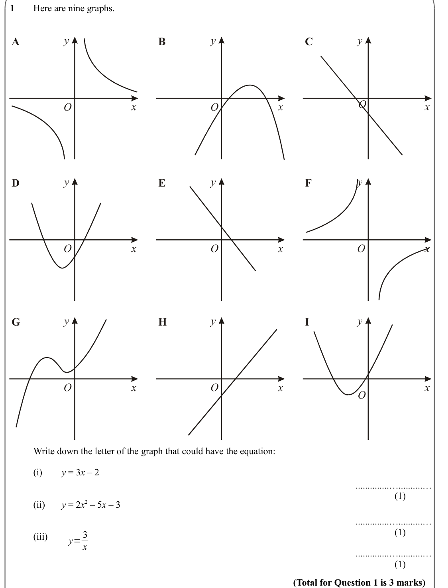
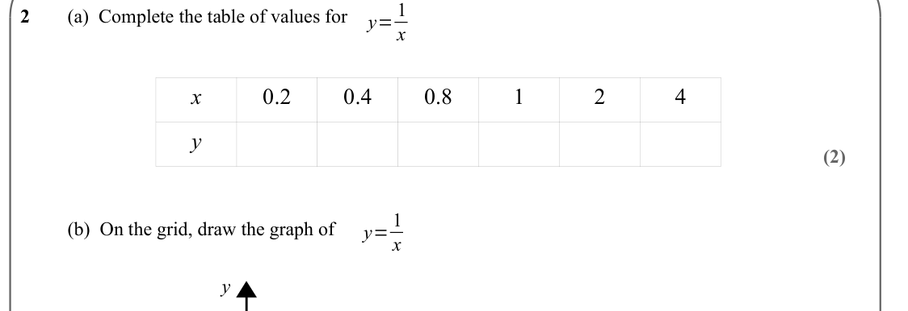
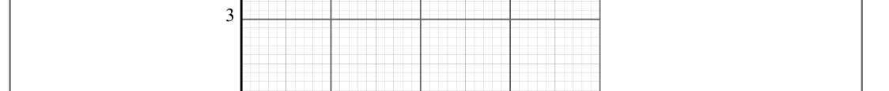
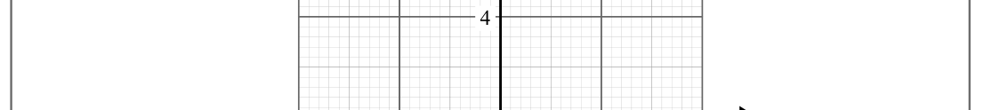
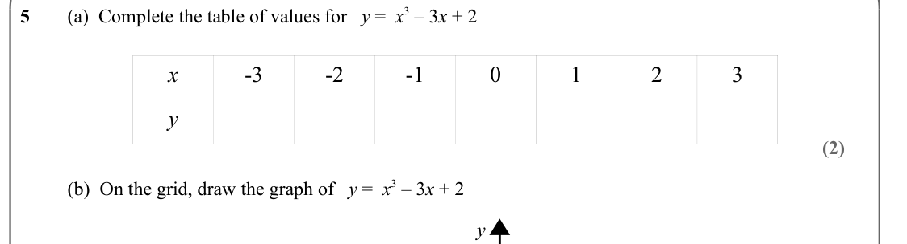
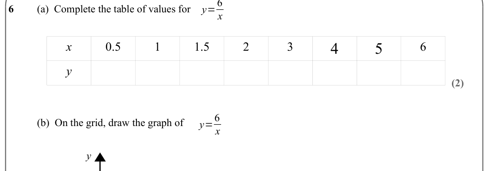
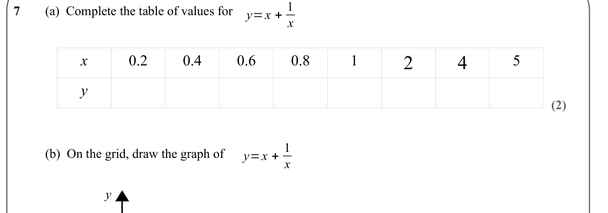

# Drawing Other Graphs: Cubic/Reciprocal — Exam Questions (GCSE Maths · Edexcel · Grade 5)

Topic code `5.10` · slug `grade-5-5-10-drawing-other-graphs-cubic-reciprocal` · source sheet sha256 `8508d01e56acf348…`

## Q1 (marks not printed)

Text (lossy): 1    / Here are nine graphs.  / y / y / y / A / B / C / O / x / x / x / O / O / y / y / y / D / E / F / x / x / x / O / O / O / y / y / y / G / H / I / x / x / x / O / O / O /     / Write down the letter of the graph that could have the equation: / (i)  / y = 3 x – 2  / ..............…..........…  / (1)             / (ii)   / y = 2 x 2 – 5 x – 3 / ..............…..........…  / (1)             / (i

## Q2 (marks not printed · parts a, b)

Text (lossy): 2   / (a)  Complete the table of values for  / x / x / 0.2 / 0.4 / 0.8 / 1 / 2 / 4 / y / (2) / y= 1 / (b)  On the grid, draw the graph of  / x / y

## Q3 (marks not printed)

Text (lossy): 3

## Q4 (marks not printed)

Text (lossy): 4

## Q5 (marks not printed · parts a, b)

Text (lossy): 5   / (a)  Complete the table of values for   y =  x 3 – 3 x + 2 / x / -3 / -2 / -1 / 0 / 1 / 2 / 3 / y / (2) /      / (b)  On the grid, draw the graph of   y =  x 3 – 3 x + 2 / y

## Q6 (marks not printed · parts a, b)

Text (lossy): 6    / (a)  Complete the table of values for  / x / x / 0.5 / 1 / 1.5 / 2 / 3 / 4 / 5 / 6 / y / (2) / y=6 / (b)  On the grid, draw the graph of  / x / y

## Q7 (marks not printed · parts a, b)

Text (lossy): 7    / (a)  Complete the table of values for  / x / x / 0.2 / 0.4 / 0.6 / 0.8 / 1 / 2 / 4 / 5 / y / (2) / y=x + 1 / (b)  On the grid, draw the graph of  / x / y

