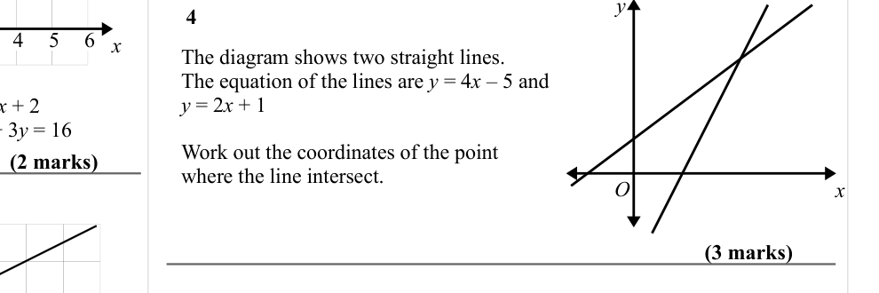
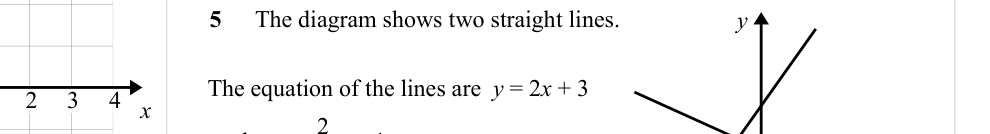

# Solving Simultaneous Equations Graphically — Exam Questions (GCSE Maths · Edexcel · Grade 5)

Topic code `5.12` · slug `grade-5-5-12-solving-simultaneous-equations-graphically` · source sheet sha256 `8b11c87d55930c3f…`

## Q1 (marks not printed)

Text (lossy): 1

## Q2 (marks not printed)

Text (lossy): 2

## Q3 (marks not printed)

Text (lossy): 3 / The graphs of the straight lines with  / equations  2 y – x = 4 and  / x + y = -1 have been drawn on the  / grid.

## Q4 (5 marks)

Text (lossy): 4    / x / The diagram shows two straight lines.  / The equation of the lines are y = 4 x – 5 and  / y = 2 x + 1 / Work out the coordinates of the point  / where the line intersect. / (2 marks) / O / x / (3 marks)

## Q5 (marks not printed)

Text (lossy): 5    / The diagram shows two straight lines.  / y / The equation of the lines are  y = 2 x + 3 / x / −2 /  and  y =        x + 1

