# Equation of a Line — Exam Questions (GCSE Maths · Edexcel · Grade 5)

Topic code `5.15` · slug `grade-5-5-15-equation-of-a-line` · source sheet sha256 `7f18aab0cbdbd961…`

## Q1 (2 marks · parts a, b)

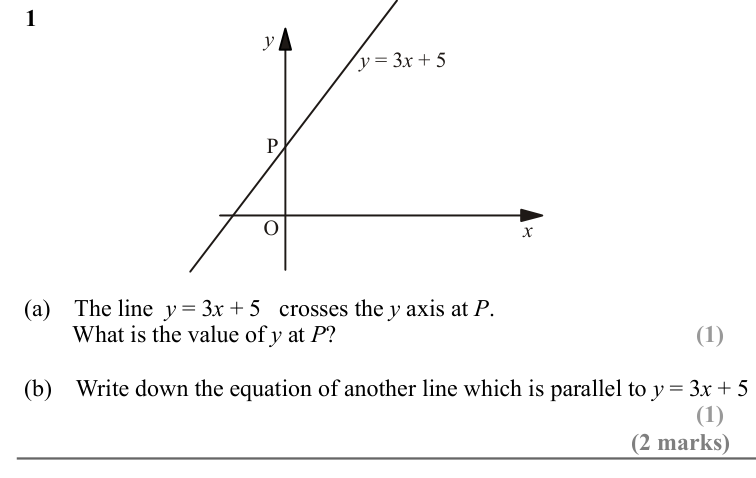

Text (lossy): 1 / y / y / x /  = 3  + 5 / P / O / x / (a)    The line  y = 3 x + 5   crosses the y axis at P. /         What is the value of y at P? / (b)    Write down the equation of another line which is parallel to y = 3 x + 5 / (2 marks)

## Q2 (2 marks)

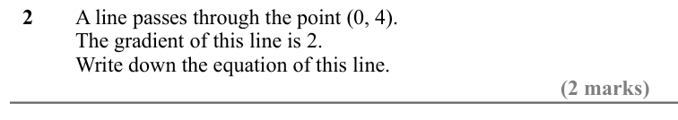

Text (lossy): 2 / A line passes through the point (0, 4). / The gradient of this line is 2. / Write down the equation of this line. / (2 marks)

## Q3 (2 marks)

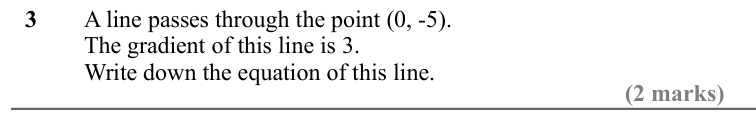

Text (lossy): 3 / A line passes through the point (0, -5). / The gradient of this line is 3. / Write down the equation of this line. / (2 marks)

## Q4 (2 marks · parts a, b)

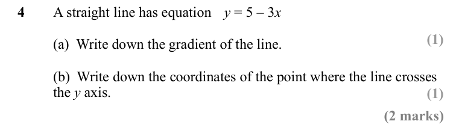

Text (lossy): 4 / A straight line has equation y = 5 – 3 x / (a)  Write down the gradient of the line. / (b)  Write down the coordinates of the point where the line crosses  / the y axis. / (2 marks)

## Q5 (2 marks · parts a, b)

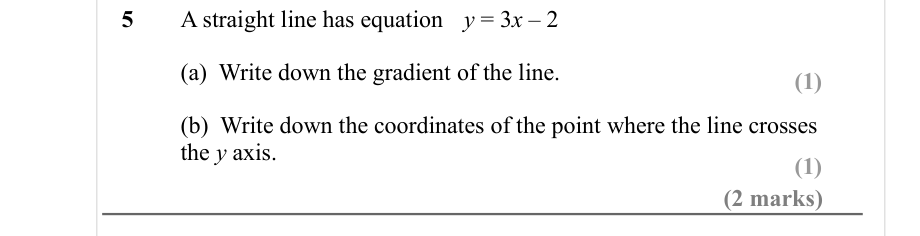

Text (lossy): 5 / A straight line has equation y = 3 x – 2 /   / (a)  Write down the gradient of the line. / (1) / (b)  Write down the coordinates of the point where the line crosses  / the y axis. / (1) / (2 marks)

## Q6 (2 marks · parts a, b)

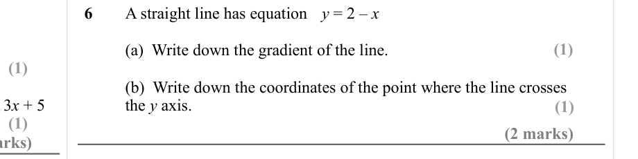

Text (lossy): 6 / A straight line has equation y = 2 – x / (1) / (a)  Write down the gradient of the line. / (1) / (b)  Write down the coordinates of the point where the line crosses  / the y axis. / (1) / (1) / (2 marks)

## Q7 (2 marks · parts a, b)

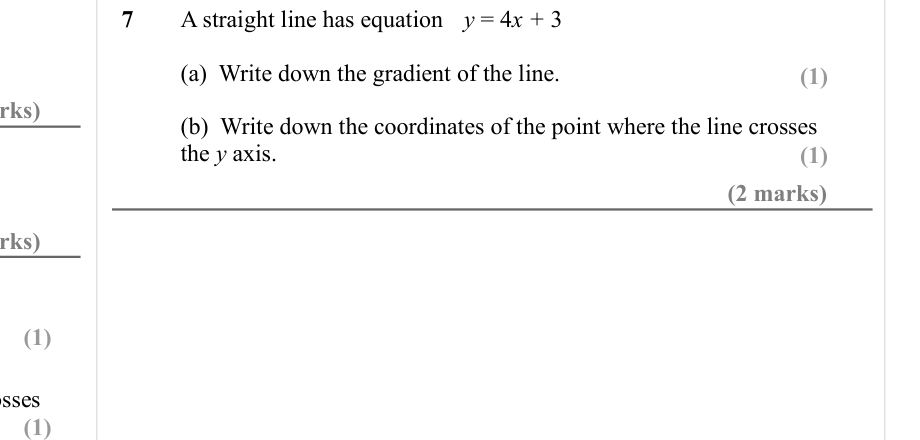

Text (lossy): 7 / A straight line has equation y = 4 x + 3 /   / (a)  Write down the gradient of the line. / (1) / (b)  Write down the coordinates of the point where the line crosses  / the y axis. / (1) / (2 marks) / (1) / (1)

## Q8 (3 marks)

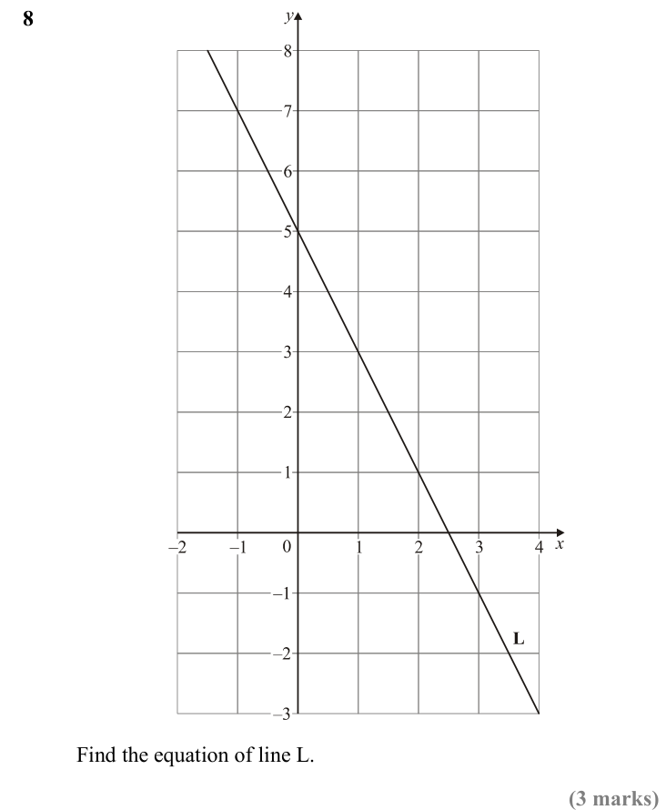

Text (lossy): 8 / Find the equation of line L.  / (3 marks)

## Q9 (3 marks · parts a, b)

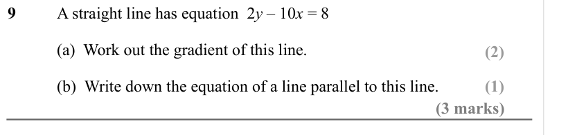

Text (lossy): 9 / A straight line has equation  2 y – 10 x = 8 / (a)  Work out the gradient of this line. / (2) / (b)  Write down the equation of a line parallel to this line. / (1) / (3 marks)

## Q10 (3 marks · parts a, b)

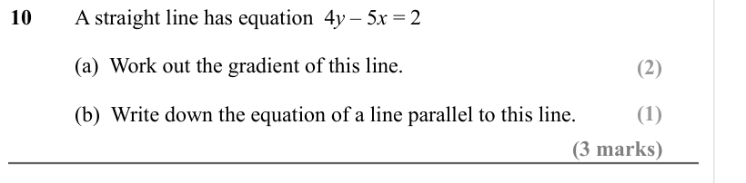

Text (lossy): 10 / A straight line has equation  4 y – 5 x = 2 / (a)  Work out the gradient of this line. / (2) / (1) / (b)  Write down the equation of a line parallel to this line. / (3 marks)

## Q11 (5 marks · parts a, b, c)

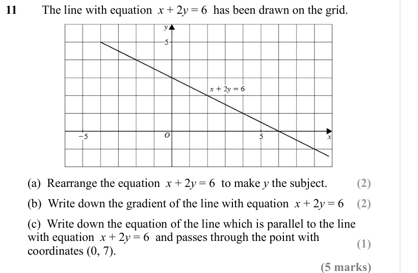

Text (lossy): 11 / The line with equation  x + 2 y = 6  has been drawn on the grid. / (a)  Rearrange the equation  x + 2 y = 6  to make y the subject. / (2) / (b)  Write down the gradient of the line with equation  x + 2 y = 6  / (2) / (c)  Write down the equation of the line which is parallel to the line  / with equation  x + 2 y = 6  and passes through the point with  / coordinates (0, 7). / (1) / (5 marks)

## Q12 (marks not printed)

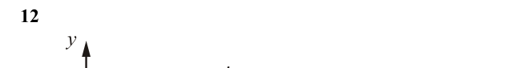

Text (lossy): 12 / y

## Q13 (2 marks)

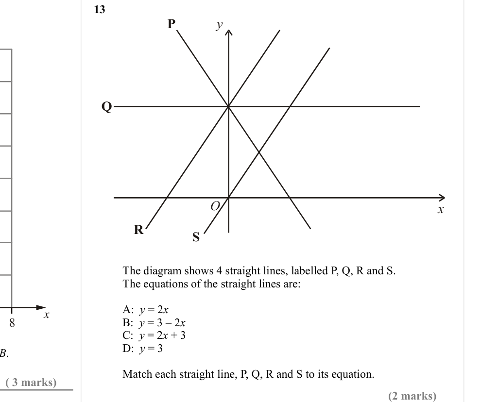

Text (lossy): 13 / P / y / Q / O / x / R / S / The diagram shows 4 straight lines, labelled P, Q, R and S. / The equations of the straight lines are: / A:  y = 2 x / B:  y = 3 – 2 x  / C:  y = 2 x + 3  / D:  y = 3 / x / Match each straight line, P, Q, R and S to its equation.   / ( 3 marks) / (2 marks)

