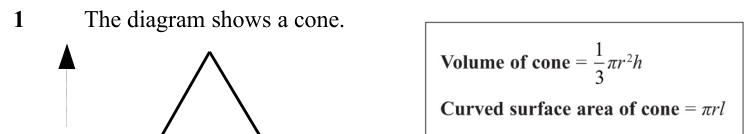
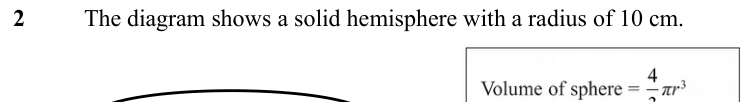
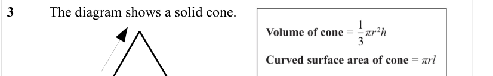
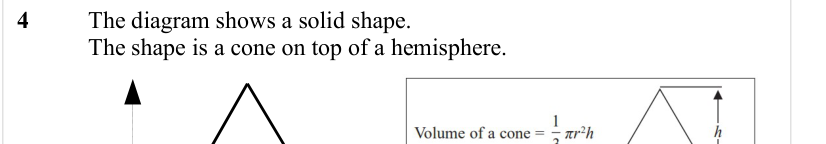
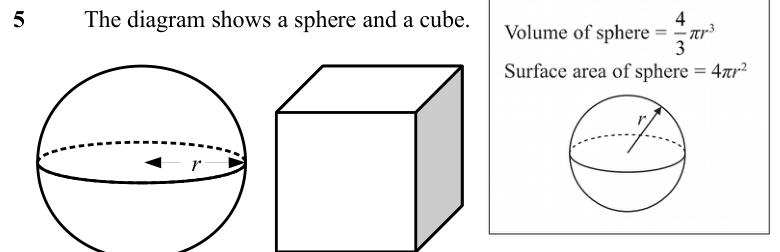
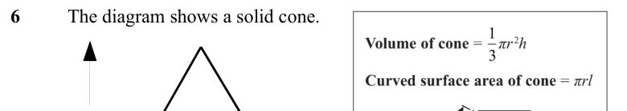
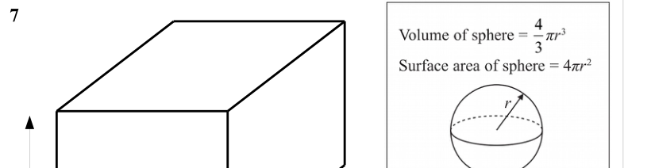

# Spheres and Cones — Exam Questions (GCSE Maths · Edexcel · Grade 5)

Topic code `5.16` · slug `grade-5-5-16-spheres-and-cones` · source sheet sha256 `e1006ad5f5b65f0b…`

## Q1 (marks not printed)

Text (lossy): 1 / The diagram shows a cone.

## Q2 (marks not printed)

Text (lossy): 2 / The diagram shows a solid hemisphere with a radius of 10 cm.

## Q3 (marks not printed)

Text (lossy): 3 / The diagram shows a solid cone.

## Q4 (marks not printed)

Text (lossy): 4 / The diagram shows a solid shape. / The shape is a cone on top of a hemisphere.

## Q5 (marks not printed)

Text (lossy): 5 / The diagram shows a sphere and a cube.  / r

## Q6 (marks not printed)

Text (lossy): 6 / The diagram shows a solid cone.

## Q7 (marks not printed)

Text (lossy): 7

