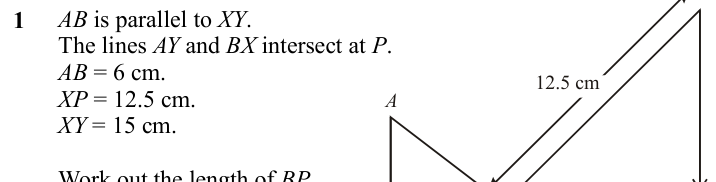
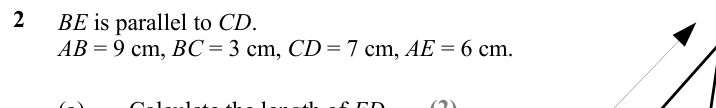
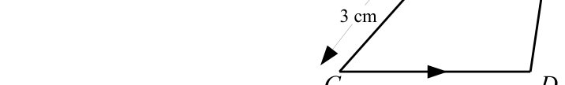
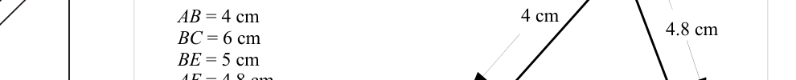
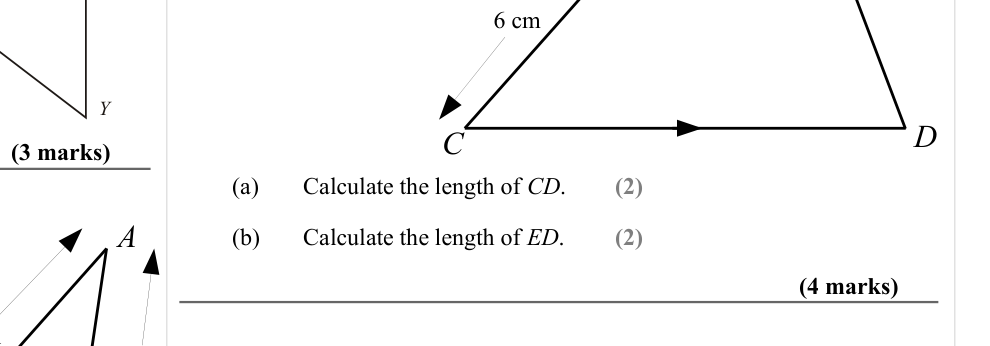
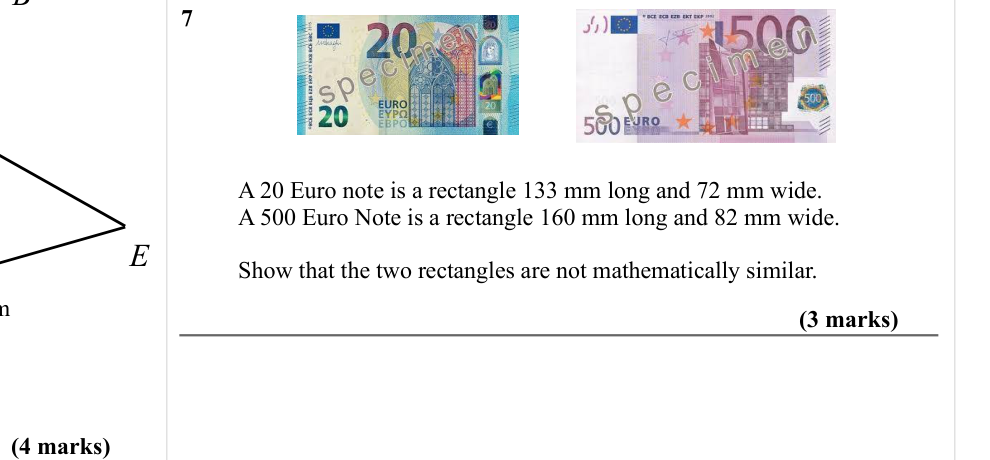

# Similar Shapes (Lengths) — Exam Questions (GCSE Maths · Edexcel · Grade 5)

Topic code `5.18` · slug `grade-5-5-18-similar-shapes-lengths` · source sheet sha256 `0f6e18770830b5cb…`

## Q1 (marks not printed)

Text (lossy): AB is parallel to XY. / The lines AY and BX intersect at P. / AB = 6 cm. / XP = 12.5 cm. / XY = 15 cm. / 1 / 12.5 cm / A / Work out the length of BP.

## Q2 (marks not printed · parts a)

Text (lossy): 2 / BE is parallel to CD. / AB = 9 cm, BC = 3 cm, CD = 7 cm, AE = 6 cm. / (2) / (a) / Calculate the length of ED.

## Q3 (marks not printed)

Text (lossy): 3 cm / C / D

## Q4 (marks not printed)

Text (lossy): 4 cm / 4.8 cm / AB = 4 cm / BC = 6 cm / BE = 5 cm / AE = 4.8 cm.

## Q5 (marks not printed)

Text (lossy): 5 cm

## Q6 (7 marks · parts a, b)

Text (lossy): 6 cm / Y / C / D / (3 marks) / (a) / Calculate the length of CD. / (2) / A / (b) / Calculate the length of ED. / (2) / (4 marks)

## Q7 (7 marks)

Text (lossy): 7 / A 20 Euro note is a rectangle 133 mm long and 72 mm wide. / A 500 Euro Note is a rectangle 160 mm long and 82 mm wide. / E / Show that the two rectangles are not mathematically similar. / (3 marks) / (4 marks)

