# SOHCAHTOA (Trigonometry) — Exam Questions (GCSE Maths · Edexcel · Grade 5)

Topic code `5.19` · slug `grade-5-5-19-sohcahtoa-trigonometry` · source sheet sha256 `78ed9914406765a3…`

## Q1 (marks not printed)

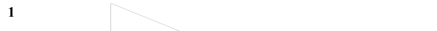

Text (lossy): 1

## Q2 (marks not printed)

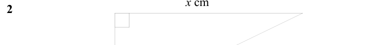

Text (lossy): 2

## Q3 (marks not printed)

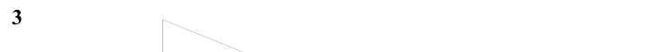

Text (lossy): 3

## Q4 (marks not printed)

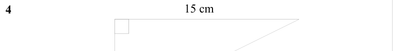

Text (lossy): 15 cm / 4

## Q5 (marks not printed)

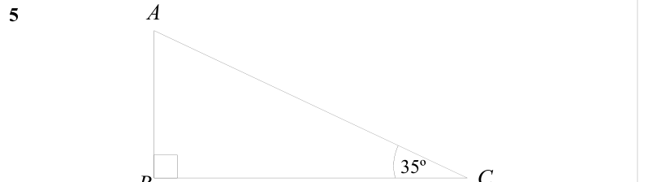

Text (lossy): 5     / 35º / C / B

## Q6 (marks not printed)

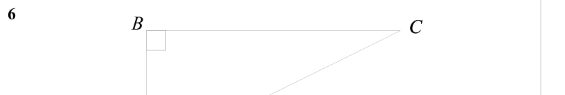

Text (lossy): 6     / C / B

## Q7 (marks not printed)

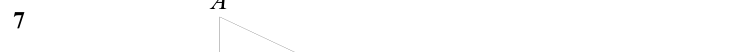

Text (lossy): 7

## Q8 (marks not printed)

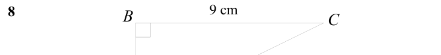

Text (lossy): 9 cm / 8     / C / B

## Q9 (marks not printed)

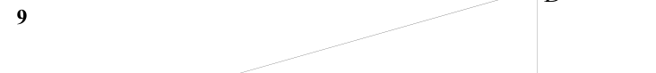

Text (lossy): 9

## Q10 (marks not printed)

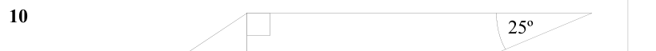

Text (lossy): 10     / 25º

## Q11 (marks not printed)

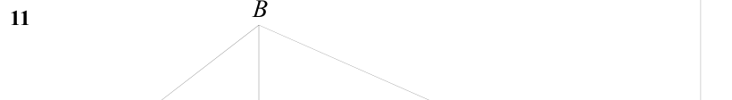

Text (lossy): 11

