# Exact trig values — Exam Questions (GCSE Maths · Edexcel · Grade 5)

Topic code `5.20` · slug `grade-5-5-20-exact-trig-values` · source sheet sha256 `ea09a131c89eb338…`

## Q1 (1 marks)

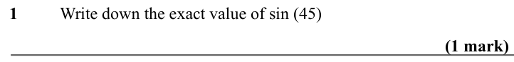

Text (lossy): 1 / Write down the exact value of sin (45)     / (1 mark)

## Q2 (1 marks)

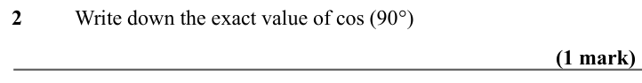

Text (lossy): 2 / Write down the exact value of cos (90°)     / (1 mark)

## Q3 (1 marks)

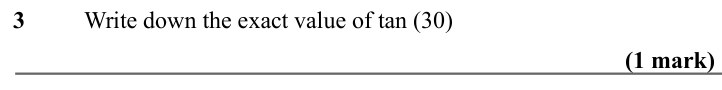

Text (lossy): 3 / Write down the exact value of tan (30)     / (1 mark)

## Q4 (1 marks)

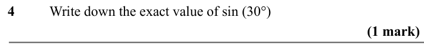

Text (lossy): 4 / Write down the exact value of sin (30°)     / (1 mark)

## Q5 (1 marks)

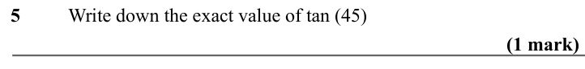

Text (lossy): 5 / Write down the exact value of tan (45)     / (1 mark)

## Q6 (1 marks)

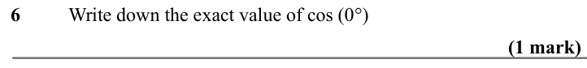

Text (lossy): 6 / Write down the exact value of cos (0°)     / (1 mark)

## Q7 (1 marks)

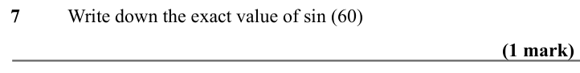

Text (lossy): 7 / Write down the exact value of sin (60)     / (1 mark)

## Q8 (1 marks)

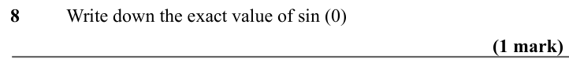

Text (lossy): 8 / Write down the exact value of sin (0)     / (1 mark)

## Q9 (1 marks)

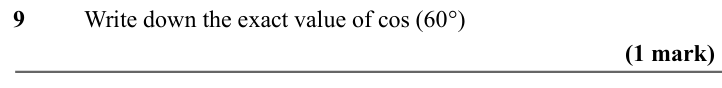

Text (lossy): 9 / Write down the exact value of cos (60°)     / (1 mark)

## Q10 (1 marks)

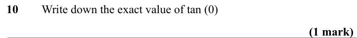

Text (lossy): 10 / Write down the exact value of tan (0)     / (1 mark)

## Q11 (1 marks)

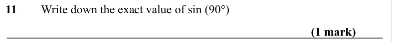

Text (lossy): 11 / Write down the exact value of sin (90°)     / (1 mark)

## Q12 (1 marks)

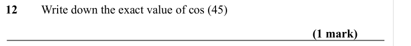

Text (lossy): 12 / Write down the exact value of cos (45)     / (1 mark)

## Q13 (1 marks)

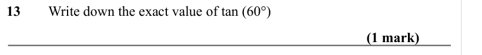

Text (lossy): 13 / Write down the exact value of tan (60°)     / (1 mark)

## Q14 (1 marks)

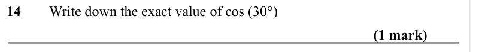

Text (lossy): 14 / Write down the exact value of cos (30°)     / (1 mark)

## Q15 (marks not printed)

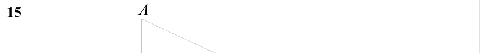

Text (lossy): 15

## Q16 (marks not printed)

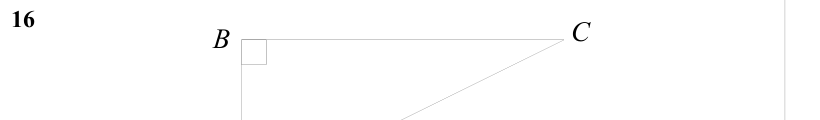

Text (lossy): 16     / C / B

