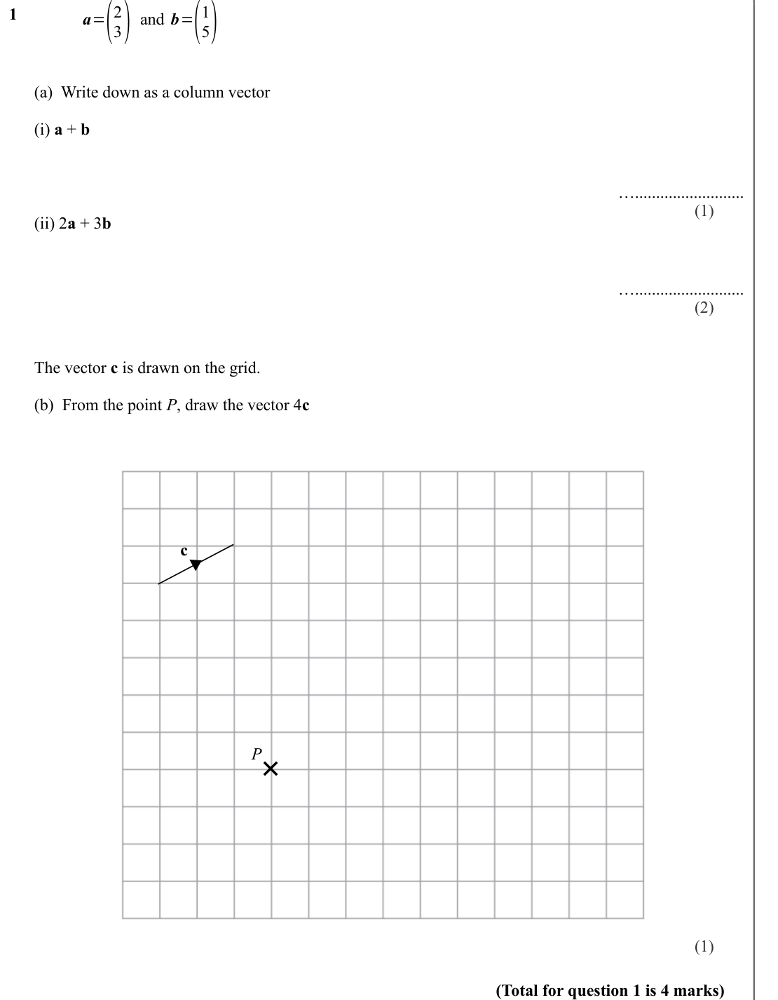
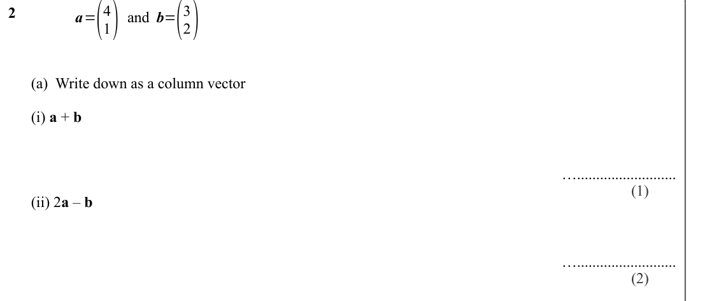
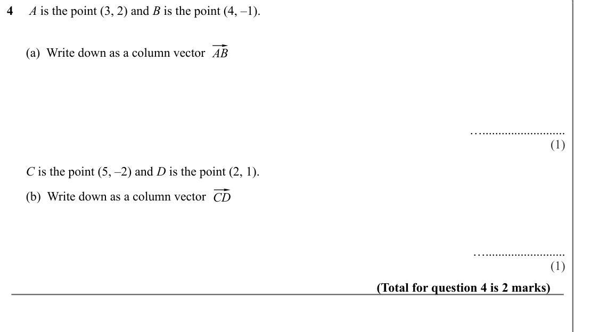
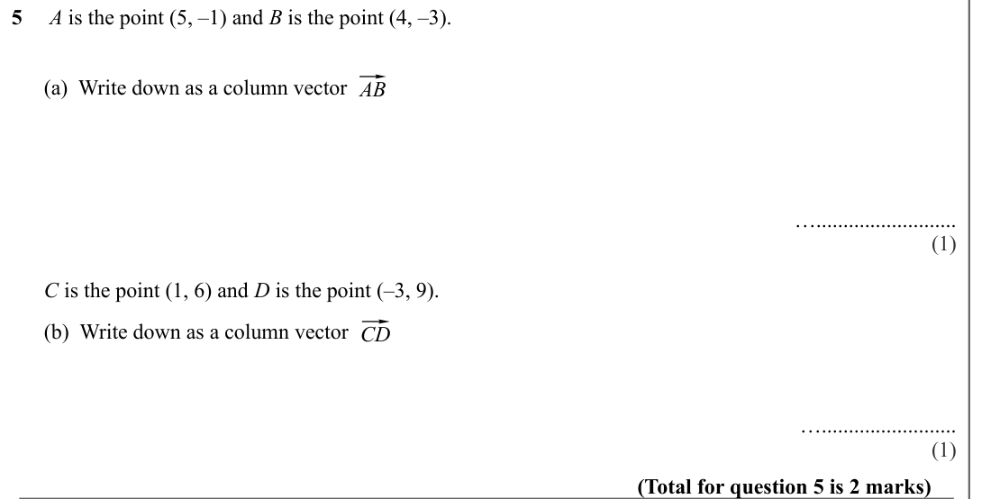
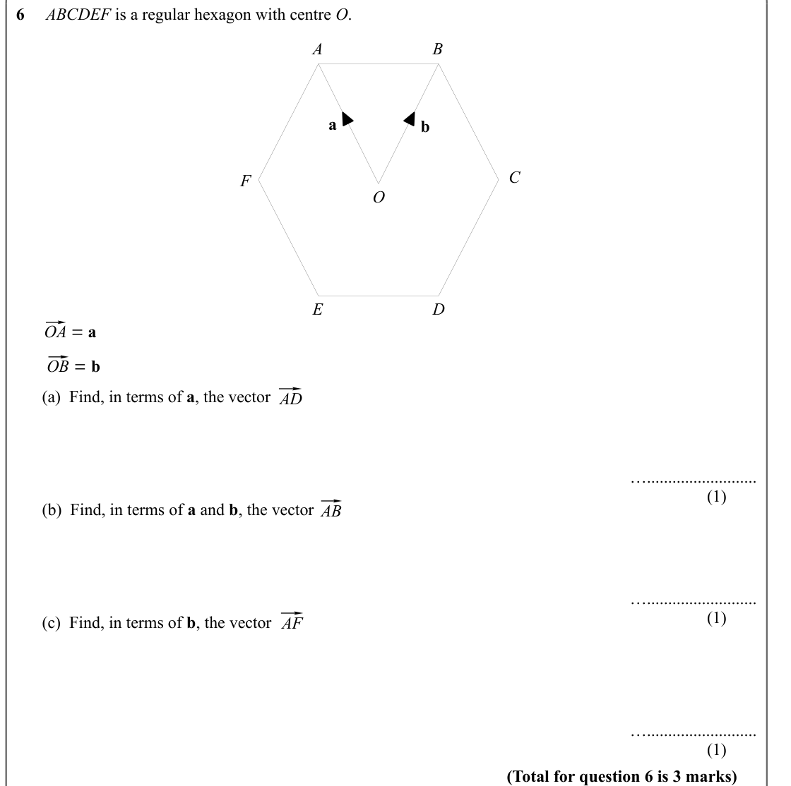
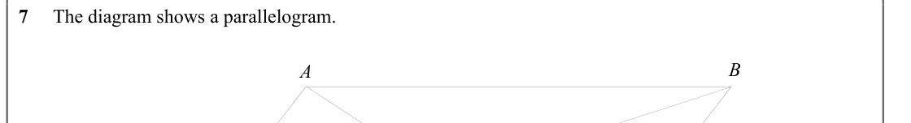
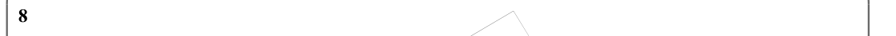
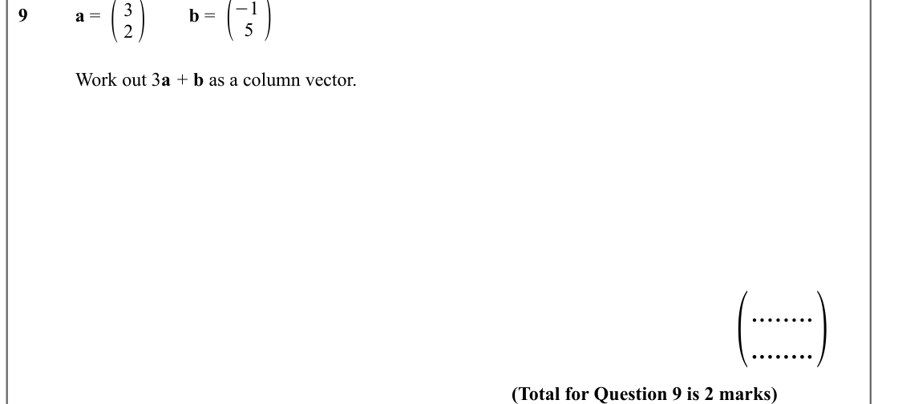

# Vectors — Exam Questions (GCSE Maths · Edexcel · Grade 5)

Topic code `5.21` · slug `grade-5-5-21-vectors` · source sheet sha256 `d9935c8b949446ae…`

## Q1 (marks not printed · parts a, b)

Text (lossy): 1     /    /       (a)  Write down as a column vector /       (i) a + b / ….......................... / (1) /       (ii) 2 a + 3 b / ….......................... / (2) /    /       The vector c is drawn on the grid.  /       (b)  From the point P, draw the vector 4 c / c / P / Ï / (1) / (Total for question 1 is 4 marks)

## Q2 (marks not printed · parts a)

Text (lossy): 2     /    /       (a)  Write down as a column vector /       (i) a + b / ….......................... / (1) /       (ii) 2 a – b / ….......................... / (2)

## Q3 (marks not printed)

## Q4 (marks not printed · parts a, b)

Text (lossy): 4     A is the point (3, 2) and B is the point (4, –1). /    /       (a)  Write down as a column vector / ⃗ / AB /         /   / ….......................... / (1) /       C is the point (5, –2) and D is the point (2, 1). /    /       (b)  Write down as a column vector / ⃗ / CD /         /   / …......................... / (1) / (Total for question 4 is 2 marks)

## Q5 (marks not printed · parts a, b)

Text (lossy): 5     A is the point (5, –1) and B is the point (4, –3). /    /       (a)  Write down as a column vector / ⃗ / AB /         /   / ….......................... / (1) /       C is the point (1, 6) and D is the point (–3, 9). /    /       (b)  Write down as a column vector / ⃗ / CD /         /   / …......................... / (1) / (Total for question 5 is 2 marks)

## Q6 (marks not printed · parts a, b, c)

Text (lossy): 6     ABCDEF is a regular hexagon with centre O.  / A / B / a / b / C / F / O / D / E / ⃗ / OA = a  / ⃗ / OB = b  /    /         (a)  Find, in terms of a, the vector / ⃗ / AD / ….......................... / (1) / ⃗ / AB /         (b)  Find, in terms of a and b, the vector / ….......................... / (1) / ⃗ / AF /         (c)  Find, in terms of b, the vector /   / ….......................... /

## Q7 (marks not printed)

Text (lossy): 7     The diagram shows a parallelogram. / B / A

## Q8 (marks not printed)

Text (lossy): 8

## Q9 (marks not printed)

Text (lossy): 9  / a =  / b =  / Work out 3 a + b as a column vector. / ( / ........ / ........) / (Total for Question 9 is 2 marks)

