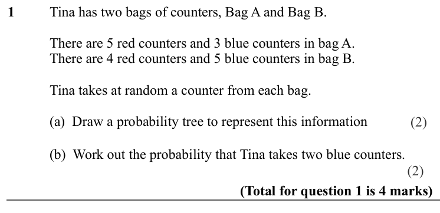
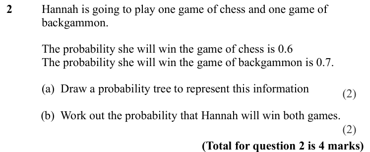
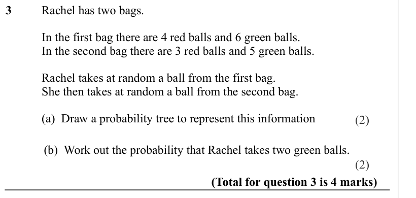
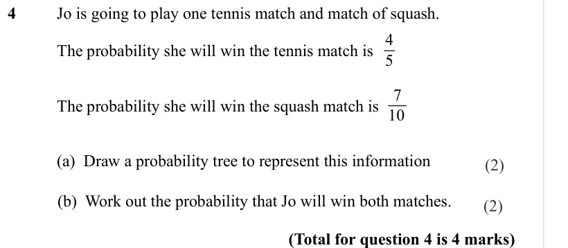
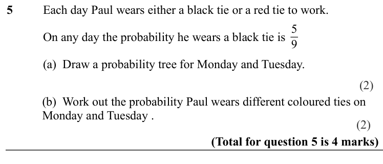
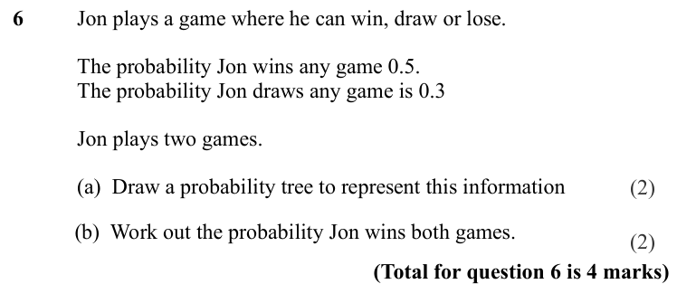
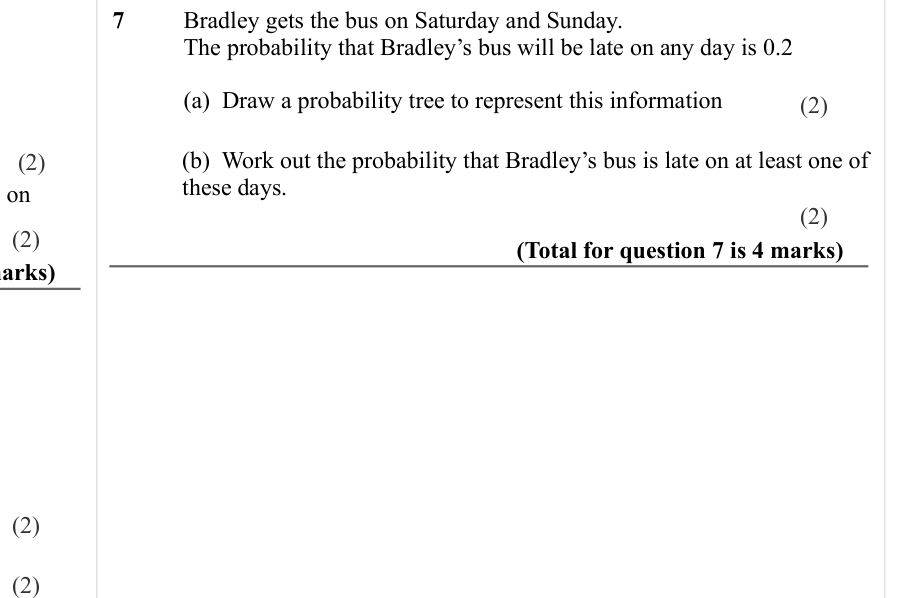

# Probability Trees — Exam Questions (GCSE Maths · Edexcel · Grade 5)

Topic code `5.22` · slug `grade-5-5-22-probability-trees` · source sheet sha256 `e74cca113bd09d3c…`

## Q1 (marks not printed · parts a, b)

Text (lossy): 1     / Tina has two bags of counters, Bag A and Bag B.  /        / There are 5 red counters and 3 blue counters in bag A.  /        / There are 4 red counters and 5 blue counters in bag B.  /        / Tina takes at random a counter from each bag.   /        / (a)  Draw a probability tree to represent this information  / (2) /    /       / (b)  Work out the probability that Tina takes two blue cou

## Q2 (marks not printed · parts a, b)

Text (lossy): 2     / Hannah is going to play one game of chess and one game of  / backgammon.  / The probability she will win the game of chess is 0.6 / The probability she will win the game of backgammon is 0.7. /        / (a)  Draw a probability tree to represent this information  / (2) /    /       / (b)  Work out the probability that Hannah will win both games.  / (2) / (Total for question 2 is 4 marks)

## Q3 (marks not printed · parts a, b)

Text (lossy): 3     / Rachel has two bags. / In the first bag there are 4 red balls and 6 green balls.  / In the second bag there are 3 red balls and 5 green balls.  / Rachel takes at random a ball from the first bag.  / She then takes at random a ball from the second bag.  /        / (a)  Draw a probability tree to represent this information  / (2) /    /       / (b)  Work out the probability that Rachel takes

## Q4 (marks not printed · parts a, b)

Text (lossy): 4     / Jo is going to play one tennis match and match of squash.  / 4 / 5 / The probability she will win the tennis match is / 7 / 10 / The probability she will win the squash match is   /        / (a)  Draw a probability tree to represent this information  / (2) /    /       / (b)  Work out the probability that Jo will win both matches.  / (2) / (Total for question 4 is 4 marks)

## Q5 (marks not printed · parts a, b)

Text (lossy): 5     / Each day Paul wears either a black tie or a red tie to work. / 5 / 9 / On any day the probability he wears a black tie is  /       / (a)  Draw a probability tree for Monday and Tuesday.   /    /       / (b)  Work out the probability Paul wears different coloured ties on  / Monday and Tuesday .  / (Total for question 5 is 4 marks)

## Q6 (marks not printed · parts a, b)

Text (lossy): 6     / Jon plays a game where he can win, draw or lose.  / The probability Jon wins any game 0.5.  / The probability Jon draws any game is 0.3 / Jon plays two games.  /        / (a)  Draw a probability tree to represent this information  /    /       / (b)  Work out the probability Jon wins both games.  / (Total for question 6 is 4 marks)

## Q7 (marks not printed · parts a, b)

Text (lossy): 7     / Bradley gets the bus on Saturday and Sunday.  / The probability that Bradley’s bus will be late on any day is 0.2 /        / (a)  Draw a probability tree to represent this information  / (2) /    /       / (b)  Work out the probability that Bradley’s bus is late on at least one of  / these days. / (2) / (2) / (2) / (Total for question 7 is 4 marks) / (2) / (2)

