# Venn Diagrams — Exam Questions (GCSE Maths · Edexcel · Grade 5)

Topic code `5.23` · slug `grade-5-5-23-venn-diagrams` · source sheet sha256 `dec9687b3a1a80a6…`

## Q1 (marks not printed)

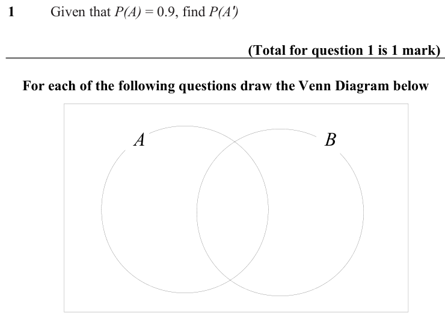

Text (lossy): 1  / Given that P(A) = 0.9, find P(A') / (Total for question 1 is 1 mark) /     For each of the following questions draw the Venn Diagram below / A / B

## Q2 (1 marks)

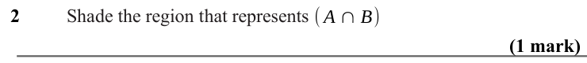

Text (lossy): 2  / Shade the region that represents / ( A ∩B) / (1 mark)

## Q3 (1 marks)

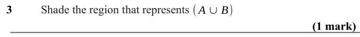

Text (lossy): 3  / Shade the region that represents ( A ∪B) / (1 mark)

## Q4 (1 marks)

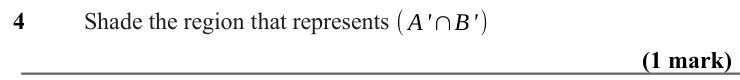

Text (lossy): 4  / Shade the region that represents ( A'∩B') / (1 mark)

## Q5 (1 marks)

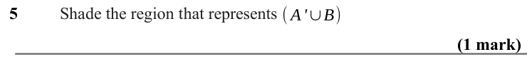

Text (lossy): 5  / Shade the region that represents ( A'∪B) / (1 mark)

## Q6 (1 marks)

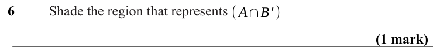

Text (lossy): 6  / Shade the region that represents ( A∩B' ) / (1 mark)

## Q7 (marks not printed)

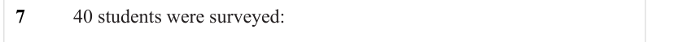

Text (lossy): 7  / 40 students were surveyed:

## Q8 (marks not printed)

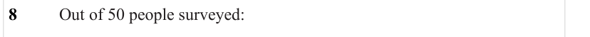

Text (lossy): 8  / Out of 50 people surveyed:

## Q9 (marks not printed)

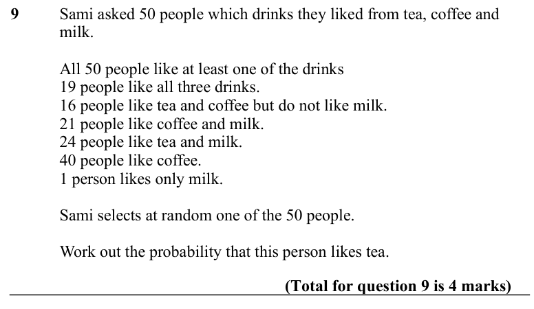

Text (lossy): 9 / Sami asked 50 people which drinks they liked from tea, coffee and  / milk. / All 50 people like at least one of the drinks / 19 people like all three drinks. / 16 people like tea and coffee but do not like milk. / 21 people like coffee and milk. / 24 people like tea and milk. / 40 people like coffee. / 1 person likes only milk. / Sami selects at random one of the 50 people. / Work out the prob

## Q10 (marks not printed)

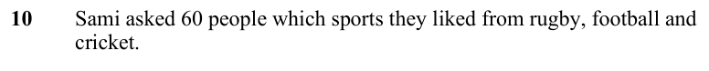

Text (lossy): 10 / Sami asked 60 people which sports they liked from rugby, football and  / cricket.

## Q11 (marks not printed · parts a, b)

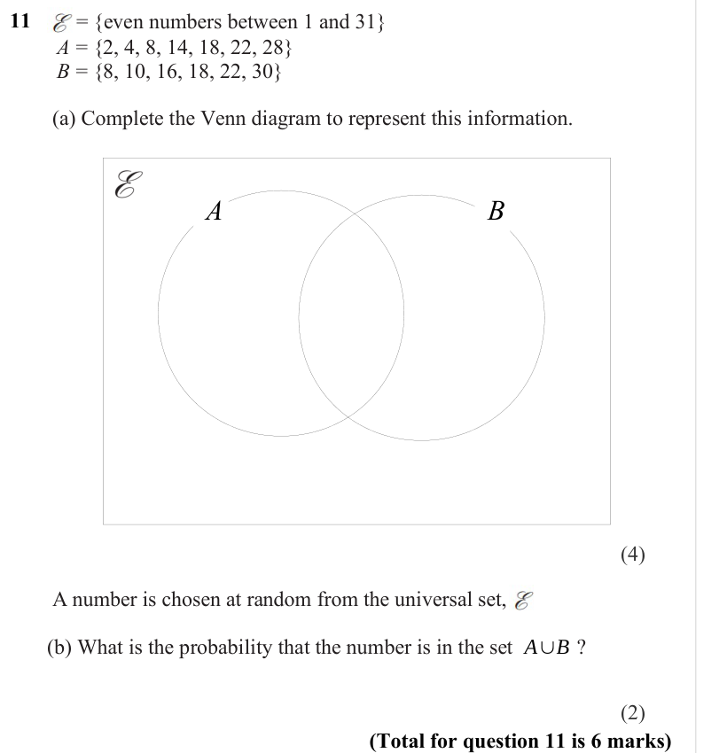

Text (lossy): 11     /              = {even numbers between 1 and 31} /        A = {2, 4, 8, 14, 18, 22, 28} /        B = {8, 10, 16, 18, 22, 30} /        (a) Complete the Venn diagram to represent this information. / A / B / (4) /         A number is chosen at random from the universal set,     . / A∪B /        (b) What is the probability that the number is in the set            ? / (2) / (Total for question 1

## Q12 (marks not printed)

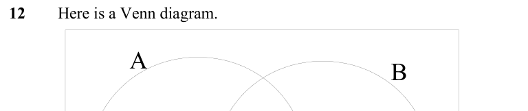

Text (lossy): 12     Here is a Venn diagram.  / A / B

## Q13 (marks not printed)

Text (lossy): 7 / 13

