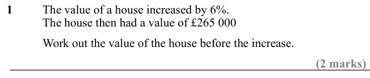
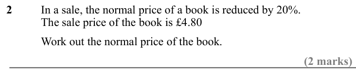
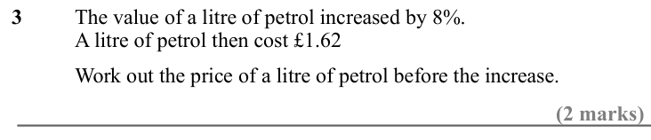
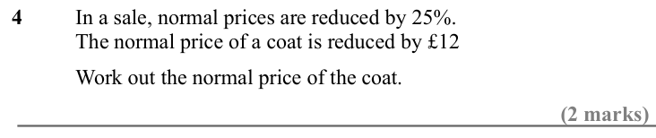
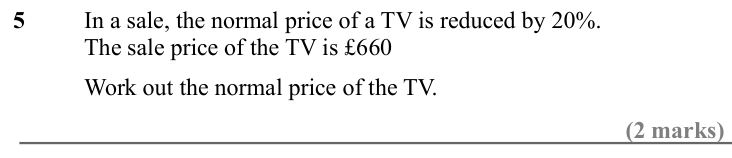
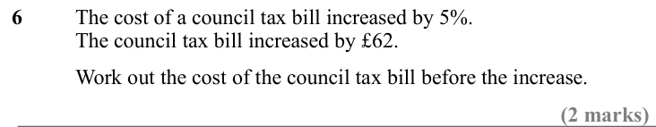
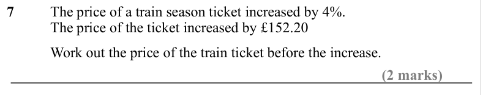
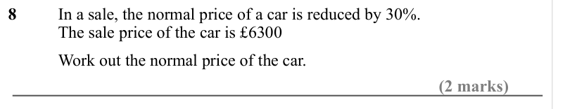
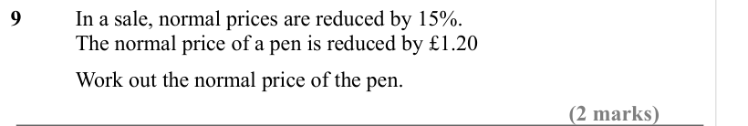

# Reverse Percentages — Exam Questions (GCSE Maths · Edexcel · Grade 5)

Topic code `5.3` · slug `grade-5-5-3-reverse-percentages` · source sheet sha256 `ea00e4bdd9b24bb8…`

## Q1 (2 marks)

Text (lossy): 1 / The value of a house increased by 6%. / The house then had a value of £265 000 / Work out the value of the house before the increase. / (2 marks)

## Q2 (2 marks)

Text (lossy): 2 / In a sale, the normal price of a book is reduced by 20%. / The sale price of the book is £4.80 / Work out the normal price of the book. / (2 marks)

## Q3 (2 marks)

Text (lossy): 3  / The value of a litre of petrol increased by 8%. / A litre of petrol then cost £1.62 / Work out the price of a litre of petrol before the increase. / (2 marks)

## Q4 (2 marks)

Text (lossy): 4 / In a sale, normal prices are reduced by 25%. / The normal price of a coat is reduced by £12 / Work out the normal price of the coat. / (2 marks)

## Q5 (2 marks)

Text (lossy): 5 / In a sale, the normal price of a TV is reduced by 20%. / The sale price of the TV is £660 / Work out the normal price of the TV. / (2 marks)

## Q6 (2 marks)

Text (lossy): 6 / The cost of a council tax bill increased by 5%. / The council tax bill increased by £62. / Work out the cost of the council tax bill before the increase. / (2 marks)

## Q7 (2 marks)

Text (lossy): 7 / The price of a train season ticket increased by 4%. / The price of the ticket increased by £152.20 / Work out the price of the train ticket before the increase. / (2 marks)

## Q8 (2 marks)

Text (lossy): 8 / In a sale, the normal price of a car is reduced by 30%. / The sale price of the car is £6300 / Work out the normal price of the car. / (2 marks)

## Q9 (2 marks)

Text (lossy): 9   / In a sale, normal prices are reduced by 15%. / The normal price of a pen is reduced by £1.20 / Work out the normal price of the pen. / (2 marks)

