# Standard Form — Exam Questions (GCSE Maths · Edexcel · Grade 5)

Topic code `5.4` · slug `grade-5-5-4-standard-form` · source sheet sha256 `8f24aed3a53c89d7…`

## Q1 (marks not printed · parts a, b)

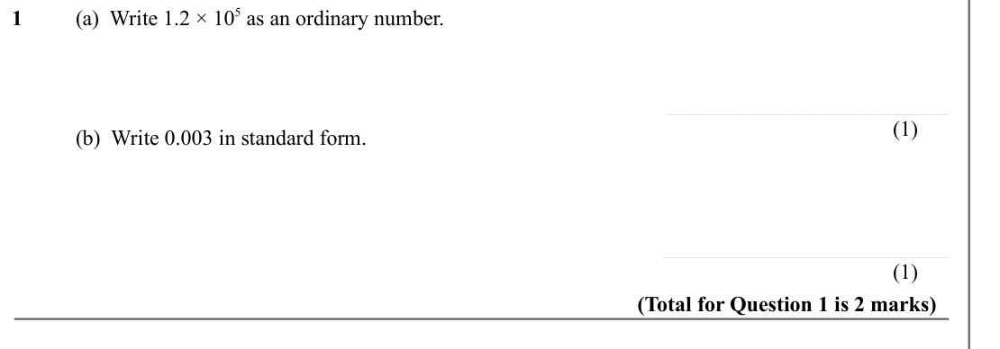

Text (lossy): 1      / (a)  Write 1.2 × 10 5 as an ordinary number.  / (1) / (b)  Write 0.003 in standard form.  / (1) / (Total for Question 1 is 2 marks)

## Q2 (marks not printed · parts a, b)

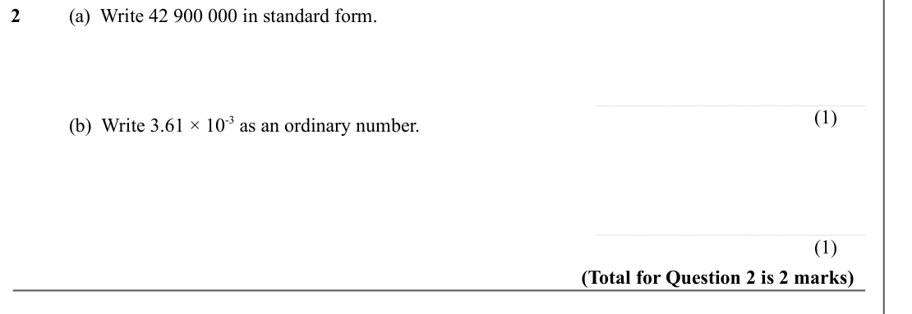

Text (lossy): 2      / (a)  Write 42 900 000 in standard form.  / (1) / (b)  Write 3.61 × 10-3 as an ordinary number.  / (1) / (Total for Question 2 is 2 marks)

## Q3 (marks not printed · parts a, b, c)

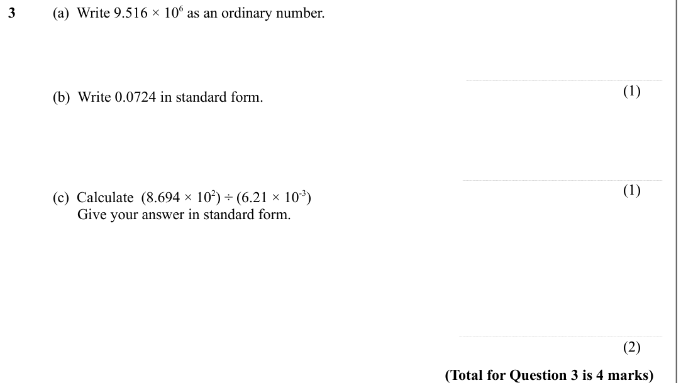

Text (lossy): 3      / (a)  Write 9.516 × 10 6 as an ordinary number.  / (1) / (b)  Write 0.0724 in standard form.  / (1) / (c)  Calculate  (8.694 × 10 2) ÷ (6.21 × 10-3) /        Give your answer in standard form.  / (2) / (Total for Question 3 is 4 marks)

## Q4 (marks not printed · parts a, b)

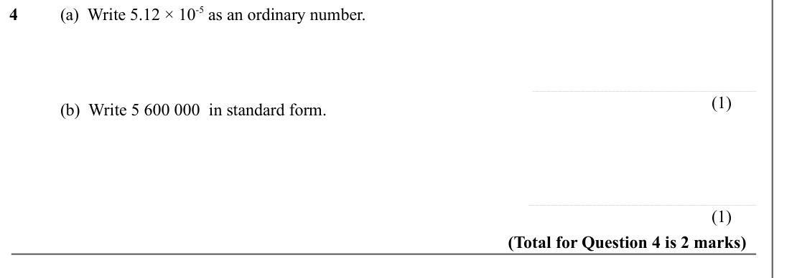

Text (lossy): 4      / (a)  Write 5.12 × 10-5 as an ordinary number.  / (1) / (b)  Write 5 600 000  in standard form.  / (1) / (Total for Question 4 is 2 marks)

## Q5 (marks not printed · parts a, b)

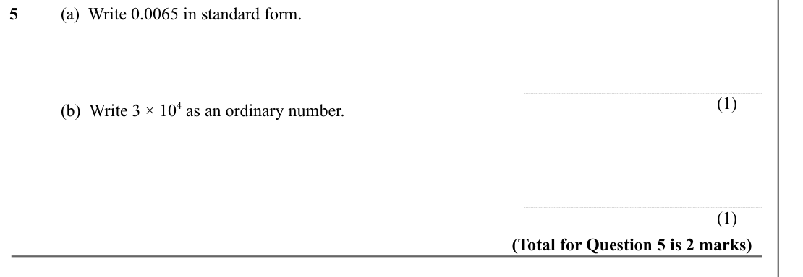

Text (lossy): 5      / (a)  Write 0.0065 in standard form.  / (1) / (b)  Write 3 × 10 4 as an ordinary number.  / (1) / (Total for Question 5 is 2 marks)

## Q6 (marks not printed · parts a, b, c)

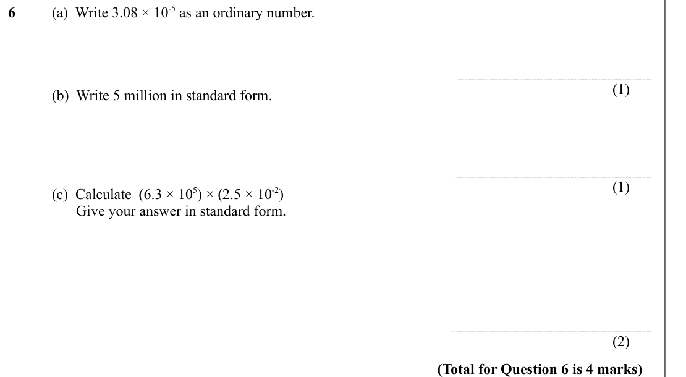

Text (lossy): 6      / (a)  Write 3.08 × 10-5 as an ordinary number.  / (1) / (b)  Write 5 million in standard form.  / (1) / (c)  Calculate  (6.3 × 10 5) × (2.5 × 10-2) /        Give your answer in standard form.  / (2) / (Total for Question 6 is 4 marks)

## Q7 (marks not printed)

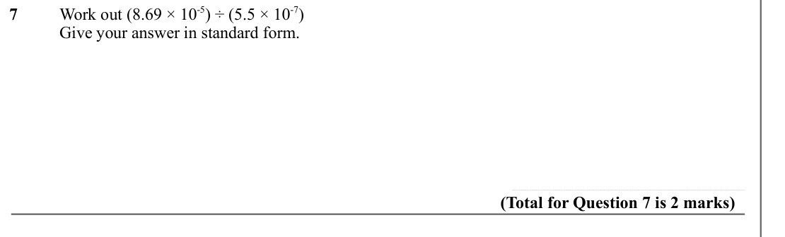

Text (lossy): 7      / Work out (8.69 × 10-5) ÷ (5.5 × 10-7) / Give your answer in standard form.  / (Total for Question 7 is 2 marks)

## Q8 (marks not printed · parts a, b)

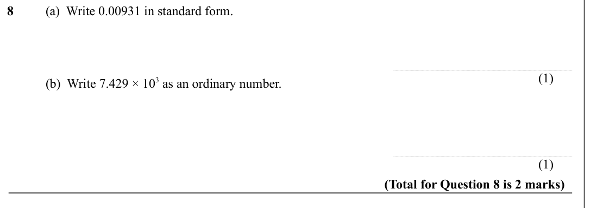

Text (lossy): 8      / (a)  Write 0.00931 in standard form.  / (1) / (b)  Write 7.429 × 10 3 as an ordinary number.  / (1) / (Total for Question 8 is 2 marks)

## Q9 (marks not printed · parts a, b)

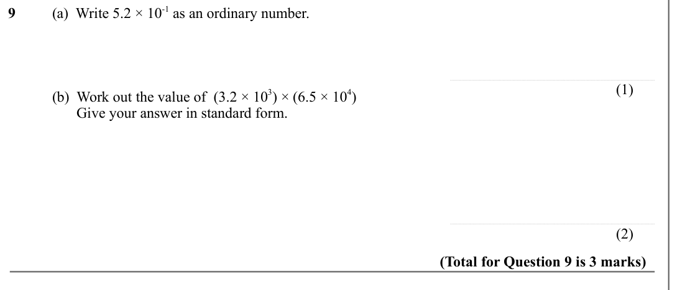

Text (lossy): 9      / (a)  Write 5.2 × 10-1 as an ordinary number.  / (1) / (b)  Work out the value of  (3.2 × 10 3) × (6.5 × 10 4) /        Give your answer in standard form.  / (2) / (Total for Question 9 is 3 marks)

## Q10 (marks not printed)

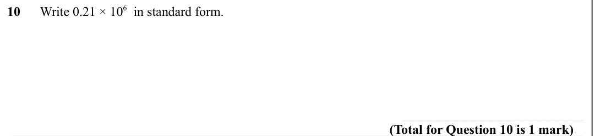

Text (lossy): 10      Write 0.21 × 10 6  in standard form. / (Total for Question 10 is 1 mark)

## Q11 (marks not printed)

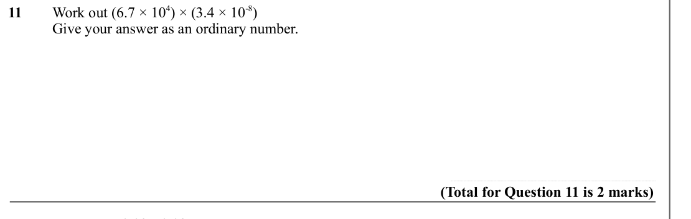

Text (lossy): 11     Work out (6.7 × 10 4) × (3.4 × 10-8) / Give your answer as an ordinary number.  / (Total for Question 11 is 2 marks) / 0.03×0.02

## Q12 (marks not printed)

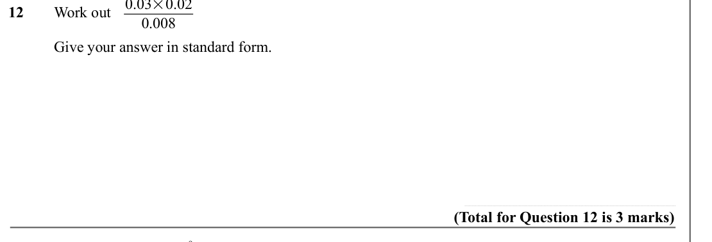

Text (lossy): 12     Work out   / 0.008 / Give your answer in standard form.  / (Total for Question 12 is 3 marks) / 3.744×10 9

## Q13 (marks not printed)

Text (lossy): 13     Work out

## Q14 (marks not printed)

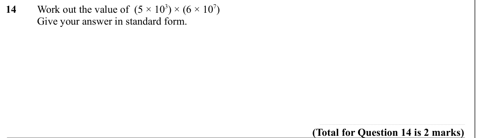

Text (lossy): 14     Work out the value of  (5 × 10 3) × (6 × 10 7) / Give your answer in standard form.  / (Total for Question 14 is 2 marks)

## Q15 (marks not printed · parts b, c)

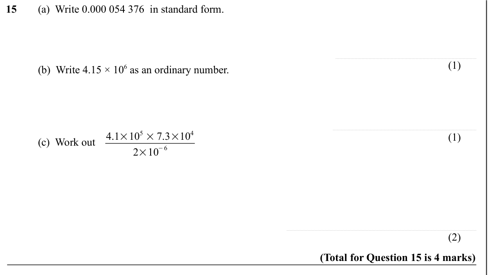

Text (lossy): 15     (a)  Write 0.000 054 376  in standard form.  / (1) / (b)  Write 4.15 × 10 6 as an ordinary number.  / 4.1×10 5 × 7.3×10 4 / (c)  Work out  / (1) / −6 / 2×10 / (2) / (Total for Question 15 is 4 marks)

## Q16 (marks not printed)

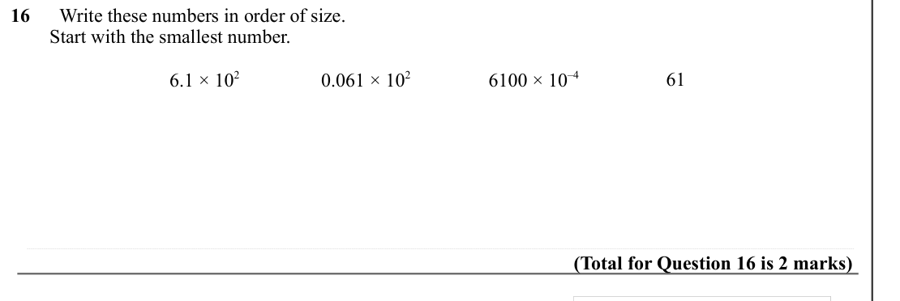

Text (lossy): 16      Write these numbers in order of size.  /         Start with the smallest number. / 6.1 × 10 2 / 0.061 × 10 2 / 6100 × 10–4 / 61 / (Total for Question 16 is 2 marks)

## Q17 (marks not printed)

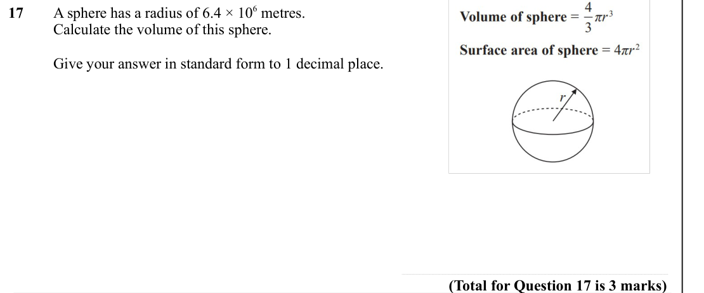

Text (lossy): 17     A sphere has a radius of 6.4 × 10 6 metres.  /          / Calculate the volume of this sphere.  / Give your answer in standard form to 1 decimal place.  / (Total for Question 17 is 3 marks)

## Q18 (marks not printed)

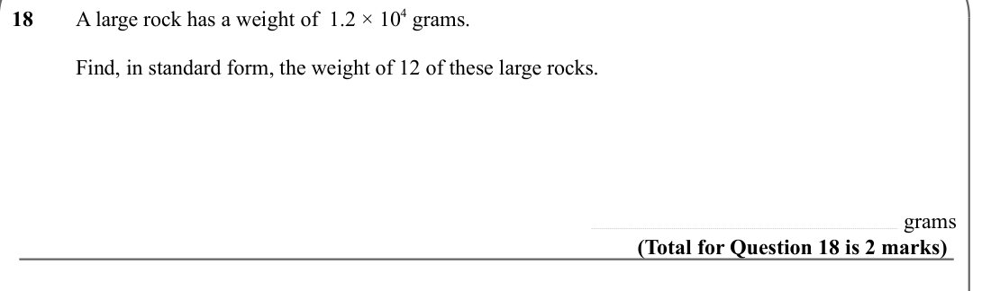

Text (lossy): 18   / A large rock has a weight of  1.2 × 10 4 grams. /         / Find, in standard form, the weight of 12 of these large rocks.  / grams / (Total for Question 18 is 2 marks)

## Q19 (marks not printed)

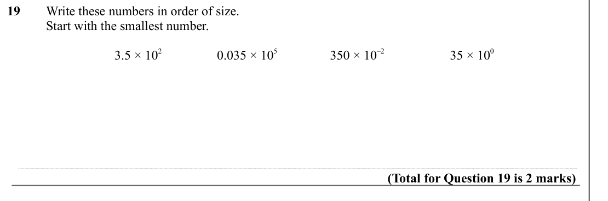

Text (lossy): 19      Write these numbers in order of size.  /          / Start with the smallest number. / 3.5 × 10 2 / 0.035 × 10 5 / 350 × 10–2 / 35 × 10 0 / (Total for Question 19 is 2 marks)

## Q20 (marks not printed)

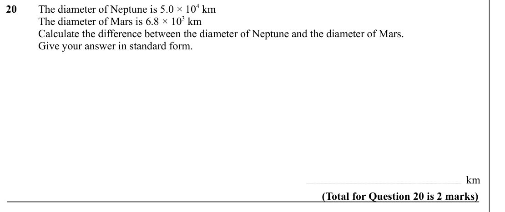

Text (lossy): 20     / The diameter of Neptune is 5.0 × 10 4 km / The diameter of Mars is 6.8 × 10 3 km / Calculate the difference between the diameter of Neptune and the diameter of Mars.  / Give your answer in standard form. / km  / (Total for Question 20 is 2 marks)

## Q21 (marks not printed)

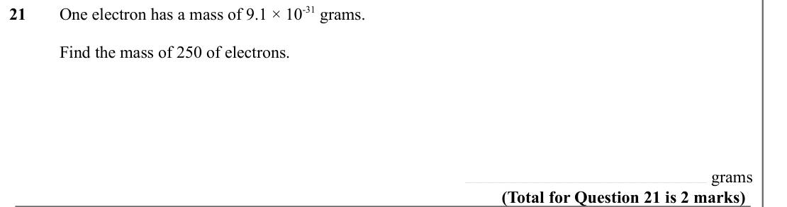

Text (lossy): 21    / One electron has a mass of 9.1 × 10-31 grams. /         / Find the mass of 250 of electrons.  / grams / (Total for Question 21 is 2 marks)

## Q22 (marks not printed)

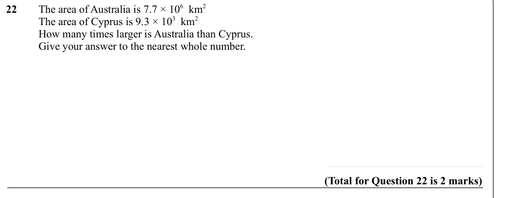

Text (lossy): 22     The area of Australia is 7.7 × 10 6  km 2 / The area of Cyprus is 9.3 × 10 3  km 2 / How many times larger is Australia than Cyprus.  / Give your answer to the nearest whole number.  / (Total for Question 22 is 2 marks)

## Q23 (marks not printed)

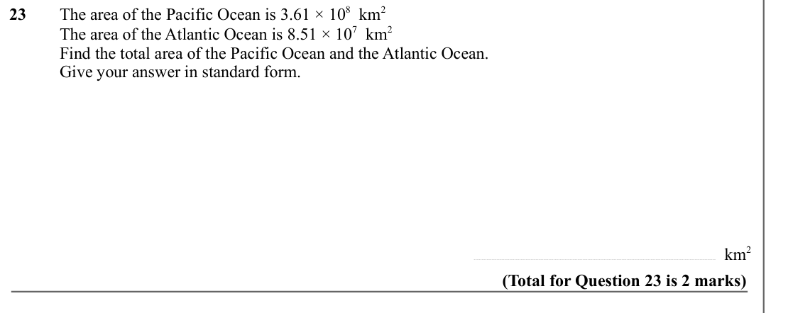

Text (lossy): 23     The area of the Pacific Ocean is 3.61 × 10 8  km 2 / The area of the Atlantic Ocean is 8.51 × 10 7  km 2 / Find the total area of the Pacific Ocean and the Atlantic Ocean. / Give your answer in standard form.  / km 2  / (Total for Question 23 is 2 marks)

## Q24 (marks not printed)

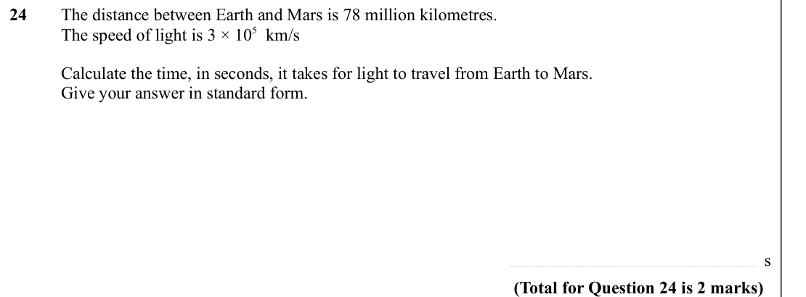

Text (lossy): 24     The distance between Earth and Mars is 78 million kilometres.  / The speed of light is 3 × 10 5  km/s / Calculate the time, in seconds, it takes for light to travel from Earth to Mars. / Give your answer in standard form.  / s / (Total for Question 24 is 2 marks)

